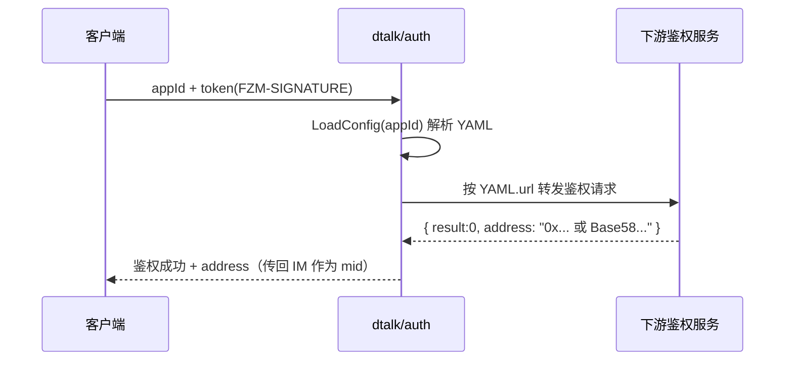

# 基于 appId 可切换地址格式（ETH/BTC）可行性方案

## 核心结论

- appId 是“租户/应用路由键”。dtalk/auth 会按 appId 读取数据库中的 YAML 配置并调用对应的下游鉴权服务；IM 将下游返回的 `address` 原样作为用户身份（mid）。
- 切换地址格式（ETH/BTC）无需改动 IM 或 dtalk 鉴权主流程，只需：
  - 为不同 appId 配不同的 `app_config`（指向返回 ETH 或 BTC 地址的鉴权接口），或
  - 让同一鉴权接口按 appId 分支返回不同格式的地址。

---

## 入口（代码位置）

- 鉴权主流程（dtalk）

```text
dtalk/service/auth/service/auth.go
func (s *Service) Auth(request *model.AuthRequest) {...}
- 解析 token（timestamp*appId） → 校验时效/摘要
- 依据 appId 读取 MySQL 中的 app_config（YAML）
- 解析 YAML 并调用配置的下游鉴权 URL
- 从响应中按 uid_name 取 address，回传给 IM
```

- 配置加载（MySQL）

```text
dtalk/service/auth/dao/db.go
_LoadConfig = "SELECT app_config FROM dtalk_ver_auth WHERE app_id=?"
_GetKey     = "SELECT app_key FROM dtalk_ver_auth WHERE app_id=?"
```

- 配置结构（YAML）

```text
dtalk/service/auth/model/app_config.go
type AppConfig struct {
  BasicConfig struct{ Method, Url string } `yaml:"basic_config"`
  Request     struct{ TokenName string }   `yaml:"request"`
  Response    struct{
    UidName       string                      `yaml:"uid_name"`
    SuccessResult map[interface{}]interface{} `yaml:"success_result"`
  } `yaml:"response"`
}
```

- 示例 YAML

```text
dtalk/service/auth/config/example.yml
response:
  uid_name: address
  success_result:
    result: 0
```

- IM 映射（下游返回的 address → mid）

```text
im/logic/auth/dtalk/auth.go
uid = success.Address  // 作为用户身份返回给 IM（即 mid）
```

---

## 方案 A：多 appId → 多下游鉴权（强隔离）

为不同 appId 写入不同 `app_config`：

- appId=wallet-eth → `basic_config.url` 指向 ETH 登录鉴权（返回 `0x...` 地址）
- appId=wallet-btc → `basic_config.url` 指向 BTC 登录鉴权（返回 Base58 地址）

YAML 模板（ETH）：

```yaml
basic_config:
  method: POST
  url: https://auth.example.com/eth/login
request:
  token_name: FZM-SIGNATURE
response:
  uid_name: address      # 取响应中的 address 字段
  success_result:
    result: 0
```

YAML 模板（BTC）：

```yaml
basic_config:
  method: POST
  url: https://auth.example.com/btc/login
request:
  token_name: FZM-SIGNATURE
response:
  uid_name: address      # 取响应中的 address 字段
  success_result:
    result: 0
```

优点：租户隔离清晰、灰度与回滚方便；缺点：多配置/接口需运维。

---

## 方案 B：同一接口按 appId 分支（低改动）

一个下游鉴权服务支持按 appId 分支返回不同格式的地址（ETH/BTC），dtalk 无需变更，YAML 也仅需配置一次。

优点：统一接口，部署简；缺点：分支逻辑集中在同一个服务，需注意回归。

---

## Token 与安全

- 客户端本地用私钥对 `timestamp*appId` 签名生成 token；dtalk 校验时效与摘要后再调用下游。
- 下游负责基于签名/公钥恢复地址（ETH、BTC或自定义）并返回。

---

## 时序图



---

## 实施步骤（建议）

1) 建表/检查：确认存在 `dtalk_ver_auth(app_id, app_config, app_key, ...)`。

2) 写入配置：
- 为每个 appId 写入一条 row；
- `app_config` 存放 YAML 文本；`response.uid_name=address`；
- `basic_config.url` 指向对应的下游鉴权接口。

3) 客户端：握手时在 `AuthMsg` 中携带 `appId` 与 `token`。

4) 下游鉴权：按 appId 返回 ETH（0x 开头 40hex）或 BTC（Base58）的 `address`。

5) 验证：
- 使用 ETH appId 登录 → mid 形如 `0x...`；
- 使用 BTC appId 登录 → mid 形如 Base58。

---

## 回归与监控

- 回归：token 过期、success_result 判定、`uid_name` 字段变更兼容。
- 监控：鉴权成功率与错误分布；address 格式分布（0x/非0x）校验发布是否生效。

---

## 风险与缓解

- 下游响应字段名变更 → 通过 `response.uid_name` 可快速切换。
- 地址格式混用 → 在上层加格式校验（`0x[0-9a-fA-F]{40}` 或 Base58 解码）。
- 配置误发布 → 按 appId 灰度发布，并做好回滚预案（预存旧 YAML）。

---

## 验收标准

- ETH appId 登录返回 `0x` 地址，BTC appId 登录返回 Base58 地址。
- IM 映射的 mid 与预期格式一致，后续消息/同步流程正常。


