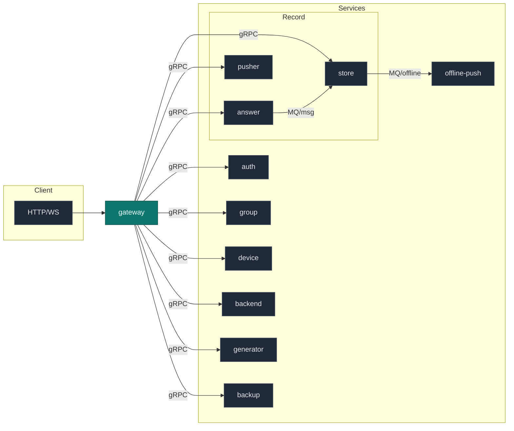
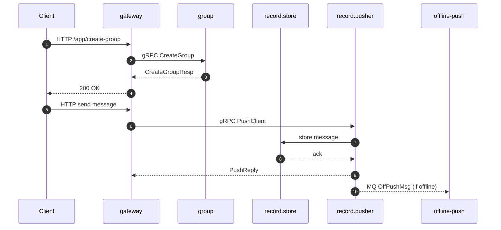

### dtalk 项目功能与 RPC 接口一览

> 本文档汇总项目功能、架构与各服务的 gRPC 接口方法；同时补充网关可见的主要 HTTP 能力链接，便于快速对接与排查。

## 项目概览

- **定位**: 去中心化/多模块即时通讯后台，聚合鉴权、群组、设备、版本管理、消息存储/分发、离线推送、备份等能力。
- **形态**: 多服务微服务化，通过 gRPC 内部互通，`gateway` 提供统一 HTTP 接入。
- **核心模块**:
  - `auth`: 第三方应用鉴权，签发/校验并映射为用户标识。
  - `group`: 群组全量能力（创建、成员、禁言、转让、解散、列表与信息查询等）。
  - `device`: 设备注册、查询、线程推送开关。
  - `backend`: 版本管理（创建、更新、上/下线、列表、更新检查）。
  - `generator`: 分布式 ID 生成。
  - `record`: 消息收发/存储子域（`answer` 入站接入、`pusher` 分发、`store` 存储与查询、`proto` MQ 协议）。
  - `offline-push`: 离线推送消息协议（供 MQ -> 推送通道使用）。
  - `backup`: 账户找回信息检索。

## 架构示意

## 技术栈

- **语言/框架**: Go, gRPC, Protobuf
- **网关/HTTP**: `gateway`（自研/Go），Nginx（容器内反代）
- **存储**: MySQL、Redis
- **消息队列**: Kafka（`record` 域内生产/消费）
- **对象存储**: Aliyun OSS、Huawei OBS、MinIO 适配（在 `pkg/oss`）
- **观测**: Prometheus 指标、Jaeger Trace（`script/trace`）
- **容器化**: Docker、Compose（`script/compose`）

---

## RPC 接口索引

以下列表来自各服务的 `.proto` 定义，按服务归档；请求/响应结构仅给出消息名，具体字段请参考相应 `*.proto`。

### auth 服务（`service/auth/api/auth.proto`）

- 服务: `Auth`
  - 方法: `DoAuth(AuthRequest) returns (AuthReply)`
  - 说明: 校验第三方应用凭据，返回内部用户 `uid`。

### backend 服务（版本管理）（`service/backend/api/api.proto`）

- 服务: `Generator`
  - 方法: `CreateVersion(CreateRequest) returns (CreateReply)`
  - 说明: 创建版本记录（其余检查/更新/变更状态/列表多通过 HTTP 网关暴露，见下方“HTTP 参考”）。

### backup 服务（`service/backup/api/api.proto`）

- 服务: `Backup`
  - 方法: `Retrieve(RetrieveReq) returns (RetrieveReply)`
  - 说明: 按手机号/邮箱/链上地址检索备份信息。

### device 服务（`service/device/api/api.proto`）

- 服务: `DeviceSrv`
  - 方法: `AddDevice(Device) returns (Empty)`
  - 方法: `EnableThreadPushDevice(EnableThreadPushDeviceRequest) returns (Empty)`
  - 方法: `GetUserAllDevices(GetUserAllDevicesRequest) returns (GetUserAllDevicesReply)`
  - 方法: `GetDeviceByConnId(GetDeviceByConnIdRequest) returns (Device)`
  - 说明: 设备注册/查询与线程推送开关。

### generator 服务（`service/generator/api/api.proto`）

- 服务: `Generator`
  - 方法: `GetID(Empty) returns (GetIDReply)`
  - 说明: 分布式 ID 生成。

### group 服务（`service/group/api/group.proto`）

- 服务: `Group`
  - 鉴权/校验类：
    - `GetGroupIds(GetGroupIdsRequest) returns (GetGroupIdsReply)`
    - `CheckInGroup(CheckInGroupRequest) returns (CheckInGroupReply)`
    - `GetMemberIds(GetMemberIdsRequest) returns (GetMemberIdsReply)`
    - `CheckMute(CheckMuteRequest) returns (CheckMuteReply)`
  - 查询类：
    - `GetGroups(GetGroupsReq) returns (GetGroupsResp)`
    - `GetMember(GetMemberReq) returns (GetMemberResp)`
    - `GetGroupInfo(GetGroupInfoReq) returns (GetGroupInfoResp)`
    - `GetPriGroupInfo(GetPriGroupInfoReq) returns (GetPriGroupInfoResp)`
    - `GetPubGroupInfo(GetPubGroupInfoReq) returns (GetPubGroupInfoResp)`
    - `GetGroupList(GetGroupListReq) returns (GetGroupListResp)`
    - `GetGroupMemberList(GetGroupMemberListReq) returns (GetGroupMemberListResp)`
    - `GetGroupMemberInfo(GetGroupMemberInfoReq) returns (GetGroupMemberInfoResp)`
    - `GetMuteList(GetMuteListReq) returns (GetMuteListResp)`
  - 变更类：
    - `CreateGroup(CreateGroupReq) returns (CreateGroupResp)`
    - `InviteGroupMembers(InviteGroupMembersReq) returns (InviteGroupMembersResp)`
    - `GroupExit(GroupExitReq) returns (GroupExitResp)`
    - `GroupDisband(GroupDisbandReq) returns (GroupDisbandResp)`
    - `GroupRemove(GroupRemoveReq) returns (GroupRemoveResp)`
    - `ChangeOwner(ChangeOwnerReq) returns (ChangeOwnerResp)`
    - `UpdateGroupName(UpdateGroupNameReq) returns (UpdateGroupNameResp)`
    - `UpdateGroupAvatar(UpdateGroupAvatarReq) returns (UpdateGroupAvatarResp)`
    - `UpdateGroupJoinType(UpdateGroupJoinTypeReq) returns (UpdateGroupJoinTypeResp)`
    - `UpdateGroupFriendType(UpdateGroupFriendTypeReq) returns (UpdateGroupFriendTypeResp)`
    - `UpdateGroupMuteType(UpdateGroupMuteTypeReq) returns (UpdateGroupMuteTypeResp)`
    - `UpdateGroupMemberName(UpdateGroupMemberNameReq) returns (UpdateGroupMemberNameResp)`
    - `SetAdmin(SetAdminReq) returns (SetAdminResp)`
    - `UpdateGroupMemberMuteTime(UpdateGroupMemberMuteTimeReq) returns (UpdateGroupMemberMuteTimeResp)`
  - 第三方/运维强制操作：
    - `ForceUpdateGroupType(ForceUpdateGroupTypeReq) returns (ForceUpdateGroupTypeResp)`
    - `ForceDisbandGroup(ForceDisbandGroupReq) returns (ForceDisbandGroupResp)`
    - `ForceAddMember(ForceAddMemberReq) returns (ForceAddMemberResp)`
    - `ForceAddMembers(ForceAddMembersReq) returns (ForceAddMembersResp)`
    - `ForceDeleteMember(ForceDeleteMemberReq) returns (ForceDeleteMemberResp)`
    - `ForceDeleteMembers(ForceDeleteMembersReq) returns (ForceDeleteMembersResp)`
    - `ForceJoinGroups(ForceJoinGroupsReq) returns (ForceJoinGroupsResp)`
    - `ForceExitGroups(ForceExitGroupsReq) returns (ForceExitGroupsResp)`
    - `ForceChangeOwner(ForceChangeOwnerReq) returns (ForceChangeOwnerResp)`

### record.answer 服务（`service/record/answer/api/answer.proto`）

- 服务: `Answer`
  - 方法: `PushCommonMsg(PushCommonMsgReq) returns (PushCommonMsgReply)`
  - 方法: `PushNoticeMsg(PushNoticeMsgReq) returns (PushNoticeMsgReply)`
  - 方法: `UniCastSignal(UniCastSignalReq) returns (UniCastSignalReply)`
  - 方法: `GroupCastSignal(GroupCastSignalReq) returns (GroupCastSignalReply)`
  - 说明: 消息入站接入与信令分发（单播/组播）。

### record.pusher 服务（`service/record/pusher/api/api.proto`）

- 服务: `Pusher`
  - 方法: `PushClient(PushReq) returns (PushReply)`
  - 说明: 将消息推送到客户端连接。

### record.store 服务（`service/record/store/api/api.proto`）

- 服务: `Store`
  - 方法: `DelRecord(DelRecordReq) returns (DelRecordReply)`
  - 方法: `GetRecord(GetRecordReq) returns (GetRecordReply)`
  - 方法: `AddRecordFocus(AddRecordFocusReq) returns (AddRecordFocusReply)`
  - 方法: `GetRecordsAfterMid(GetRecordsAfterMidReq) returns (GetRecordsAfterMidReply)`
  - 方法: `GetSyncRecordsAfterMid(GetSyncRecordsAfterMidReq) returns (GetSyncRecordsAfterMidReply)`
  - 说明: 消息存储/检索、焦点标记与同步查询。

### offline-push 协议（`service/offline-push/api/api.proto`）

- 定义: `OffPushMsg` 等枚举/消息，无 gRPC 服务；供 `record` 域通过 MQ 传递到离线通道。

### record.proto（`service/record/proto/record.proto`）

- 定义: `PushMsg`、`RecordDeal` 等 MQ 消息协议，无 gRPC 服务（Record 域内协作）。

---

## 网关 HTTP 能力参考（选摘）

> 完整参数/示例见 `doc/*.md` 与各子服务 `docs/swagger.*`。

- `gateway` 通用约定：见 `doc/root.md`。
- 版本管理（backend）：见 `doc/backend.md`（检查更新、创建/更新版本、变更状态、列表、登录获取 token）。
- 群组（group）：见 `doc/group.md`（创建群、邀请成员、群信息、群列表、成员列表/信息、踢人、退群、解散等）。
- 网关模块状态：见 `doc/gateway.md`（模块启用状态与端点）。

---

## 调用关系（简略）

---

## 开发者提示

- 优先通过 `.proto` 确认 gRPC 请求/响应结构；HTTP 仅作为对外网关封装。
- `record` 域与 `offline-push` 更多依赖 MQ 协议，注意区分 gRPC 与 MQ 消息边界。
- 观测接入：开启 Prometheus/Trace 中间件与 Jaeger 以便排查链路。

