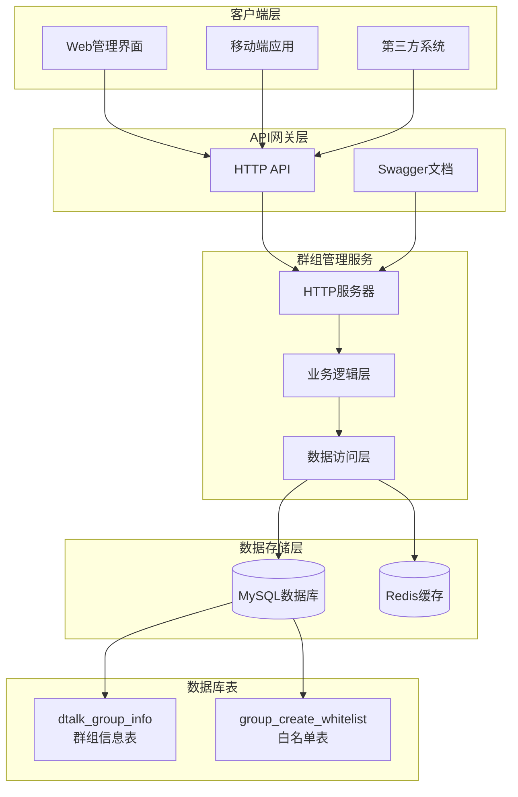
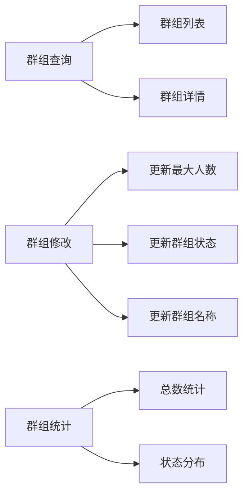
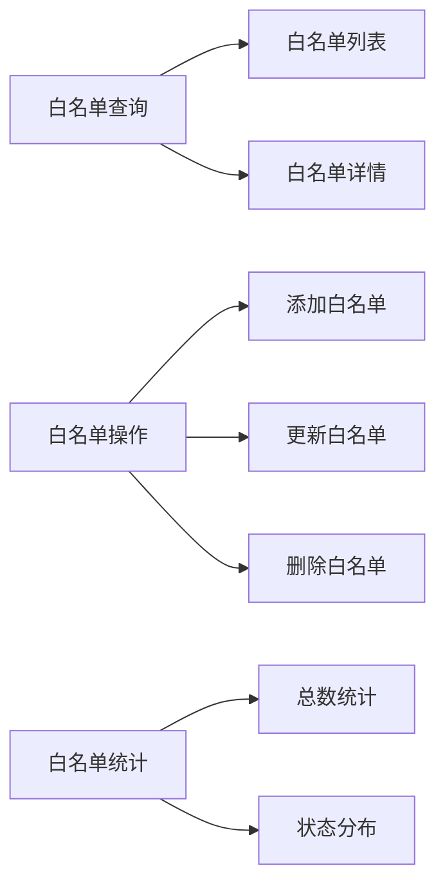
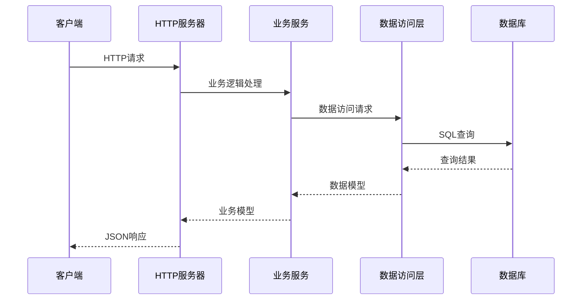
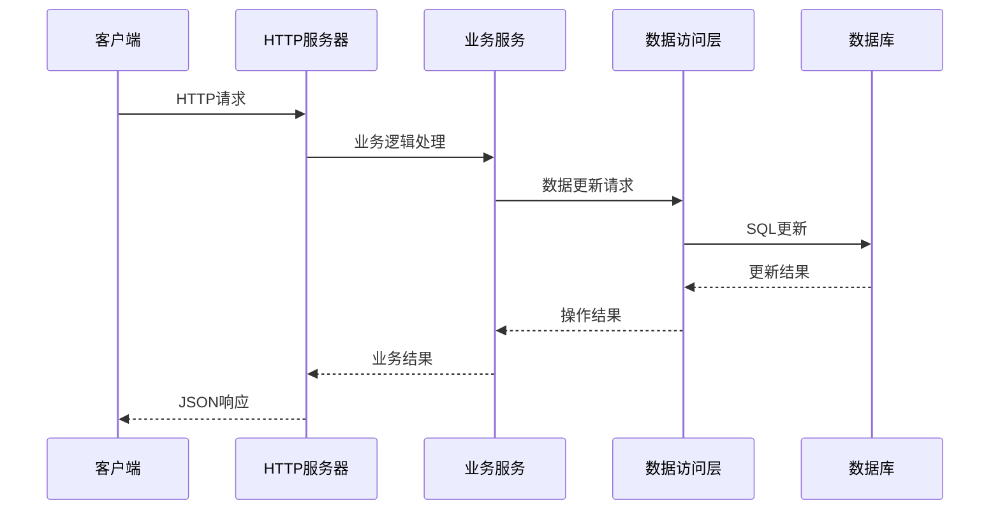

# 群组管理服务架构设计

## 系统架构图

## 分层架构设计

### 1. 表现层 (Presentation Layer)
- **HTTP服务器**: 基于Gin框架的RESTful API服务
- **路由管理**: 统一的API路由配置
- **中间件**: 日志记录、错误处理、响应格式化
- **文档**: Swagger API文档自动生成

### 2. 业务逻辑层 (Business Logic Layer)
- **服务层**: 核心业务逻辑处理
- **数据转换**: 数据库模型与业务模型之间的转换
- **业务规则**: 群组管理规则、白名单控制逻辑
- **错误处理**: 统一的业务异常处理

### 3. 数据访问层 (Data Access Layer)
- **DAO接口**: 数据访问对象接口定义
- **数据库操作**: MySQL数据库的CRUD操作
- **缓存操作**: Redis缓存的数据管理
- **事务管理**: 数据库事务的封装

### 4. 数据存储层 (Data Storage Layer)
- **MySQL**: 主要数据存储，存储群组信息和白名单数据
- **Redis**: 缓存层，提供高性能的数据访问

## 核心功能模块

### 群组信息管理模块

### 白名单管理模块

## 数据流设计

### 查询数据流

### 更新数据流

## 技术栈选择

### 后端技术
- **Go 1.19+**: 高性能的编程语言
- **Gin**: 轻量级Web框架
- **MySQL**: 关系型数据库
- **Redis**: 内存数据库
- **Swagger**: API文档生成

### 设计模式
- **分层架构**: 清晰的职责分离
- **依赖注入**: 松耦合的组件设计
- **接口抽象**: 便于测试和扩展
- **工厂模式**: 对象创建的封装

## 性能优化策略

### 数据库优化
- **索引设计**: 为查询字段添加合适的索引
- **分页查询**: 避免大数据量的全表扫描
- **连接池**: 数据库连接的高效管理

### 缓存策略
- **查询缓存**: 热点数据的缓存
- **结果缓存**: 统计结果的缓存
- **过期策略**: 合理的缓存过期时间

### 并发处理
- **连接池**: 数据库连接池管理
- **协程安全**: Go协程的安全使用
- **锁机制**: 数据一致性的保证

## 安全设计

### 数据安全
- **参数验证**: 输入参数的严格验证
- **SQL注入防护**: 参数化查询
- **数据加密**: 敏感数据的加密存储

### 访问控制
- **权限验证**: API访问权限控制
- **白名单机制**: 群组创建权限控制
- **审计日志**: 操作记录的完整记录

## 监控和运维

### 日志记录
- **结构化日志**: 便于分析和查询
- **日志级别**: 不同级别的日志输出
- **日志轮转**: 日志文件的管理

### 性能监控
- **pprof支持**: Go性能分析工具
- **指标收集**: 关键性能指标
- **告警机制**: 异常情况的及时通知

### 健康检查
- **服务状态**: 服务运行状态检查
- **依赖检查**: 数据库和缓存连接检查
- **优雅关闭**: 服务的平滑停止
