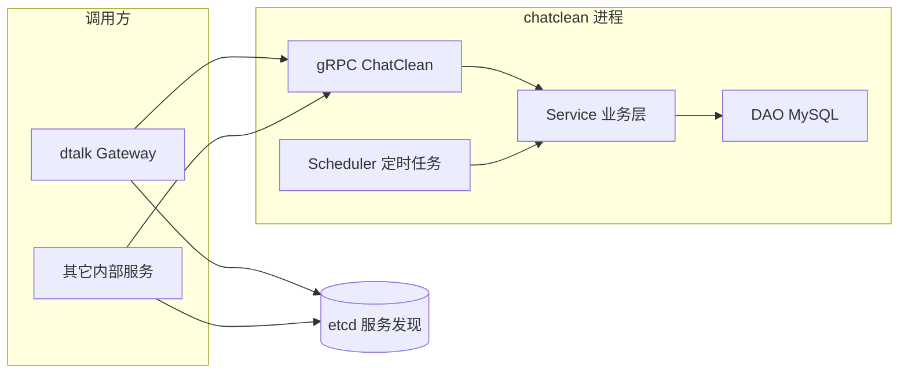

# chatclean 项目说明

## 1. 定位与能力

**chatclean** 是 dtalk 体系中的独立微服务，负责：

1. **手动清理**：按时间范围删除两名用户之间的**私聊**消息（落库在消息库中的 `dtalk_msg_relation` / `dtalk_msg_content`）。
2. **自动删除配置**：为一对用户会话保存「保留最近 N 天」等策略；由服务内**调度器**周期扫描并删除超出保留期的历史消息。
3. **审计**：手动清理与调度触发的删除可写入 `dtalk_clean_audit`（具体字段见 DAO 实现）。

服务**不直接提供面向终端的 HTTP API**，对外以 **gRPC** 暴露；App 通常通过 **Gateway** 的 JSON HTTP 调用，Gateway 再经 etcd 发现调用本服务。

## 2. 架构关系

## 3. 目录结构（核心）

| 路径 | 作用 |
|------|------|
| `cmd/main.go` | 入口：配置、日志、调度器、gRPC、etcd 注册、优雅退出 |
| `api/chatclean.proto` | gRPC 协议与消息定义 |
| `api/*.pb.go`、`api/client.go` | 生成代码与 etcd 客户端封装 |
| `server/grpc/server.go` | gRPC 服务实现 |
| `service/service.go` | 时间范围换算、有序 uid 对、审计与自动删除单次执行 |
| `dao/dao.go` | MySQL 连接（业务库 DSN） |
| `dao/clean.go` | 分批删除消息、审计表、自动删除配置 CRUD |
| `scheduler/scheduler.go` | 按间隔拉取 `option != 0` 的配置并执行删除 |
| `config/config.go`、`etc/chatclean.toml` | 配置加载与示例 |
| `deploy/` | Docker / compose 等 |

## 4. 启动与配置要点

- 配置文件默认由 `config.Init()` 加载（示例见 `etc/chatclean.toml`）。
- **gRPC**：`[GRPCServer]` 如 `:30010`。
- **etcd**：`[Reg]` 中 `SrvName` 一般为 `chatclean`，与 Gateway 的 `ChatCleanRPCClient.SrvName` 一致。
- **MySQL**：
  - `Db`：连接库，存放 `dtalk_clean_audit`、`dtalk_auto_delete_config` 等（以代码中 SQL 为准）。
  - `RecordDb`：消息所在库名，用于 `dtalk_msg_relation`、`dtalk_msg_content` 的**库前缀**（默认常写作 `dtalk_record`）。
- **调度器**：`[Scheduler].Interval` 为扫描周期（如 `1h`）。配置中的 `BatchSize` 若与代码常量不一致，以 `dao/clean.go` 内实际 `batchSize` 为准。

## 5. 数据与删除语义

- **会话主键**：业务上对 `(operator_id, target_id)` 会规范为 **字典序** `uid_a <= uid_b` 再落库，避免重复行。
- **手动删除**：在 `[startTime, endTime]`（**Unix 毫秒**）范围内，按批删除对应 `mid` 的 relation 与 content；删除条数以 content 行为统计口径（见 `CleanPrivateChat` 返回值）。
- **时间选项**：非 `CUSTOM` 时，**以 chatclean 服务进程当前时间**计算「最近 N 天 / 全部」的区间端点（与 Gateway 侧预计算逻辑应对齐同一枚举语义）。
- **自动删除**：对每条配置，删除 **创建时间 ≤ now − 保留时长** 的消息（即超出保留窗口的旧消息）；`option == 0` 表示不自动删，调度器会跳过（不进入列表查询条件）。

## 6. 依赖与运维

- 强依赖 **MySQL**；启动时 `Ping` 失败会导致进程无法启动。
- 依赖 **etcd** 做服务注册，供 Gateway 等通过服务名解析 gRPC 地址。
- 部署参考 `deploy/Dockerfile`、`deploy/docker-compose.yml`。

## 7. 相关测试与 SQL

- 集成测试可参考包内 `service/service_integration_test.go` 等。
- 建表脚本若在仓库 `script/mysql/` 下，请以实际 `dtalk_chatclean.sql` 或迁移文件为准。
