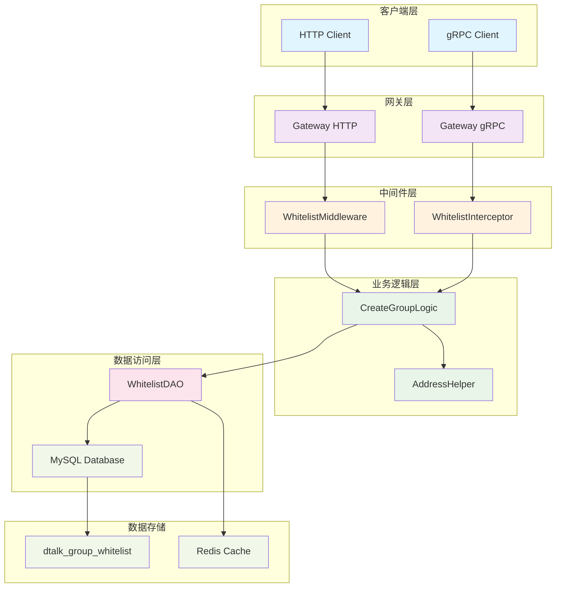
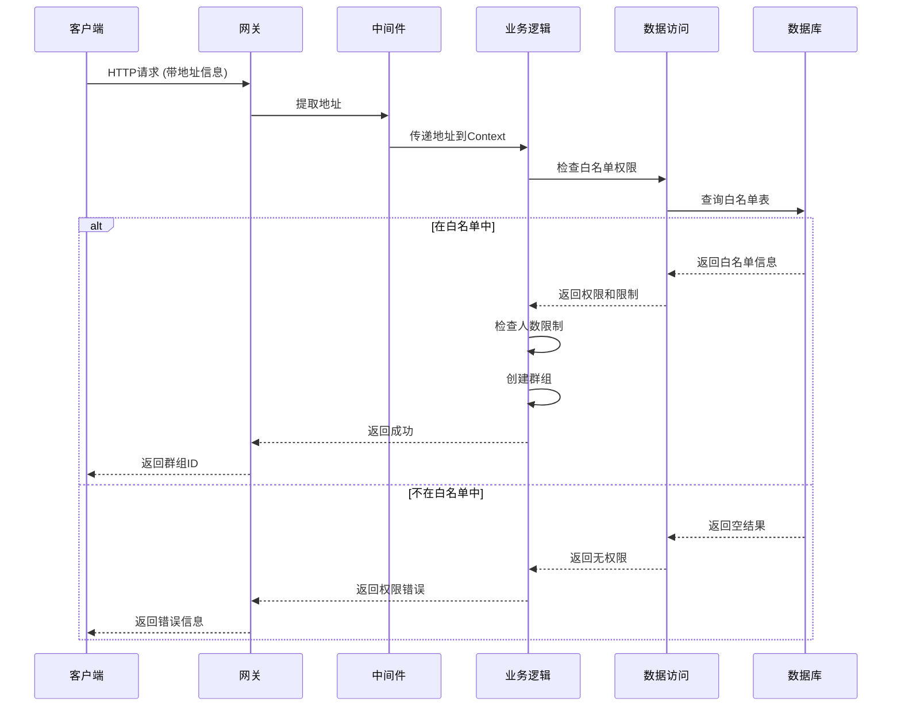

# 群组创建白名单功能架构图

## 系统架构

## 数据流图

## 核心组件说明

### 1. 数据模型层
- **WhitelistInfo**: 白名单信息结构体
- **CheckWhitelistResp**: 白名单检查响应
- **ErrGroupCreatePermission**: 权限错误定义

### 2. 数据访问层
- **WhitelistDAO**: 白名单数据访问接口
- 支持增删改查操作
- 支持按地址查询权限和限制

### 3. 业务逻辑层
- **CreateGroupLogic**: 群组创建逻辑
- **AddressHelper**: 地址获取和验证工具
- 集成白名单检查到创建流程

### 4. 中间件层
- **WhitelistMiddleware**: HTTP层地址提取
- **WhitelistInterceptor**: gRPC层地址提取
- 支持多种地址获取方式

### 5. 数据存储层
- **MySQL**: 主数据存储
- **Redis**: 缓存层（可选）
- 支持高并发查询

## 关键特性

1. **权限控制**: 只有白名单中的地址才能创建群组
2. **人数限制**: 每个地址可以设置最大群成员数量
3. **灵活配置**: 支持动态添加/删除白名单记录
4. **高性能**: 支持缓存和索引优化
5. **可扩展**: 支持多种地址获取方式

## 使用场景

1. **企业内网**: 限制只有特定员工可以创建群组
2. **VIP用户**: 为付费用户提供更大的群组容量
3. **安全控制**: 防止恶意用户创建大量群组
4. **资源管理**: 合理分配群组创建权限
