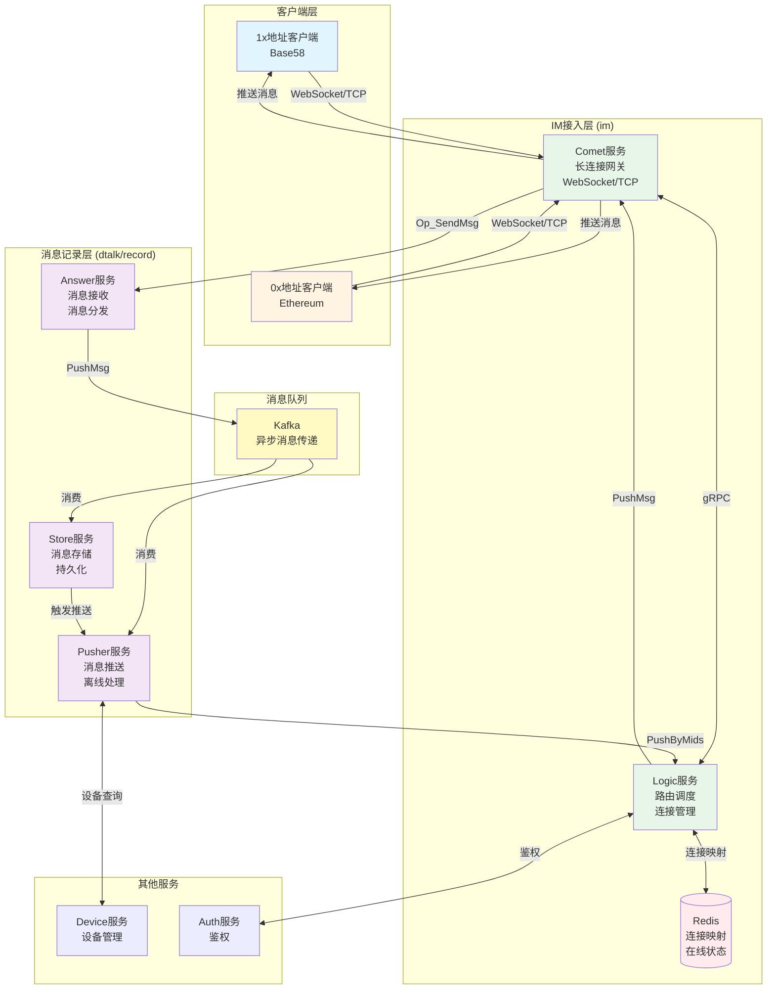
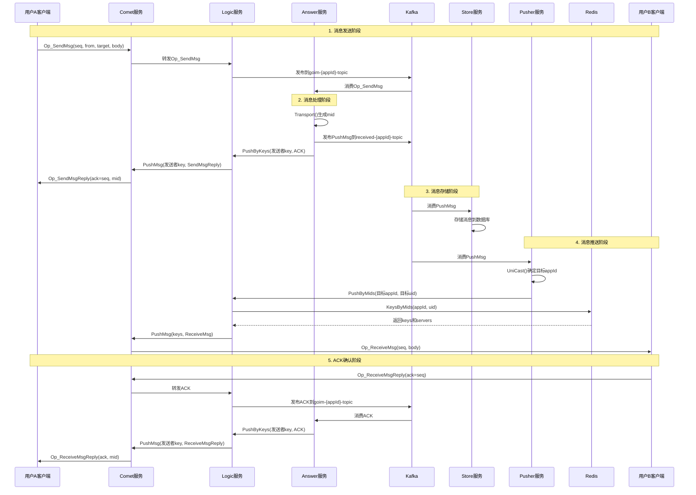
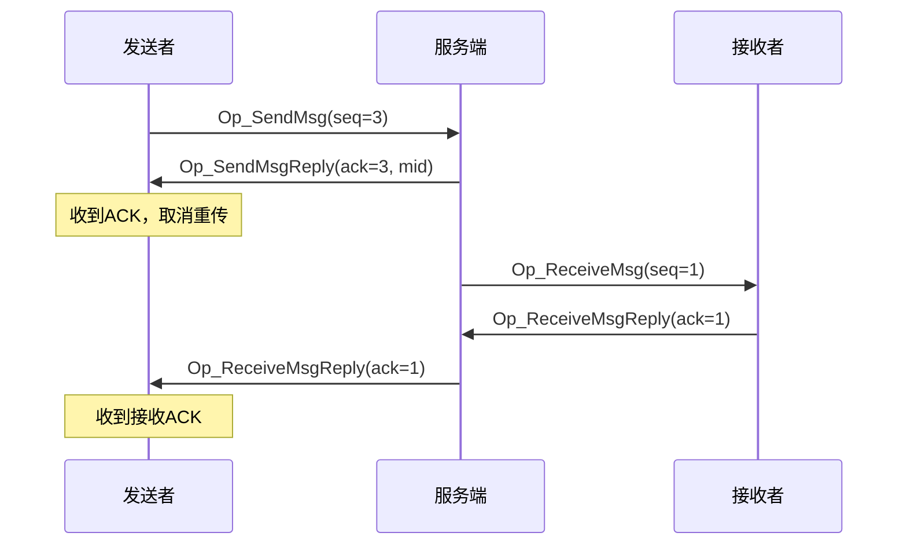
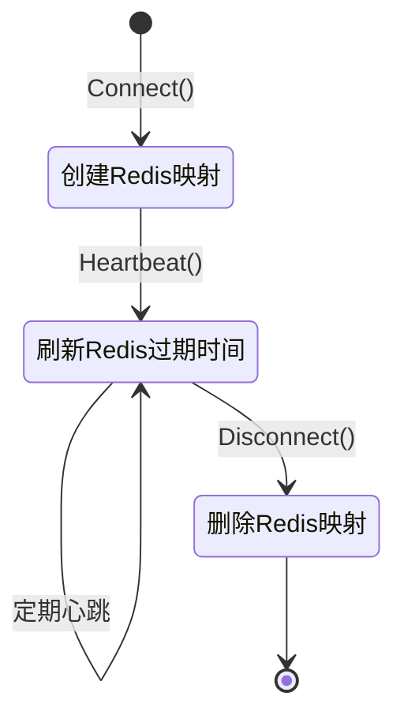

# 聊天通信架构文档

## 目录

1. [系统架构概览](#系统架构概览)
2. [核心模块说明](#核心模块说明)
3. [消息流转完整流程](#消息流转完整流程)
4. [Redis数据结构](#redis数据结构)
5. [Kafka Topic设计](#kafka-topic设计)
6. [多appId支持机制](#多appid支持机制)
7. [关键技术点](#关键技术点)
8. [消息序列号与ACK机制](#消息序列号与ack机制)
9. [连接管理](#连接管理)

---

## 系统架构概览

### 整体架构图



### 服务职责划分

| 服务 | 职责 | 关键功能 |
|------|------|----------|
| **Comet** | 长连接网关 | 维护WebSocket/TCP连接、消息收发、心跳保活 |
| **Logic** | 路由调度 | 连接映射管理、消息路由、在线状态查询 |
| **Answer** | 消息接收 | 接收客户端消息、消息分发、ACK处理 |
| **Pusher** | 消息推送 | 消息推送、离线处理、设备管理 |
| **Store** | 消息存储 | 消息持久化、消息查询、同步 |
| **Redis** | 连接映射 | 存储用户连接信息、在线状态 |
| **Kafka** | 消息队列 | 异步消息传递、解耦服务 |

---

## 核心模块说明

### 1. Comet服务 (im/comet)

**职责：** 维护客户端长连接，处理消息收发

**核心组件：**
- **Channel**: 每个客户端连接对应一个Channel
  - `Key`: 连接唯一标识（UUID）
  - `Seq`: 服务端序列号（用于推送消息）
  - `signal`: 消息通道（用于服务端推送）
  - `CliProto`: 客户端消息环形缓冲区

**关键操作：**
- `Push(p *grpc.Proto)`: 服务端推送消息到客户端
- `Ready() *grpc.Proto`: 从signal通道读取待发送消息
- `seqInc()`: 递增服务端序列号

**消息类型：**
- `Op_SendMsg`: 客户端发送消息
- `Op_ReceiveMsg`: 服务端推送消息给客户端
- `Op_SendMsgReply`: 服务端返回发送ACK
- `Op_ReceiveMsgReply`: 客户端返回接收ACK
- `Op_RePush`: 重推消息（用于ACK超时重传）

### 2. Logic服务 (im/logic)

**职责：** 连接路由调度，管理用户连接映射

**核心功能：**
- **连接管理**：
  - `Connect()`: 建立连接映射
  - `Disconnect()`: 删除连接映射
  - `Heartbeat()`: 心跳保活

- **消息路由**：
  - `PushByMids()`: 根据用户ID推送消息
  - `PushByKeys()`: 根据连接Key推送消息

**Redis映射关系：**
- `mid_{appId}:{uid}` → `{key: server}` (Hash)
- `key_{key}` → `server` (String)
- `usr_{key}` → `{appId}:{uid}` (String)

### 3. Answer服务 (dtalk/service/record/answer)

**职责：** 接收客户端消息，进行消息分发

**核心流程：**
1. 从Kafka消费 `goim-{appId}-topic` 中的 `Op_SendMsg` 消息
2. 调用 `Transport()` 函数处理消息
3. 发布 `PushMsg` 到 `received-{appId}-topic`
4. 处理ACK消息（`RevAck`）

**关键方法：**
- `Transport()`: 消息传输处理
  - 生成消息ID（mid）
  - 构建PushMsg
  - 发布到Kafka
  - 推送给发送者（同步消息）

- `RevAck()`: 处理接收ACK
  - 从Kafka消费ACK消息
  - 调用Logic的PushByKeys推送ACK给发送者

**多appId支持：**
- 支持配置多个appId：`AppIds = ["dtalk", "dtalk-eth"]`
- 为每个appId创建独立的Kafka消费者
- 动态从context获取appId

### 4. Pusher服务 (dtalk/service/record/pusher)

**职责：** 消息推送，处理离线消息

**核心流程：**
1. 从Kafka消费 `received-{appId}-topic` 中的 `PushMsg`
2. 调用 `UniCast()` 推送消息
3. 根据目标地址确定appId
4. 调用Logic的PushByMids推送消息

**关键方法：**
- `UniCast()`: 单播推送
  - 根据目标地址确定appId（关键修复点）
  - 推送给发送者（同步消息）
  - 推送给目标用户
  - 保存连接序列号索引

- `UniCastDevices()`: 设备推送
  - 查询用户所有设备
  - 根据设备Key推送

**多appId支持：**
- 支持配置多个appId
- 为每个appId创建独立的Kafka消费者
- 消费时根据消息appId过滤

### 5. Store服务 (dtalk/service/record/store)

**职责：** 消息持久化存储

**核心功能：**
- 从Kafka消费 `PushMsg`
- 存储消息到数据库
- 触发推送（可选）

---

## 消息流转完整流程

### 场景1：用户A发送消息给用户B



### 关键步骤详解

#### 步骤1：客户端发送消息

```go
// 客户端 (im-util/internal/device/device.go)
func (d *Device) SendMsg(channelType string, target, text string) {
    p, err := protoutil.CreateProtoSendMsg(0, d.u.GetUID(), target, chType, text)
    seq, err := d.conn.Push(p)  // 客户端序列号递增
    // 添加重传任务
    d.tsk.Add(seq, job)
}
```

#### 步骤2：Comet接收并转发

```go
// Comet服务 (im/comet/ws.go)
// 客户端消息 → CliProto → 转发到Logic
```

#### 步骤3：Answer处理消息

```go
// Answer服务 (dtalk/service/record/answer/service/msg.go)
func (e *Exec) Transport(ctx context.Context, mid int64, key, from, target string, ...) {
    // 1. 获取动态appId
    appId := ctx.Value("answer-app-id")
    
    // 2. 构建PushMsg
    pushMsg := &record.PushMsg{
        AppId:  appId,
        FromId: from,
        Target: target,
        Mid:    mid,
        Msg:    data,
    }
    
    // 3. 发布到Kafka
    e.dao.PublishToSendWithAppId(ctx, appId, from, data)
    
    // 4. 推送给发送者（同步消息）
    keysMsg := &logic.KeysMsg{Keys: []string{key}, ...}
    e.logicClient.PushByKeys(ctx, keysMsg)
}
```

#### 步骤4：Pusher推送消息

```go
// Pusher服务 (dtalk/service/record/pusher/service/push.go)
func (p *Pusher) UniCast(ctx context.Context, m *record.PushMsg) error {
    // 1. 根据目标地址确定appId（关键！）
    targetAppId := p.getAppIdByAddress(m.GetTarget())
    fromAppId := p.getAppIdByAddress(m.GetFromId())
    
    // 2. 推送给发送者（同步消息）
    fromMidsMsg := &logic.MidsMsg{
        AppId: fromAppId,
        ToIds: []string{m.GetFromId()},
        Msg:   m.GetMsg(),
    }
    p.s.logicClient.PushByMids(ctx, fromMidsMsg)
    
    // 3. 推送给目标用户
    targetMidsMsg := &logic.MidsMsg{
        AppId: targetAppId,  // ✅ 使用目标用户的appId
        ToIds: []string{m.GetTarget()},
        Msg:   m.GetMsg(),
    }
    reply, err := p.s.logicClient.PushByMids(ctx, targetMidsMsg)
}
```

#### 步骤5：Logic路由消息

```go
// Logic服务 (im/logic/logic.go)
func (l *Logic) PushByMids(c context.Context, appId string, toIds []string, msg []byte) {
    // 1. 根据appId和uid查找连接
    server2keys, err := l.getServerByMids(c, appId, toIds)
    
    // 2. 按Comet服务器分组推送
    for server, keys := range server2keys {
        l.cometClient.PushMsg(c, &comet.PushMsgReq{
            Keys: keys,
            Proto: proto,
        })
    }
}

func (l *Logic) getServerByMids(c context.Context, appId string, mids []string) {
    // 查询Redis: mid_{appId}:{uid}
    ress, _, err := l.dao.KeysByMids(c, appId, mids)
    // ress: {key: server}
}
```

#### 步骤6：Comet推送消息

```go
// Comet服务 (im/comet/grpc/server.go)
func (s *server) PushMsg(ctx context.Context, req *pb.PushMsgReq) {
    for _, key := range req.Keys {
        bucket := s.srv.Bucket(key)
        channel := bucket.Channel(key)
        if channel != nil {
            seq, err = channel.Push(req.Proto)  // 服务端序列号递增
            index[key] = seq
        }
    }
    return &pb.PushMsgReply{Index: index}
}
```

---

## Redis数据结构

### 连接映射结构

#### 1. 用户ID到连接的映射

**Key格式：** `mid_{appId}:{uid}`  
**类型：** Hash  
**结构：** `{key: server}`

**示例：**
```
mid_dtalk:19BKdzKcQbJ7N6q7Ys3KYaJHVSnCF3raAo
  → {key1: "grpc://127.0.0.1:3109", key2: "grpc://127.0.0.1:3109"}

mid_dtalk-eth:0xa100b68ec7df4562457dc813f52f8a1a69ba4e01
  → {key1: "grpc://127.0.0.1:3109"}
```

**用途：** 根据用户ID查找所有连接

#### 2. 连接Key到服务器的映射

**Key格式：** `key_{key}`  
**类型：** String  
**值：** `server地址`

**示例：**
```
key_18f5e9ad-e444-4b9d-ab8f-c62ca73e1c9c
  → "grpc://127.0.0.1:3109"
```

**用途：** 根据连接Key查找Comet服务器

#### 3. 连接Key到用户ID的映射

**Key格式：** `usr_{key}`  
**类型：** String  
**值：** `{appId}:{uid}`

**示例：**
```
usr_18f5e9ad-e444-4b9d-ab8f-c62ca73e1c9c
  → "dtalk:19BKdzKcQbJ7N6q7Ys3KYaJHVSnCF3raAo"
```

**用途：** 根据连接Key查找用户信息

### 数据操作流程

#### 连接建立时（Logic.Connect）

```go
func (d *Dao) AddMapping(c context.Context, mid string, appId string, key string, server string) {
    // 1. 添加到 mid_{appId}:{uid} Hash
    HSET mid_{appId}:{uid} {key} {server}
    
    // 2. 设置 key_{key} → server
    SET key_{key} {server}
    
    // 3. 设置 usr_{key} → {appId}:{uid}
    SET usr_{key} {appId}:{uid}
    
    // 4. 设置过期时间
    EXPIRE mid_{appId}:{uid} {expire}
    EXPIRE key_{key} {expire}
    EXPIRE usr_{key} {expire}
}
```

#### 连接断开时（Logic.Disconnect）

```go
func (d *Dao) DelMapping(c context.Context, mid string, appId string, key string) {
    // 1. 从 mid_{appId}:{uid} Hash中删除
    HDEL mid_{appId}:{uid} {key}
    
    // 2. 删除 key_{key}
    DEL key_{key}
    
    // 3. 删除 usr_{key}
    DEL usr_{key}
}
```

#### 查询连接时（Logic.PushByMids）

```go
func (d *Dao) KeysByMids(c context.Context, appId string, mids []string) {
    // 批量查询 mid_{appId}:{uid}
    for _, mid := range mids {
        HGETALL mid_{appId}:{mid}
    }
    // 返回: {key: server}
}
```

---

## Kafka Topic设计

### Topic命名规则

| Topic类型 | 命名格式 | 说明 | 消费者 |
|-----------|----------|------|--------|
| **客户端消息** | `goim-{appId}-topic` | 客户端发送的消息 | Answer服务 |
| **推送消息** | `received-{appId}-topic` | 需要推送的消息 | Pusher服务、Store服务 |
| **存储消息** | `store-{appId}-topic` | 需要存储的消息 | Store服务 |

### Topic示例

**单appId场景：**
- `goim-dtalk-topic`
- `received-dtalk-topic`
- `store-dtalk-topic`

**多appId场景：**
- `goim-dtalk-topic` / `goim-dtalk-eth-topic`
- `received-dtalk-topic` / `received-dtalk-eth-topic`
- `store-dtalk-topic` / `store-dtalk-eth-topic`

### 消息流转

```mermaid
graph LR
    A[客户端发送] -->|Op_SendMsg| B[goim-{appId}-topic]
    B -->|消费| C[Answer服务]
    C -->|PushMsg| D[received-{appId}-topic]
    D -->|消费| E[Pusher服务]
    D -->|消费| F[Store服务]
    F -->|存储| G[数据库]
    E -->|推送| H[Logic服务]
    H -->|PushMsg| I[Comet服务]
    I -->|推送| J[目标客户端]
    
    style B fill:#fff9c4
    style D fill:#fff9c4
```

---

## 多appId支持机制

### 背景

系统需要支持不同地址格式的用户：
- **1x地址（Base58）**：`19BKdzKcQbJ7N6q7Ys3KYaJHVSnCF3raAo` → `appId = "dtalk"`
- **0x地址（Ethereum）**：`0xa100b68ec7df4562457dc813f52f8a1a69ba4e01` → `appId = "dtalk-eth"`

### 关键修复点

#### 1. Pusher服务 - appId动态确定

**问题：** 使用发送者的appId查找目标用户连接  
**修复：** 根据目标地址格式确定appId

```go
// 修复前（错误）
midsMsg := &logic.MidsMsg{
    AppId: m.GetAppId(),  // ❌ 使用发送者的appId
    ToIds: []string{m.GetTarget()},
}

// 修复后（正确）
targetAppId := p.getAppIdByAddress(m.GetTarget())  // ✅ 根据目标地址确定
targetMidsMsg := &logic.MidsMsg{
    AppId: targetAppId,  // ✅ 使用目标用户的appId
    ToIds: []string{m.GetTarget()},
}
```

#### 2. Answer服务 - 多appId支持

**配置：**
```toml
AppIds = ["dtalk", "dtalk-eth"]
```

**实现：**
```go
// 为每个appId创建Kafka消费者
if len(c.AppIds) > 0 {
    for _, aid := range c.AppIds {
        consumers[fmt.Sprintf("%s-%s", aid, k)] = consumer.NewKafkaConsumers(
            fmt.Sprintf("goim-%s-topic", aid),
            fmt.Sprintf("goim-%s-group", aid), ...)
    }
}

// 消费时过滤
if len(s.cfg.AppIds) > 0 {
    ok := false
    for _, aid := range s.cfg.AppIds {
        if bizMsg.AppId == aid {
            ok = true
            break
        }
    }
    if !ok {
        return nil  // 跳过不匹配的消息
    }
}
```

#### 3. Pusher服务 - 多appId支持

**配置：**
```toml
AppIds = ["dtalk", "dtalk-eth"]
```

**实现：**
```go
// 为每个appId创建Kafka消费者
if len(c.AppIds) > 0 {
    for _, aid := range c.AppIds {
        receivedConsumers[fmt.Sprintf("%s-%s", aid, k)] = consumer.NewKafkaConsumers(
            fmt.Sprintf("received-%s-topic", aid),
            fmt.Sprintf("received-%s-group", aid), ...)
    }
}
```

### appId确定规则

```go
func getAppIdByAddress(address string) string {
    if strings.HasPrefix(address, "0x") {
        return "dtalk-eth"  // Ethereum地址
    }
    return "dtalk"  // Base58地址
}
```

---

## 关键技术点

### 1. 消息序列号管理

#### 客户端序列号（Client Seq）

- **作用：** 客户端发送消息的序列号
- **管理：** 客户端维护，每次发送递增
- **用途：** 用于ACK确认、消息去重

#### 服务端序列号（Server Seq）

- **作用：** 服务端推送消息的序列号
- **管理：** Comet Channel维护，每次推送递增
- **用途：** 用于消息顺序、ACK确认

#### 序列号生成

```go
// 客户端 (im-util/pkg/net/client.go)
func (c *IMConn) Push(p *comet.Proto) (seq int32, err error) {
    p.Seq = c.incSeq()  // 客户端序列号递增
    return seq, nil
}

// 服务端 (im/comet/channel.go)
func (c *Channel) Push(p *grpc.Proto) (seq int32, err error) {
    if p.Op == int32(grpc.Op_ReceiveMsg) {
        p.Seq = c.seqInc()  // 服务端序列号递增
    }
    return seq, c.push(p)
}
```

### 2. ACK机制

#### 发送ACK（SendMsgReply）

**流程：**
1. 客户端发送 `Op_SendMsg`
2. Answer处理消息，生成mid
3. Answer推送 `Op_SendMsgReply` 给发送者
4. 客户端收到ACK，取消重传任务

**消息结构：**
```go
Op_SendMsgReply {
    Seq: 客户端seq,
    Ack: 客户端seq,  // 确认的序列号
    Body: {mid: 消息ID}
}
```

#### 接收ACK（ReceiveMsgReply）

**流程：**
1. 服务端推送 `Op_ReceiveMsg` 给接收者
2. 接收者返回 `Op_ReceiveMsgReply`
3. Answer处理ACK，推送给发送者
4. 发送者收到ACK，记录消息已送达

**消息结构：**
```go
Op_ReceiveMsgReply {
    Seq: 服务端seq,
    Ack: 服务端seq,  // 确认的序列号
}
```

### 3. 消息重传机制

#### 客户端重传

```go
// 客户端发送消息后，添加重传任务
job, _ := tsk.AddJobRepeat(rto, 0, func() {
    d.conn.RePush(p)  // 重推消息
})
tsk.Add(seq, job)

// 收到ACK后，取消重传任务
if j := tsk.Get(seq); j != nil {
    j.Cancel()
}
```

#### 服务端重传

```go
// Comet推送ReceiveMsg后，添加重传任务
p.Op = int32(grpc.Op_RePush)
job, _ := tsk.AddJobRepeat(rto, 0, func() {
    ch.Push(p)  // 重推消息
})
tsk.Add(seq, job)

// 收到ACK后，取消重传任务
if j := tsk.Get(seq); j != nil {
    j.Cancel()
}
```

### 4. 同步消息机制

**目的：** 让发送者也能收到自己发送的消息（用于UI同步）

**实现：**
```go
// Pusher.UniCast
// 1. 先推送给发送者（同步消息）
fromMidsMsg := &logic.MidsMsg{
    AppId: fromAppId,
    ToIds: []string{m.GetFromId()},  // 发送者自己
    Msg:   m.GetMsg(),
}
p.s.logicClient.PushByMids(ctx, fromMidsMsg)

// 2. 再推送给目标用户
targetMidsMsg := &logic.MidsMsg{
    AppId: targetAppId,
    ToIds: []string{m.GetTarget()},
    Msg:   m.GetMsg(),
}
p.s.logicClient.PushByMids(ctx, targetMidsMsg)
```

**客户端过滤：**
```go
// 客户端收到消息后，过滤掉自己的同步消息
if common.GetFrom() == d.u.GetUID() {
    // 跳过同步消息，不记录receive日志
    return
}
```

### 5. 连接映射查找流程

```mermaid
graph TD
    A[PushByMids调用] -->|appId, uids| B[KeysByMids]
    B -->|查询Redis| C[mid_{appId}:{uid}]
    C -->|返回Hash| D[{key: server}]
    D -->|按server分组| E[server2keys]
    E -->|遍历| F[PushMsg到Comet]
    F -->|根据key| G[查找Channel]
    G -->|推送消息| H[客户端]
    
    style C fill:#ffebee
    style D fill:#e8f5e9
```

---

## 消息序列号与ACK机制

### 序列号类型

| 类型 | 作用域 | 管理方 | 用途 |
|------|--------|--------|------|
| **Client Seq** | 客户端 | 客户端 | 客户端发送消息的序列号 |
| **Server Seq** | 服务端 | Comet Channel | 服务端推送消息的序列号 |

### ACK流程



### 重传机制

- **客户端重传：** 发送消息后，如果超时未收到ACK，自动重传
- **服务端重传：** 推送消息后，如果超时未收到ACK，自动重传
- **重传间隔：** 可配置（RTO - Retransmission Timeout）

---

## 连接管理

### 连接生命周期



### 连接状态管理

- **在线状态：** 存储在Redis，有过期时间
- **多设备支持：** 一个用户可以有多个连接（多个key）
- **连接查找：** 通过 `mid_{appId}:{uid}` Hash查找所有连接

---

## 总结

### 核心要点

1. **appId是关键：** 不同地址格式对应不同appId，必须正确匹配
2. **连接映射：** Redis存储三层映射关系，支持快速查找
3. **消息流转：** 通过Kafka解耦，支持异步处理
4. **ACK机制：** 确保消息可靠送达
5. **多appId支持：** 通过配置和动态判断实现

### 关键修复

1. ✅ **Pusher服务：** 根据目标地址确定appId
2. ✅ **Answer服务：** 支持多appId，动态获取appId
3. ✅ **Pusher服务：** 支持多appId，消费多个topic
4. ✅ **客户端：** 修复token生成时的appId硬编码

### 系统特点

- **高可用：** 服务解耦，支持水平扩展
- **可靠性：** ACK机制、重传机制保证消息送达
- **灵活性：** 支持多appId、多设备、多协议
- **可扩展：** 通过Kafka支持异步处理，易于扩展

---

**文档版本：** v1.0  
**最后更新：** 2025-11-10  
**维护者：** 开发团队

---

## 附录

### A. 常见问题排查

#### 问题1：消息发送成功但接收方未收到

**排查步骤：**
1. 检查Pusher日志，确认是否调用了`UniCast`
2. 检查Logic日志，确认`PushByMids`是否找到连接
3. 检查Redis，确认`mid_{appId}:{uid}`是否存在
4. 检查Comet日志，确认`PushMsg`是否成功
5. 检查客户端连接状态

#### 问题2：ACK未返回

**排查步骤：**
1. 检查Answer服务是否订阅了正确的Kafka topic
2. 检查`RevAck`是否被调用
3. 检查`PushByKeys`是否成功
4. 检查发送者连接是否在线

#### 问题3：跨appId通信失败

**排查步骤：**
1. 确认Pusher配置了`AppIds = ["dtalk", "dtalk-eth"]`
2. 确认Answer配置了`AppIds = ["dtalk", "dtalk-eth"]`
3. 确认`getAppIdByAddress`函数正确识别地址格式
4. 确认Redis中使用了正确的appId存储连接

### B. 性能优化建议

1. **连接池管理：** Redis连接池、gRPC连接池
2. **批量处理：** Kafka批量消费、批量推送
3. **缓存策略：** 连接信息缓存、用户信息缓存
4. **异步处理：** 消息存储异步化、推送异步化

### C. 监控指标

**关键指标：**
- 消息发送成功率
- 消息接收延迟
- ACK返回率
- 连接在线数
- Kafka消费延迟
- Redis查询延迟

### D. 相关文档

- [通信失败问题分析](./COMMUNICATION_FAILURE_ANALYSIS.md)
- [Key字段问题分析](./KEY_FIELD_ISSUE_ANALYSIS.md)
- [地址格式迁移文档](./ADDRESS_FORMAT_MIGRATION.md)

