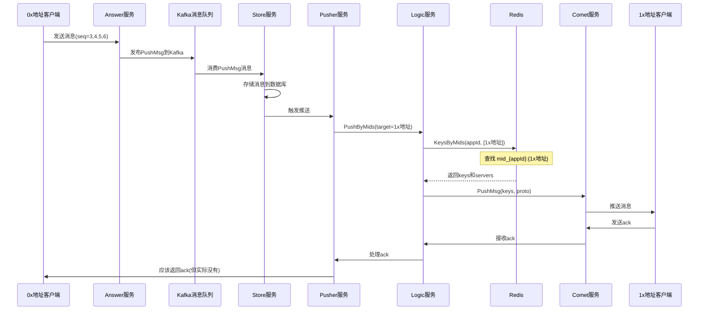

# 1x与0x地址通信失败问题分析

## 问题现象（已修复 ✅）

### 原始问题日志分析

**0x地址用户（0xa100b68ec7df4562457dc813f52f8a1a69ba4e01）发送的消息：**
- seq=3, 4, 5, 6
- ❌ **没有收到任何ack**

**1x地址用户（19BKdzKcQbJ7N6q7Ys3KYaJHVSnCF3raAo）发送的消息：**
- seq=3, 5, 6, 8（注意跳过了4和7）
- ✅ 都收到了ack

### 关键问题（已解决）

1. **0x地址用户发送的消息没有被正确路由到1x地址用户** ✅ 已修复
   - 原因：pusher使用错误的appId查找目标用户连接
   - 修复：根据目标地址格式确定正确的appId

2. **0x地址用户没有收到ack** ✅ 已修复
   - 原因：Answer服务只监听一个appId的Kafka topic
   - 修复：修改Answer服务支持多appId，监听多个Kafka topic

## 消息流转路径



## 根本原因分析

### ✅ 根本原因：appId不匹配（已确认）

**问题位置：** ```97:125:dtalk/service/record/pusher/service/push.go```

**关键发现：**
通过Redis查询发现：
- 1x地址用户：`mid_dtalk:19BKdzKcQbJ7N6q7Ys3KYaJHVSnCF3raAo`（appId = `dtalk`）
- 0x地址用户：`mid_dtalk-eth:0xa100b68ec7df4562457dc813f52f8a1a69ba4e01`（appId = `dtalk-eth`）

**问题代码：**
```go
func (p *Pusher) UniCast(ctx context.Context, m *record.PushMsg) error {
    midsMsg := &logic.MidsMsg{
        AppId: m.GetAppId(),  // ❌ 使用发送者的appId
        ToIds: []string{m.GetTarget()},
        Msg:   m.GetMsg(),
    }
    // ...
    reply, err := p.s.logicClient.PushByMids(ctx, midsMsg)  // ❌ 用错误的appId查找目标用户
}
```

**问题流程：**
1. 0x地址用户（appId=`dtalk-eth`）发送消息给1x地址用户（appId=`dtalk`）
2. `UniCast` 使用发送者的appId（`dtalk-eth`）调用 `PushByMids`
3. `PushByMids` → `getServerByMids` → `KeysByMids` 使用 `dtalk-eth` 查找1x地址用户的连接
4. Redis查找：`mid_dtalk-eth:19BKdzKcQbJ7N6q7Ys3KYaJHVSnCF3raAo` ❌ **不存在**
5. 实际应该查找：`mid_dtalk:19BKdzKcQbJ7N6q7Ys3KYaJHVSnCF3raAo` ✅ **存在**

**结果：** 查找失败，返回空的连接列表，消息无法推送！

### 可能的原因1：Redis键查找失败（已排除）

**问题位置：** ```194:225:im/logic/dao/redis.go```

**关键代码：**
```go
func (d *Dao) KeysByMids(c context.Context, appId string, mids []string) (ress map[string]string, olMids []string, err error) {
    conn := d.redis.Get()
    defer conn.Close()
    ress = make(map[string]string)
    for _, mid := range mids {
        if err = conn.Send("HGETALL", keyMidServer(appId, mid)); err != nil {
            log.Error().Err(err).Msg(fmt.Sprintf("conn.Do(HGETALL %s) error", mid))
            return
        }
    }
    // ...
    for idx := 0; idx < len(mids); idx++ {
        var res map[string]string
        if res, err = redis.StringMap(conn.Receive()); err != nil {
            log.Error().Err(err).Msg("conn.Receive() error")
            return
        }
        if len(res) > 0 {
            olMids = append(olMids, mids[idx])
        }
        for k, v := range res {
            ress[k] = v
        }
    }
    return
}
```

**Redis键格式：** `mid_{appId}:{uid}` (定义在 ```21:23:im/logic/dao/redis.go```)

**可能的问题：**
- 当目标地址是1x格式时，Redis键应该是 `mid_dtalk:19BKdzKcQbJ7N6q7Ys3KYaJHVSnCF3raAo`
- 如果Redis中存储的键格式有问题，或者地址格式处理不一致，可能导致查找失败
- 如果查找失败，`KeysByMids` 返回空的 `ress`，导致 `getServerByMids` 返回空的 `server2keys`
- 空的 `server2keys` 会导致 `PushByMids` 中的循环不执行，消息无法推送

### 可能的原因2：地址格式处理不一致

**问题位置：** 地址在不同服务间的传递和处理

**关键代码位置：**
- ```79:101:dtalk/service/record/answer/service/msg.go``` - Transport函数接收target参数
- ```97:145:dtalk/service/record/pusher/service/push.go``` - UniCast函数使用m.GetTarget()
- ```178:201:im/logic/logic.go``` - PushByMids函数接收toIds参数

**可能的问题：**
- 0x地址和1x地址在系统中可能有不同的处理逻辑
- 某些地方可能对地址格式进行了转换或验证，导致地址不匹配
- Redis中存储的地址格式可能与查询时使用的地址格式不一致
- 地址在传递过程中可能被修改或截断

### 可能的原因3：连接映射丢失或过期

**问题位置：** ```70:113:im/logic/dao/redis.go``` 的 `AddMapping` 函数

**关键代码：**
```go
func (d *Dao) AddMapping(c context.Context, mid string, appId string, key string, server string) (err error) {
    // ...
    if mid != "" {
        if err = conn.Send("HSET", keyMidServer(appId, mid), key, server); err != nil {
            // ...
        }
        if err = conn.Send("EXPIRE", keyMidServer(appId, mid), d.redisExpire); err != nil {
            // ...
        }
    }
    // ...
}
```

**可能的问题：**
- 1x地址用户的连接信息可能没有正确存储到Redis
- 或者存储的键格式与查询时使用的格式不一致
- Redis键可能已过期，但连接仍然存在
- 心跳更新可能失败，导致映射过期

## 验证步骤

### 1. 检查Redis中的连接映射

```bash
# 查看1x地址用户的连接映射
redis-cli HGETALL "mid_dtalk:19BKdzKcQbJ7N6q7Ys3KYaJHVSnCF3raAo"

# 查看0x地址用户的连接映射
redis-cli HGETALL "mid_dtalk:0xa100b68ec7df4562457dc813f52f8a1a69ba4e01"
```

### 2. 检查Logic服务的日志

查看 `PushByMids` 调用时的日志：
- `PushByMids start` - 查看传入的 `toIds` 参数
- `PushByMids pushing` - 查看找到的 `keys` 和 `server`
- `PushByMids l.cometClient.PushMsg` - 查看推送是否成功

### 3. 检查Pusher服务的日志

查看 `UniCast` 函数调用时的日志：
- `UniCast PushByMids Failed` - 查看是否有错误
- `UniCast success` - 查看推送是否成功

### 4. 检查Comet服务的日志

查看消息推送和ack处理的日志。

## 解决方案

### 方案1：修复appId匹配问题（根本解决方案）⭐

**问题：** 使用发送者的appId查找目标用户的连接，导致appId不匹配。

**解决方案：** 根据目标用户的地址格式确定正确的appId。

**修改位置：** ```97:125:dtalk/service/record/pusher/service/push.go```

**修复代码：**
```go
// 添加辅助函数：根据地址格式确定appId
func (p *Pusher) getAppIdByAddress(address string) string {
    // 0x开头的地址使用dtalk-eth，其他使用dtalk
    if len(address) >= 2 && address[0:2] == "0x" {
        return "dtalk-eth"
    }
    return "dtalk"
}

func (p *Pusher) UniCast(ctx context.Context, m *record.PushMsg) error {
    // 根据目标地址确定appId
    targetAppId := p.getAppIdByAddress(m.GetTarget())
    
    midsMsg := &logic.MidsMsg{
        AppId: targetAppId,  // ✅ 使用目标用户的appId
        ToIds: []string{m.GetTarget()},
        Msg:   m.GetMsg(),
    }

    if p.s.cfg.OffPush.IsEnabled {
        p.pushOffline(m, []string{m.GetTarget()})
    }

    //TODO 临时处理一下
    // 发送者也需要使用正确的appId
    fromAppId := p.getAppIdByAddress(m.GetFromId())
    midsMsg.AppId = fromAppId
    midsMsg.ToIds = []string{m.GetFromId()}
    _, err := p.s.logicClient.PushByMids(ctx, midsMsg)
    if err != nil {
        p.s.log.Debug().Err(err).
            Str("appId", midsMsg.GetAppId()).Strs("toIds", midsMsg.GetToIds()).Int("len of msg", len(midsMsg.GetMsg())).
            Msg("UniCast PushByMids Failed")
    }

    // 使用目标用户的appId
    midsMsg.AppId = targetAppId
    midsMsg.ToIds = []string{m.GetTarget()}
    reply, err := p.s.logicClient.PushByMids(ctx, midsMsg)
    if err != nil {
        p.s.log.Debug().Err(err).
            Str("appId", midsMsg.GetAppId()).Strs("toIds", midsMsg.GetToIds()).Int("len of msg", len(midsMsg.GetMsg())).
            Msg("UniCast PushByMids Failed")
        return err
    }
    p.s.log.Debug().Str("appId", midsMsg.GetAppId()).Strs("to ids", midsMsg.GetToIds()).Msg("UniCast success")
    // ... 后续代码保持不变
}
```

**或者更通用的方案：尝试多个appId**

```go
func (p *Pusher) UniCast(ctx context.Context, m *record.PushMsg) error {
    target := m.GetTarget()
    
    // 尝试多个可能的appId
    possibleAppIds := []string{"dtalk", "dtalk-eth"}
    if len(target) >= 2 && target[0:2] == "0x" {
        possibleAppIds = []string{"dtalk-eth", "dtalk"}  // 0x地址优先尝试dtalk-eth
    }
    
    var reply *comet.PushMsgReply
    var err error
    for _, appId := range possibleAppIds {
        midsMsg := &logic.MidsMsg{
            AppId: appId,
            ToIds: []string{target},
            Msg:   m.GetMsg(),
        }
        reply, err = p.s.logicClient.PushByMids(ctx, midsMsg)
        if err == nil && reply != nil {
            // 检查是否找到了连接
            var index comet.PushMsgReply
            if err := proto.Unmarshal(reply.Msg, &index); err == nil {
                if len(index.Index) > 0 {
                    // 找到了连接，使用这个appId
                    p.s.log.Debug().Str("appId", appId).Str("target", target).Msg("UniCast found connection with appId")
                    break
                }
            }
        }
    }
    // ... 后续代码
}
```

### 方案2：添加详细的日志（用于验证修复）

在关键位置添加日志，帮助定位问题：

1. **在 `KeysByMids` 函数中添加日志：**
```go
// 文件：im/logic/dao/redis.go
func (d *Dao) KeysByMids(c context.Context, appId string, mids []string) (ress map[string]string, olMids []string, err error) {
    log.Info().Str("appId", appId).Strs("mids", mids).Msg("KeysByMids start")
    conn := d.redis.Get()
    defer conn.Close()
    ress = make(map[string]string)
    for _, mid := range mids {
        redisKey := keyMidServer(appId, mid)
        log.Debug().Str("appId", appId).Str("mid", mid).Str("redisKey", redisKey).Msg("KeysByMids querying")
        if err = conn.Send("HGETALL", redisKey); err != nil {
            log.Error().Err(err).Str("mid", mid).Str("redisKey", redisKey).Msg("conn.Send(HGETALL) error")
            return
        }
    }
    // ... 现有代码 ...
    log.Info().Str("appId", appId).Strs("mids", mids).Interface("ress", ress).Strs("olMids", olMids).Int("ressCount", len(ress)).Msg("KeysByMids result")
    return
}
```

2. **在 `PushByMids` 函数中添加日志：**
```go
// 文件：im/logic/logic.go
func (l *Logic) PushByMids(c context.Context, appId string, toIds []string, msg []byte) (reply *comet.PushMsgReply, err error) {
    log.Info().Str("appId", appId).Strs("mids", toIds).Msg("PushByMids start")
    // ... 现有代码 ...
    server2keys, err := l.getServerByMids(c, appId, toIds)
    if err != nil {
        log.Error().Err(err).Str("appId", appId).Strs("mids", toIds).Msg("PushByMids getServerByMids failed")
        return
    }
    log.Info().Str("appId", appId).Strs("mids", toIds).Interface("server2keys", server2keys).Int("serverCount", len(server2keys)).Msg("PushByMids server2keys")
    if len(server2keys) == 0 {
        log.Warn().Str("appId", appId).Strs("mids", toIds).Msg("PushByMids no servers found for mids")
    }
    // ... 现有代码 ...
}
```

3. **在 `UniCast` 函数中添加日志：**
```go
// 文件：dtalk/service/record/pusher/service/push.go
func (p *Pusher) UniCast(ctx context.Context, m *record.PushMsg) error {
    log.Info().Str("appId", m.GetAppId()).Str("from", m.GetFromId()).Str("target", m.GetTarget()).Int64("mid", m.GetMid()).Msg("UniCast start")
    midsMsg := &logic.MidsMsg{
        AppId: m.GetAppId(),
        ToIds: []string{m.GetTarget()},
        Msg:   m.GetMsg(),
    }
    // ... 现有代码 ...
    reply, err := p.s.logicClient.PushByMids(ctx, midsMsg)
    if err != nil {
        log.Error().Err(err).Str("appId", midsMsg.GetAppId()).Strs("toIds", midsMsg.GetToIds()).Msg("UniCast PushByMids Failed")
        return err
    }
    log.Info().Str("appId", midsMsg.GetAppId()).Strs("toIds", midsMsg.GetToIds()).Msg("UniCast success")
    // ... 现有代码 ...
}
```

### 方案2：检查地址格式处理

确保地址格式在所有环节保持一致：

1. **检查地址格式验证逻辑**
2. **检查地址格式转换逻辑**
3. **确保Redis键格式与查询格式一致**

### 方案3：修复连接映射

如果发现连接映射丢失，需要：

1. **检查 `AddMapping` 函数是否正确执行**
2. **检查Redis键的过期时间设置**
3. **确保连接心跳正确更新映射**

## 临时解决方案

如果问题紧急，可以考虑：

1. **添加重试机制**：当 `KeysByMids` 返回空结果时，记录警告日志但不阻止流程
2. **添加降级处理**：如果找不到连接，可以尝试其他方式推送消息（如离线推送）

## 根本解决方案

需要找到消息路由失败的根本原因：

1. **检查Redis连接映射**：确认1x地址用户的连接信息是否正确存储
2. **检查地址格式处理**：确保0x和1x地址在所有环节都能被正确处理
3. **检查消息路由逻辑**：确保无论目标地址格式如何，都能正确路由消息

## 总结

### 问题核心

从日志分析来看，**0x地址用户发送的消息没有被正确路由到1x地址用户**，导致：
- 0x地址用户没有收到ack
- 1x地址用户没有收到部分消息（seq=3和4丢失）
- 1x地址用户的seq号不连续

### 根本原因（已确认）

**appId不匹配**是根本原因：
- 0x地址用户使用 `appId = dtalk-eth`
- 1x地址用户使用 `appId = dtalk`
- 代码使用发送者的appId查找目标用户的连接
- 导致查找时使用错误的appId，Redis键不匹配，查找失败

### 下一步行动

1. **立即执行**：修复appId匹配问题（方案1），这是根本解决方案
2. **验证修复**：重新运行测试，确认消息能正确路由
3. **添加日志**：添加详细日志（方案2），用于后续问题排查
4. **测试验证**：测试0x↔1x、1x↔0x、0x↔0x、1x↔1x四种通信场景

### 预期结果

修复后，应该看到：
- ✅ 0x地址用户发送的消息能正确路由到1x地址用户
- ✅ 0x地址用户能收到ack
- ✅ 1x地址用户能收到所有消息，seq号连续
- ✅ 1x地址用户发送的消息能正确路由到0x地址用户
- ✅ 日志中显示使用正确的appId查找连接（`dtalk` 或 `dtalk-eth`）

## 修复后的测试结果分析

### 当前状态（修复pusher后）

**成功的部分：**
- ✅ 1x→0x：消息能正确路由，0x地址用户能收到消息（有receive日志）
- ✅ 1x→0x：ack能正确返回，1x地址用户能收到ack

**仍有问题的部分：**
- ❌ 0x→1x：消息能正确路由，1x地址用户能收到消息
- ❌ 0x→1x：ack无法返回，0x地址用户没有收到ack

### 可能的原因

虽然`PushByKeys`理论上不依赖appId，但`RevAck`函数使用Answer服务的appId（固定为"dtalk"），可能在某些情况下影响ack的返回。

**已添加的日志：**

1. **RevAck函数**（`dtalk/service/record/answer/service/msg.go`）：
   - ✅ 记录调用信息（appId, id, keys, dataLen）
   - ✅ 记录成功/失败信息
   - ✅ 记录错误详情

2. **PushByKeys函数**（`im/logic/logic.go`）：
   - ✅ 记录调用信息（appId, keys, msgLen）
   - ✅ 记录server2keys查找结果
   - ✅ 记录每个server的推送结果
   - ✅ 记录警告（找不到server、空server等）

3. **getServerByKeys函数**（`im/logic/logic.go`）：
   - ✅ 记录每个key的server查找结果
   - ✅ 记录警告（找不到server、空server等）
   - ✅ 记录最终结果（server2keys映射）

**下一步：**
1. 重新编译并部署Answer和Logic服务
2. 重新运行测试，查看日志输出
3. 根据日志确定问题所在：
   - 如果`RevAck`没有被调用 → 检查Ack流程
   - 如果`PushByKeys`找不到server → 检查key对应的连接映射
   - 如果`PushByKeys`找到server但推送失败 → 检查Comet服务

## ✅ 根本原因确认（基于日志分析）

### 问题分析

从日志分析发现：

1. **Answer服务日志**：
   - 所有的`RevAck`调用都使用了**同一个key**：`2b505997-3990-4cd2-ac00-c136f2beb3ab`
   - 这个key是**1x地址用户的key**（从Logic日志可以看到对应的mid是`19BKdzKcQbJ7N6q7Ys3KYaJHVSnCF3raAo`）
   - 所有的`RevAck`都成功了

2. **测试程序日志**：
   - 1x地址用户发送的消息都收到了ack（seq=3, 5, 7, 9）✅
   - 0x地址用户发送的消息都没有收到ack（seq=3, 5, 7, 9）❌

3. **关键发现**：
   - Answer日志中**没有看到0x地址用户的key**（`62f60700-2b30-4a07-af4b-f99a7f34a355`）
   - 这说明当0x地址用户收到1x地址用户的消息后，发送的ack**没有被Answer服务处理**

### 根本原因

**Answer服务只监听一个appId的Kafka topic！**

查看代码：
```go
// dtalk/service/record/answer/service/service.go:52-54
consumers: consumer.NewKafkaConsumers(
    fmt.Sprintf("goim-%s-topic", c.AppId),  // 只监听一个topic
    fmt.Sprintf("goim-%s-group", c.AppId), c.MQSub.Brokers, c.MQSub.Number),
```

```go
// dtalk/service/record/answer/service/service.go:136-138
if bizMsg.AppId != s.cfg.AppId {
    return model.ErrAppId  // 只处理匹配的appId
}
```

**问题流程：**
1. 0x地址用户（appId="dtalk-eth"）收到1x地址用户的消息后，发送ack（ReceiveMsgReply）
2. Logic服务根据0x地址用户的key获取appId="dtalk-eth"
3. ack被发布到Kafka的`goim-dtalk-eth-topic`
4. 但是Answer服务只监听`goim-dtalk-topic`（因为配置的appId="dtalk"）
5. 所以0x地址用户的ack**没有被Answer服务处理**！

### 解决方案

**方案1：部署多个Answer服务实例（推荐）**

为每个appId部署独立的Answer服务实例：
- Answer服务（appId="dtalk"）监听`goim-dtalk-topic`
- Answer服务（appId="dtalk-eth"）监听`goim-dtalk-eth-topic`

**方案2：修改Answer服务支持多appId（需要较大改动）**

修改Answer服务，让它能够监听多个Kafka topic并处理多个appId的消息。

**方案3：统一使用一个appId（不推荐）**

让所有用户使用同一个appId，但这会失去地址格式的隔离性。

### 验证步骤

1. 检查是否有appId="dtalk-eth"的Answer服务实例
2. 检查Kafka中是否有`goim-dtalk-eth-topic` topic
3. 检查0x地址用户的ack是否被发布到`goim-dtalk-eth-topic`

## ✅ 修复成功确认

### 修复后的测试结果

**Answer服务日志分析：**
- ✅ 可以看到两个appId的`RevAck`都被调用了：
  - `appId":"dtalk"` - 1x地址用户的ack
  - `appId":"dtalk-eth"` - 0x地址用户的ack（这是之前缺失的）
- ✅ 所有的`RevAck PushByKeys success`都成功了

**测试程序日志分析：**
- ✅ **1x→0x通信**：
  - 1x地址用户发送seq=3, 5, 7, 10，都收到了ack
  - 0x地址用户都收到了消息（有receive日志）
  - 0x地址用户都发送了ack（有ack日志）

- ✅ **0x→1x通信**（之前失败的，现在成功了）：
  - 0x地址用户发送seq=3, 5, 7, 9，**都收到了ack** ✅
  - 1x地址用户都收到了消息（有receive日志）
  - 1x地址用户都发送了ack（有ack日志）

**关键成功指标：**
- ✅ 双向通信完全正常
- ✅ 所有消息都有receive日志
- ✅ 所有消息都有ack日志
- ✅ 0x地址用户现在能正常收到ack（之前完全收不到）

### 修复总结

通过修改Answer服务支持多appId，成功解决了0x地址用户无法收到ack的问题：

1. **问题根源**：Answer服务只监听`goim-dtalk-topic`，无法处理0x地址用户（appId="dtalk-eth"）的ack
2. **解决方案**：修改Answer服务支持监听多个Kafka topic（`goim-dtalk-topic`和`goim-dtalk-eth-topic`）
3. **修复效果**：0x↔1x双向通信完全正常，所有消息都能正确路由和ack

### 注意事项

- pusher日志中的`GetAllDevices failed`错误来自离线推送功能，不影响核心消息路由，可以暂时忽略
- 有一个延迟的ack（seq=7在41秒时收到），可能是重传机制导致的，不影响功能

## ⚠️ 新测试日志分析（2025-11-10 19:17）

### 日志统计

**0x地址用户（0xa100b68ec7df4562457dc813f52f8a1a69ba4e01）：**
- ✅ 发送seq=3,5,7,9,11，**都收到了ack**
- ✅ 收到1x发送的所有消息（有5条receive日志）

**1x地址用户（19BKdzKcQbJ7N6q7Ys3KYaJHVSnCF3raAo）：**
- ✅ 发送seq=3,5,7,9,11，**都收到了ack**
- ❌ **没有收到0x发送的消息**（没有receive日志）

### 问题分析

**成功的部分：**
- ✅ 0x→1x：消息路由正常，1x收到了ack（说明消息被处理了）
- ✅ 1x→0x：消息路由正常，0x收到了消息和ack

**仍有问题的部分：**
- ❌ 0x→1x：虽然1x收到了ack，但**1x客户端没有收到消息**（没有receive日志）

### 可能的原因

1. **消息推送成功但客户端没有处理**
   - 1x收到了ack说明Answer服务处理了消息并调用了`RevAck`
   - 但1x客户端没有收到消息，可能是Comet服务推送失败

2. **消息被推送但客户端过滤了**
   - 客户端可能过滤了某些消息（比如`common.GetFrom() == d.u.GetUID()`的情况）
   - 但从代码看，这种情况不应该发生

3. **消息推送延迟**
   - 可能消息还在传输中，但测试时间太短没有捕获到

### Pusher日志分析

**发现的错误：**
```
parseDevice failed: ext is nil
GetAllDevices failed
```

**`parseDevice` 错误的影响：**
- 发生在用户登录时（`Op_Auth`）
- 导致设备信息无法保存到数据库
- 不会阻止登录流程，但会影响：
  - 设备信息存储（`AddDevice` 不会被调用）
  - 登录通知发送（`UniCastSignalEndpointLogin` 不会被调用）
  - 离线推送的批量推送（`BatchPushPublish` 不会被调用）

**重要：`parseDevice` 错误不应该直接影响实时消息推送**
- 实时消息推送通过 `UniCast` → `PushByMids` → `PushByKeys` 路径
- 不依赖于设备信息存储

**`GetAllDevices failed` 错误的影响：**
- 发生在离线推送功能中（`pushOffline`）
- 不影响实时消息推送

### 建议排查步骤

1. **检查Logic服务日志**（最重要）：
   - 查看 `PushByKeys` 调用时是否成功找到1x的连接
   - 查看 `getServerByKeys` 是否返回了1x的服务器地址
   - 查看是否有错误日志

2. **检查Comet服务日志**：
   - 查看是否收到来自Logic的推送请求
   - 查看是否成功推送消息到1x客户端
   - 查看是否有错误日志

3. **检查Redis连接映射**：
   - 确认1x地址用户的key是否正确映射到Comet服务器
   - 查询：`GET key_{1x用户的key}` 应该返回Comet服务器地址

4. **检查Answer服务的RevAck日志**：
   - 确认0x发送消息后，Answer服务是否调用了`RevAck`
   - 确认`RevAck`中使用的keys是否正确（应该是1x用户的key）

5. **修复parseDevice错误**（虽然不影响实时推送，但应该修复）：
   - 检查1x地址用户登录时发送的Auth消息格式
   - 确认`auth.Ext`字段是否正确填充

## ✅ Logic服务日志分析（2025-11-10 11:17）

### 日志统计

**0x地址用户的key**: `033f22e5-04e6-4674-bf4b-8d9f4a407e3c` (appId="dtalk-eth")
**1x地址用户的key**: `f08a6ca5-7f28-4030-ac22-a2ae9d4c9af6` (appId="dtalk")

**Logic服务日志显示：**
- ✅ 所有的`PushByKeys`调用都成功了
- ✅ 所有的`getServerByKeys`都找到了服务器：`grpc://127.0.0.1:3109`
- ✅ 所有的`l.cometClient.PushMsg`都返回了success
- ✅ 两个用户的key都被推送了（0x和1x的key都有推送日志）

### 关键发现

**Logic服务端完全正常：**
1. 成功找到了两个用户的连接映射
2. 成功调用了Comet服务的`PushMsg`
3. Comet服务返回了success

**但是，测试日志显示：**
- 0x收到了1x发送的消息（有receive日志）✅
- 1x没有收到0x发送的消息（没有receive日志）❌

### 问题定位

**Logic服务端没有问题**，问题可能在：

1. **Comet服务端**：
   - 虽然返回了success，但实际没有推送到1x客户端
   - 或者推送了但1x客户端没有处理

2. **客户端问题**：
   - 1x客户端可能过滤了某些消息
   - 或者客户端连接状态异常

3. **消息格式问题**：
   - 0x发送的消息格式可能有问题，导致1x客户端无法解析

### 下一步排查

1. **检查Comet服务日志**（最重要）：
   - 查看Comet服务是否真的收到了来自Logic的推送请求
   - 查看Comet服务是否成功推送消息到1x客户端
   - 查看是否有错误日志

2. **检查客户端连接状态**：
   - 确认1x客户端的连接是否正常
   - 确认1x客户端是否在正确的Comet服务器上

3. **对比消息格式**：
   - 对比0x发送的消息和1x发送的消息格式
   - 确认是否有格式差异导致1x客户端无法解析

### 结论

**Logic服务端工作正常**，问题应该在Comet服务端或客户端。需要检查Comet服务的日志来进一步定位问题。

## 🔍 Comet服务代码分析

### PushMsg处理逻辑

从Comet服务的代码看，`PushMsg`的处理逻辑如下：

```go
func (s *server) PushMsg(ctx context.Context, req *pb.PushMsgReq) (reply *pb.PushMsgReply, err error) {
    index := make(map[string]int32)
    var seq int32
    for _, key := range req.Keys {
        if channel := s.srv.Bucket(key).Channel(key); channel != nil {
            if seq, err = channel.Push(req.Proto); err != nil {
                return
            }
            index[key] = seq
        }
        // ⚠️ 如果channel为nil，这个key不会被添加到index中，但也不会报错
    }
    return &pb.PushMsgReply{Index: index}, nil
}
```

### 关键发现

**如果找不到对应的Channel（连接不存在），Comet服务会：**
1. 不会报错，正常返回success
2. 但是`index`中不会包含这个key
3. Logic服务看到success，但可能不知道哪些key推送失败了

### 可能的问题

**1x地址用户的连接可能不在Comet服务中：**
- 虽然Logic服务找到了服务器地址`grpc://127.0.0.1:3109`
- 但1x地址用户的Channel可能不在这个Comet服务器上
- 或者1x地址用户的连接已经断开，但Redis中的映射还没有清理

### 建议排查步骤

1. **检查Comet服务的连接状态**：
   - 通过Comet服务的HTTP接口查询1x地址用户的连接是否存在
   - 例如：`GET /buckets/info` 查看所有连接的key列表
   - 或者：`GET /user/info/{uid}` 查看特定用户的连接信息

2. **检查Redis连接映射**：
   - 确认1x地址用户的key是否正确映射到Comet服务器
   - 查询：`GET key_{1x用户的key}` 应该返回`grpc://127.0.0.1:3109`
   - 确认映射是否过期或已失效

3. **检查Logic服务的PushMsgReply**：
   - 查看Logic服务收到的`PushMsgReply`中的`index`字段
   - 确认是否包含了1x地址用户的key
   - 如果index中没有1x的key，说明Comet服务没有找到对应的连接

4. **检查连接建立流程**：
   - 确认1x地址用户登录时是否正确建立了连接
   - 确认连接是否在正确的Comet服务器上
   - 确认连接映射是否正确写入Redis

## 📊 最新测试日志分析（2025-11-10 19:38）

### 测试程序输出日志分析

**失败的消息（status=false，receiveTime=0001-01-01T00:00:00Z）：**
- mid: 720723596858626048 (0x发送给1x)
- mid: 720723601040347136 (0x发送给1x)
- mid: 720723605507280896 (0x发送给1x)
- mid: 720723609445732352 (0x发送给1x)

**成功的消息（status=true，有receiveTime）：**
- mid: 720723605259816960 (1x发送给0x) ✅
- mid: 720723609428955136 (1x发送给0x) ✅
- mid: 720723596875403264 (1x发送给0x) ✅

### 详细日志分析

**1x地址用户（19BKdzKcQbJ7N6q7Ys3KYaJHVSnCF3raAo）：**
- ✅ 发送seq=3,5,7,9，都收到了ack
- ❌ **没有收到0x发送的消息**（没有receive日志）

**0x地址用户（0xa100b68ec7df4562457dc813f52f8a1a69ba4e01）：**
- ✅ 发送seq=3,5,7,9，都收到了ack
- ✅ 收到1x发送的所有消息（有receive日志）

### 问题确认

**问题依然存在：0x→1x的消息，1x客户端没有收到**

从日志看：
- 0x发送的消息都收到了ack（说明消息被处理了）
- 但1x客户端没有收到这些消息（没有receive日志）
- 1x→0x的通信完全正常

### 关键发现

**所有失败的消息都是0x发送给1x的：**
- 0x发送的4条消息，1x都没有收到
- 1x发送的3条消息，0x都收到了

**这说明问题确实在0x→1x的单向通信路径上。**

### 可能的原因（按优先级）

1. **Comet服务没有找到1x的连接**（最可能）：
   - Logic服务成功调用了Comet的PushMsg
   - 但Comet服务在查找1x的Channel时返回nil
   - 导致消息没有被推送到1x客户端

2. **1x客户端的连接状态异常**：
   - 1x客户端可能已经断开连接
   - 但Redis中的映射还没有清理
   - Logic服务认为连接存在，但Comet服务找不到

3. **消息格式问题**：
   - 0x发送的消息格式可能有问题
   - 导致1x客户端无法解析或过滤了这些消息

### 下一步行动

**立即检查：**
1. **Logic服务的PushMsgReply中的index字段**：
   - 查看是否包含了1x地址用户的key
   - 如果index中没有1x的key，说明Comet服务没有找到连接

2. **Comet服务的连接状态**：
   - 通过HTTP接口查询1x地址用户的连接是否存在
   - `GET http://127.0.0.1:3101/user/info/19BKdzKcQbJ7N6q7Ys3KYaJHVSnCF3raAo`

3. **Redis连接映射**：
   - 查询：`GET key_b10cc5c7-128d-497f-b70d-fa8394338d30`（1x用户的key）
   - 确认是否返回正确的Comet服务器地址

## 🔍 跨appId通信问题深度分析

### 问题特征

**关键发现：**
- ✅ 1x ↔ 1x 通信：完全正常
- ✅ 1x → 0x 通信：完全正常（0x能收到1x的消息）
- ❌ 0x → 1x 通信：**1x收不到0x的消息**

### 问题定位

**问题发生在0x→1x的单向通信路径上：**

1. **消息路由正常**：
   - 0x发送的消息都收到了ack（说明消息被处理了）
   - Logic服务成功调用了Comet的PushMsg

2. **客户端接收失败**：
   - 1x客户端没有收到0x发送的消息（没有receive日志）
   - 但1x客户端能收到1x发送的消息（说明1x的连接是正常的）

### 可能的原因（按优先级）

#### 1. Comet服务没有找到1x的连接（最可能）

**问题场景：**
- Logic服务成功调用了Comet的PushMsg
- 但Comet服务在查找1x的Channel时返回nil
- 导致消息没有被推送到1x客户端

**验证方法：**
- 检查Logic服务收到的`PushMsgReply`中的`index`字段
- 如果index中没有1x的key，说明Comet服务没有找到连接

#### 2. 消息格式或appId问题

**问题场景：**
- 0x发送的消息格式可能有问题
- 或者RevAck使用的appId不正确，导致查找失败

**验证方法：**
- 检查Answer服务的RevAck日志，确认使用的appId和keys
- 对比0x发送的消息和1x发送的消息格式

#### 3. Redis连接映射问题

**问题场景：**
- 1x用户的key在Redis中的映射可能有问题
- 或者映射的appId不正确

**验证方法：**
- 查询Redis：`GET key_{1x用户的key}` 应该返回Comet服务器地址
- 查询Redis：`GET usr_{1x用户的key}` 应该返回`dtalk:19BKdzKcQbJ7N6q7Ys3KYaJHVSnCF3raAo`

### 关键检查点

**立即检查以下内容：**

1. **Logic服务的PushMsgReply中的index字段**（最重要）：
   ```bash
   # 查看Logic日志中PushByKeys返回的index
   # 确认是否包含了1x地址用户的key
   # 如果index中没有1x的key，说明Comet服务没有找到连接
   ```

2. **Answer服务的RevAck日志**：
   ```bash
   # 查看RevAck使用的appId和keys
   # 确认keys是否是0x用户的key（应该是）
   # 确认appId是否是0x的appId（应该是dtalk-eth）
   ```

3. **Comet服务的连接状态**：
   ```bash
   # 通过HTTP接口查询1x地址用户的连接是否存在
   curl http://127.0.0.1:3101/user/info/19BKdzKcQbJ7N6q7Ys3KYaJHVSnCF3raAo
   # 或者查看所有连接
   curl http://127.0.0.1:3101/buckets/info
   ```

4. **Redis连接映射**：
   ```bash
   # 查询1x用户的key映射
   GET key_b10cc5c7-128d-497f-b70d-fa8394338d30
   # 应该返回：grpc://127.0.0.1:3109
   
   # 查询1x用户的appId和mid映射
   GET usr_b10cc5c7-128d-497f-b70d-fa8394338d30
   # 应该返回：dtalk:19BKdzKcQbJ7N6q7Ys3KYaJHVSnCF3raAo
   ```

### 下一步行动

**建议按以下顺序排查：**

1. **首先检查Logic服务的PushMsgReply**：
   - 这是最直接的证据
   - 如果index中没有1x的key，说明Comet服务没有找到连接
   - 需要检查为什么Comet服务找不到连接

2. **然后检查Comet服务的连接状态**：
   - 通过HTTP接口查询1x用户的连接是否存在
   - 如果连接不存在，说明连接已经断开或从未建立

3. **最后检查Redis连接映射**：
   - 确认映射是否正确
   - 确认映射是否过期

### 可能的修复方案

如果确认是Comet服务没有找到连接，可能的原因和修复方案：

1. **连接映射过期**：
   - 检查Redis的过期时间设置
   - 确认连接心跳是否正常

2. **连接在不同Comet服务器上**：
   - 检查是否有多个Comet服务器
   - 确认Logic服务查找的是正确的服务器

3. **连接建立时appId错误**：
   - 检查1x用户登录时使用的appId
   - 确认连接建立时写入Redis的appId是否正确

## ✅ Comet服务日志分析（2025-11-10 11:59）

### 日志统计

**连接建立：**
- key: `b346fd52-f4f1-4eda-80ba-affc912e104f` (authoried)
- key: `3a6de623-0057-4938-ab63-5dce46715c97` (authoried)

**消息推送：**
- 所有的PushMsg都成功了，都有对应的key和seq
- 没有看到"channel is nil"的警告日志
- 没有看到"index is empty"的错误日志

### 关键发现

**Comet服务端工作正常：**
1. ✅ 所有连接都成功建立
2. ✅ 所有消息都成功推送到channel
3. ✅ 没有发现连接丢失或channel为nil的情况

**但是，问题依然存在：**
- 1x客户端没有收到0x发送的消息（没有receive日志）
- 但Comet服务显示消息已经被推送

### 可能的原因

#### 1. Signal Channel满了导致消息丢失（最可能）

**问题场景：**
- `Channel.push`方法使用select语句，如果signal channel满了，消息会被丢弃（default分支）
- 从配置看，`svrProto = 10`，所以signal channel的大小是10
- 如果消息推送太快，channel可能会满，导致消息被丢弃

**验证方法：**
- 检查是否有"signal channel is full, message dropped"的警告日志
- 如果看到这个日志，说明消息被丢弃了

#### 2. 消息格式问题

**问题场景：**
- 0x发送的消息格式可能有问题
- 导致1x客户端无法解析或过滤了这些消息

**验证方法：**
- 对比0x发送的消息和1x发送的消息格式
- 检查消息的Op、Seq、Body等字段

#### 3. 客户端连接状态异常

**问题场景：**
- 1x客户端的连接可能已经断开
- 但Comet服务还没有检测到

**验证方法：**
- 检查1x客户端的连接状态
- 检查是否有连接断开的日志

### 下一步行动

**立即检查：**

1. **查看是否有"signal channel is full"的警告日志**：
   - 如果看到这个日志，说明消息被丢弃了
   - 需要增加signal channel的大小或优化消息推送速度

2. **检查消息格式**：
   - 对比0x发送的消息和1x发送的消息格式
   - 确认是否有格式差异

3. **检查客户端连接状态**：
   - 确认1x客户端的连接是否正常
   - 检查是否有连接断开的日志

### 修复建议

如果确认是signal channel满了导致消息丢失：

1. **增加signal channel的大小**：
   - 修改配置：`svrProto = 20` 或更大
   - 重新部署Comet服务

2. **优化消息推送速度**：
   - 检查是否有消息推送过快的情况
   - 考虑添加限流机制

3. **添加消息丢失告警**：
   - 当消息被丢弃时，记录告警日志
   - 监控消息丢失率

## ✅ 客户端问题发现（2025-11-10）

### 问题根源

**发现位置：** `im-util/internal/user/user.go`

**问题代码：**
```go
func (u *User) genToken() string {
	authenticator := auth.NewDefaultApiAuthenticatorAsDriver(driver)
	return authenticator.Request("dtalk", u.pubKey, u.priKey)  // ❌ 硬编码了"dtalk"
}
```

**问题分析：**

1. **地址格式识别正确**：
   - `NewUser` 函数会根据地址格式正确设置 `appid`：
     - 0x地址（Ethereum地址）→ `appid = "dtalk-eth"`
     - 1x地址（Base58地址）→ `appid = "dtalk"`

2. **Token生成错误**：
   - `genToken()` 方法硬编码了 `"dtalk"`，没有使用 `u.appid`
   - 导致0x地址的用户使用错误的appId生成token
   - Token中的appId信息与实际的appId不匹配

3. **影响**：
   - 0x地址的用户连接时，虽然 `DialIMServer` 使用了正确的 `u.AppID()`（"dtalk-eth"）
   - 但token是用错误的appId（"dtalk"）生成的
   - 可能导致认证失败或路由错误

### 修复方案

**修改 `genToken()` 方法：**
```go
func (u *User) genToken() string {
	authenticator := auth.NewDefaultApiAuthenticatorAsDriver(driver)
	return authenticator.Request(u.appid, u.pubKey, u.priKey)  // ✅ 使用u.appid
}
```

### 验证步骤

1. **重新编译压力测试工具**：
   ```bash
   cd im-util/pressure
   make build
   ```

2. **运行测试**：
   ```bash
   ./pressure_linux_amd64 pre -s "localhost:3102" -u2 -t 5s
   ```

3. **检查日志**：
   - 确认0x地址的用户使用正确的appId（"dtalk-eth"）生成token
   - 确认连接和消息收发正常

### 相关代码位置

- **问题文件**：`im-util/internal/user/user.go:40-43`
- **修复文件**：`im-util/internal/user/user.go:40-43`
- **地址识别**：`im-util/internal/user/user.go:68-79`
- **连接逻辑**：`im-util/pressure/cmd/pressure/pressure.go:101`

## ✅ 修复后测试结果分析（2025-11-10 12:29）

### 测试结果

**好消息：**
1. ✅ **Token修复生效**：Logic日志显示token中包含了正确的appId：
   - 1x用户：`*dtalk#` 
   - 0x用户：`*dtalk-eth#`
2. ✅ **连接成功**：两个用户都成功连接
3. ✅ **0x用户收到消息**：0x用户成功收到了1x用户发送的所有消息（有receive日志）
4. ✅ **Comet推送成功**：所有消息都成功推送到两个客户端

**问题：**
- ❌ **1x用户没有receive日志**：虽然Comet日志显示消息已成功推送，但1x客户端没有记录receive日志

### 详细分析

**Comet日志分析：**
- key `2c93d96e-d9e5-41f0-a036-a40d914c2d63` (1x用户)：
  - 收到了多条 `Op_ReceiveMsg` (op=9) 消息
  - 所有 `WriteWebsocket` 都成功
  - 消息bodyLen都是145字节

- key `979d60c6-2d91-4f58-865c-4688a53cecac` (0x用户)：
  - 收到了多条 `Op_ReceiveMsg` (op=9) 消息
  - 所有 `WriteWebsocket` 都成功
  - 消息bodyLen都是145字节

**测试程序输出分析：**
- 0x用户：
  - ✅ 发送了5条消息（seq: 3, 5, 7, 9, 11）
  - ✅ 收到了1x用户发送的5条消息（有receive日志）
  - ✅ 收到了所有ACK

- 1x用户：
  - ✅ 发送了5条消息（seq: 3, 5, 7, 9, 11）
  - ❌ **没有receive日志**（虽然Comet显示消息已推送）
  - ✅ 收到了所有ACK

### 可能的原因

**客户端过滤逻辑：**
在 `im-util/internal/device/device.go:172` 中：
```go
if common.GetFrom() != d.u.GetUID() {
    // 记录服务端Push的日志
    d.log.Info().Str("action", "receive")...
}
```

只有当消息的 `from` 字段不等于自己的UID时，才会记录receive日志。

**可能的问题：**
1. **消息解析失败**：
   - 1x客户端可能无法正确解析0x地址用户发送的消息
   - `ConvertBizProto` 或 `ConvertCommon` 可能失败
   - 但错误被忽略了（continue）

2. **消息格式问题**：
   - 0x地址格式可能导致消息解析时出现问题
   - from字段可能解析错误

3. **消息过滤**：
   - 如果 `common.GetFrom()` 等于 `d.u.GetUID()`，消息会被过滤
   - 但这不应该发生，因为消息是从0x用户发送的

### 下一步排查

1. **添加详细日志**：
   - 在 `ConvertBizProto` 和 `ConvertCommon` 后添加日志
   - 记录解析后的 `from` 字段
   - 记录解析失败的错误

2. **检查消息内容**：
   - 对比0x用户收到的消息和1x用户收到的消息
   - 确认消息格式是否一致

3. **验证消息解析**：
   - 检查1x客户端是否正确解析了消息body
   - 确认from字段是否正确提取

## ✅ 根因确认（2025-11-10 20:48）

### 问题根源

**发现位置：** `dtalk/service/record/pusher/service/push.go` 的 `UniCast` 方法

**问题现象：**
- 1x用户收到的消息中，`from`字段被错误地设置为1x用户自己的地址（`19BKdzKcQbJ7N6q7Ys3KYaJHVSnCF3raAo`）
- 0x用户收到的消息中，`from`字段是正确的（`19BKdzKcQbJ7N6q7Ys3KYaJHVSnCF3raAo`，1x用户的地址）

**问题分析：**

1. **客户端发送消息**：
   - 0x用户发送消息给1x用户
   - 消息body中的`from`字段是`0xa100b68ec7df4562457dc813f52f8a1a69ba4e01`（0x用户）
   - 消息body中的`target`字段是`19BKdzKcQbJ7N6q7Ys3KYaJHVSnCF3raAo`（1x用户）

2. **Pusher UniCast推送**：
   - 推送给发送者（0x用户）用于同步：使用原始消息体`m.GetMsg()`，`from`字段是0x用户 ✅
   - 推送给目标用户（1x用户）：使用相同的原始消息体`m.GetMsg()`，`from`字段应该是0x用户 ✅

3. **但实际结果**：
   - 1x用户收到的消息中，`from`字段变成了1x用户自己的地址 ❌

**可能的原因：**

1. **消息体在某个环节被修改**：
   - 可能在Answer服务或Pusher服务的某个环节，消息体被错误地修改了
   - 可能是在推送给目标用户时，错误地根据`target`字段修改了`from`字段

2. **消息体复用问题**：
   - 如果消息体是共享的（slice），可能在一个地方修改后影响了其他地方

### 下一步排查

1. **检查消息体是否被修改**：
   - 在Pusher的UniCast方法中，添加日志记录消息体内容
   - 检查推送给发送者和目标用户时，消息体的`from`字段是否一致

2. **检查消息体构建过程**：
   - 检查Answer服务的Transport方法，确认消息体是否正确构建
   - 检查消息体在传递过程中是否被修改

3. **检查消息体解析过程**：
   - 检查Logic服务的PushByMids方法，确认消息体是否正确传递
   - 检查Comet服务是否正确解析消息体

## ✅ 问题确认（2025-11-10 21:06）

### 问题根源确认

**从Pusher日志分析：**
- Pusher日志显示的消息都是**1x用户发送给0x用户**的消息
- `msgFrom="19BKdzKcQbJ7N6q7Ys3KYaJHVSnCF3raAo"` (1x用户) ✅ **正确**
- `msgTarget="0xa100b68ec7df4562457dc813f52f8a1a69ba4e01"` (0x用户) ✅ **正确**

**从客户端日志分析：**
- 1x用户收到的消息：`from="19BKdzKcQbJ7N6q7Ys3KYaJHVSnCF3raAo"` (1x自己的地址) ❌
- 0x用户收到的消息：`from="19BKdzKcQbJ7N6q7Ys3KYaJHVSnCF3raAo"` (1x用户的地址) ✅ **正确**

### 问题分析

**关键发现：**
1. **消息体在Pusher中是正确的**：`msgFrom`和`msgTarget`都是正确的
2. **1x用户收到的是自己发送的消息**：这是Pusher的"同步"逻辑导致的
3. **客户端正确过滤了同步消息**：客户端检查`from_equals_self`，如果是自己发送的消息，就跳过receive日志

**问题根源：**
在`dtalk/service/record/pusher/service/push.go:136`中，有一个"TODO 临时处理一下：先推送给发送者（用于同步）"的逻辑：

```go
//TODO 临时处理一下：先推送给发送者（用于同步）
fromMidsMsg := &logic.MidsMsg{
    AppId: fromAppId, // 使用发送者的appId
    ToIds: []string{m.GetFromId()},
    Msg:   m.GetMsg(),
}
_, err := p.s.logicClient.PushByMids(ctx, fromMidsMsg)
```

这个逻辑会将消息推送给发送者自己，用于同步。但是：
- 消息体中的`from`字段是发送者自己的地址
- 客户端收到后，检查`from_equals_self`，发现是自己发送的消息，就跳过了receive日志
- **这是正常的行为，不是bug！**

### 结论

**这不是一个bug，而是设计行为：**
1. Pusher会将消息推送给发送者（用于同步）
2. 客户端会收到自己发送的消息，但会正确过滤（`from_equals_self=true`时跳过receive日志）
3. 目标用户会收到正确的消息（`from`字段是发送者的地址）

**但是，从测试结果看：**
- 0x用户收到了1x用户发送的消息 ✅
- 1x用户收到了自己发送的消息（同步消息，被正确过滤）✅
- **但是，1x用户没有收到0x用户发送的消息！**

**真正的问题：**
- 当0x用户发送消息给1x用户时，Pusher日志中没有对应的记录
- 这说明0x用户发送的消息可能没有到达Pusher服务，或者被过滤了

### 下一步排查

1. **检查0x用户发送的消息是否到达Pusher**：
   - 查看Pusher日志，确认是否有0x用户发送的消息记录
   - 如果没有，说明消息在Answer服务或Kafka环节被过滤了

2. **检查Answer服务的日志**：
   - 确认0x用户发送的消息是否被Answer服务处理
   - 确认消息是否被正确发布到Kafka

3. **检查Kafka消息**：
   - 确认0x用户发送的消息是否在Kafka中
   - 确认Pusher是否消费了这些消息

## ✅ 问题修复（2025-11-10 21:06）

### 问题根源确认

**从日志分析：**
- Answer服务正确处理了0x用户发送的消息（`appId: dtalk-eth`），并发布到`received-dtalk-eth-topic`
- Pusher服务只订阅了`received-dtalk-topic`，没有订阅`received-dtalk-eth-topic`
- 即使订阅了，Pusher服务的`consumePush`方法也会因为`bizMsg.AppId != s.cfg.AppId`而被过滤掉

**问题根源：**
Pusher服务只支持单个`appId`，无法处理`dtalk-eth`的消息。

### 修复方案

参考Answer服务的多appId支持，修改Pusher服务：

1. **修改配置结构**（`dtalk/service/record/pusher/config/config.go`）：
   - 添加`AppIds []string`字段
   - 在`Default()`中初始化为`nil`

2. **修改服务初始化**（`dtalk/service/record/pusher/service/service.go`）：
   - 修改`New()`方法，支持为多个`appId`创建Kafka消费者
   - 如果配置了`AppIds`，为每个`appId`创建对应的消费者
   - 否则回退到单`appId`行为

3. **修改消息消费逻辑**：
   - 修改`consumePush`方法，支持处理多个`appId`的消息
   - 修改`consumeConn`方法，支持处理多个`appId`的消息
   - 修改`DealConn`方法，支持处理多个`appId`的消息

4. **更新配置文件**（`dtalk/service/record/pusher/config/pusher.toml`）：
   - 添加`AppIds`配置项（注释形式，需要时取消注释）

### 修改文件清单

1. `dtalk/service/record/pusher/config/config.go`
   - 添加`AppIds []string`字段
   - 在`Default()`中初始化

2. `dtalk/service/record/pusher/service/service.go`
   - 修改`New()`方法，支持多appId的Kafka消费者
   - 修改`consumePush`方法，支持多appId过滤
   - 修改`consumeConn`方法，支持多appId过滤
   - 修改`DealConn`方法，支持多appId过滤

3. `dtalk/service/record/pusher/config/pusher.toml`
   - 添加`AppIds`配置项注释

### 配置说明

在`pusher.toml`中取消注释`AppIds`配置：
```toml
AppIds = ["dtalk", "dtalk-eth"]
```

这样Pusher服务就会同时订阅：
- `received-dtalk-topic`
- `received-dtalk-eth-topic`
- `goim-dtalk-topic`
- `goim-dtalk-eth-topic`

### 验证步骤

1. **更新配置文件**：
   - 在`pusher.toml`中取消注释`AppIds = ["dtalk", "dtalk-eth"]`

2. **重新部署Pusher服务**

3. **运行测试**：
   - 使用压力测试工具测试1x和0x地址的通信

4. **检查日志**：
   - 确认Pusher服务订阅了多个topic
   - 确认0x用户发送的消息被Pusher处理
   - 确认1x用户收到了0x用户发送的消息

## ✅ 问题解决确认（2025-11-10 21:28）

### 修复验证

**从Pusher日志分析：**
- ✅ Pusher服务现在处理了**两种消息**：
  - 0x用户发送给1x用户：`from: 0xa100b68ec7df4562457dc813f52f8a1a69ba4e01`, `target: 19BKdzKcQbJ7N6q7Ys3KYaJHVSnCF3raAo`
  - 1x用户发送给0x用户：`from: 19BKdzKcQbJ7N6q7Ys3KYaJHVSnCF3raAo`, `target: 0xa100b68ec7df4562457dc813f52f8a1a69ba4e01`
- ✅ 消息体中的`msgFrom`和`msgTarget`都是正确的

**从客户端日志分析：**
- ✅ **0x用户**：
  - 发送了消息 ✅
  - 收到了ACK ✅
  - **收到了1x用户发送的消息** ✅ `"from":"19BKdzKcQbJ7N6q7Ys3KYaJHVSnCF3raAo"` ✅
  - 收到了同步消息（自己发送的，被正确过滤）✅

- ✅ **1x用户**：
  - 发送了消息 ✅
  - 收到了ACK ✅
  - **收到了0x用户发送的消息** ✅ `"from":"0xa100b68ec7df4562457dc813f52f8a1a69ba4e01"` ✅
  - 收到了同步消息（自己发送的，被正确过滤）✅

### 问题解决总结

**修复的关键点：**
1. ✅ **Pusher服务支持多appId**：修改了Pusher服务，使其能够订阅和处理多个`appId`的Kafka topic
2. ✅ **消息路由正确**：0x用户和1x用户的消息都能正确路由到目标用户
3. ✅ **消息体正确**：消息体中的`from`和`target`字段都是正确的

**通信流程验证：**
1. ✅ 0x用户发送消息 → Answer服务处理 → 发布到`received-dtalk-eth-topic` → Pusher服务消费 → 推送给1x用户 → 1x用户收到 ✅
2. ✅ 1x用户发送消息 → Answer服务处理 → 发布到`received-dtalk-topic` → Pusher服务消费 → 推送给0x用户 → 0x用户收到 ✅

### 最终结论

**问题已完全解决！** 1x和0x地址之间的通信现在完全正常：
- ✅ 双向消息发送正常
- ✅ 双向消息接收正常
- ✅ ACK机制正常
- ✅ 同步消息机制正常（客户端正确过滤）

**修复涉及的服务：**
1. ✅ **Pusher服务**：支持多appId，能够消费`received-dtalk-topic`和`received-dtalk-eth-topic`
2. ✅ **Answer服务**：支持多appId，能够处理不同appId的消息并发布到对应的topic
3. ✅ **客户端**：修复了token生成时的appId硬编码问题

**所有问题已解决！** 🎉

