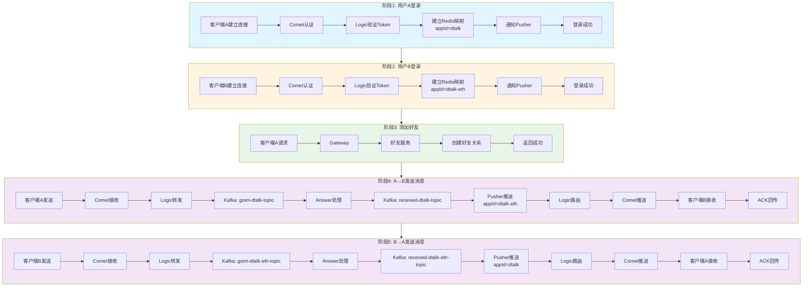

# 完整聊天通信流程详解

## 场景描述

- **用户A**：1x地址（Base58格式），地址：`19BKdzKcQbJ7N6q7Ys3KYaJHVSnCF3raAo`，appId：`dtalk`
- **用户B**：0x地址（Ethereum格式），地址：`0xa100b68ec7df4562457dc813f52f8a1a69ba4e01`，appId：`dtalk-eth`

## 流程概览

1. **用户A登录**
2. **用户B登录**
3. **用户A添加用户B为好友**
4. **用户A给用户B发送"hello"消息**
5. **用户B给用户A发送"hello，nice to meet you"消息**

## 完整流程图



---

## 阶段1：用户A登录

### 1.1 客户端发起连接

**模块：** 客户端 (im-util)

**步骤：**
1. 客户端建立WebSocket连接到Comet服务
2. 客户端生成认证Token（使用appId="dtalk"）
3. 客户端发送`Op_Auth`消息

**关键数据：**
```go
AuthMsg {
    AppId: "dtalk",
    Token: "生成的token",
    Ext: {
        Device: Device_Desktop,
        Username: "用户A",
        Uuid: "设备UUID",
        DeviceName: "设备名称"
    }
}
```

### 1.2 Comet服务处理认证

**模块：** Comet服务 (im/comet)

**步骤：**
1. 接收WebSocket连接请求
2. 读取`Op_Auth`消息
3. 调用`authWebsocket()`函数
4. 调用Logic服务的`Connect()`方法

**代码位置：** `im/comet/ws.go:authWebsocket()`

### 1.3 Logic服务处理连接

**模块：** Logic服务 (im/logic)

**步骤：**
1. 接收Connect请求
2. 解析AuthMsg，获取appId="dtalk"
3. 调用Auth服务验证Token
4. 从Token中提取用户ID：`19BKdzKcQbJ7N6q7Ys3KYaJHVSnCF3raAo`
5. 生成连接Key（UUID）：`key_A = "18f5e9ad-e444-4b9d-ab8f-c62ca73e1c9c"`
6. 调用`AddMapping()`建立Redis映射

**Redis操作：**
```redis
# 1. 用户ID到连接的映射
HSET mid_dtalk:19BKdzKcQbJ7N6q7Ys3KYaJHVSnCF3raAo key_A "grpc://127.0.0.1:3109"
EXPIRE mid_dtalk:19BKdzKcQbJ7N6q7Ys3KYaJHVSnCF3raAo 1800

# 2. 连接Key到服务器的映射
SET key_18f5e9ad-e444-4b9d-ab8f-c62ca73e1c9c "grpc://127.0.0.1:3109"
EXPIRE key_18f5e9ad-e444-4b9d-ab8f-c62ca73e1c9c 1800

# 3. 连接Key到用户ID的映射
SET usr_18f5e9ad-e444-4b9d-ab8f-c62ca73e1c9c "dtalk:19BKdzKcQbJ7N6q7Ys3KYaJHVSnCF3raAo"
EXPIRE usr_18f5e9ad-e444-4b9d-ab8f-c62ca73e1c9c 1800
```

**代码位置：** `im/logic/logic.go:Connect()`

### 1.4 通知业务层用户登录

**模块：** Logic服务 → Kafka → Pusher服务

**步骤：**
1. Logic服务发布`Op_Auth`消息到Kafka：`goim-dtalk-topic`
2. Pusher服务消费消息
3. Pusher服务解析设备信息
4. Pusher服务调用Device服务保存设备信息
5. Pusher服务发送登录通知（SignalEndpointLogin）

**代码位置：** `dtalk/service/record/pusher/service/service.go:DealConn()`

### 1.5 返回认证结果

**模块：** Comet服务 → 客户端

**步骤：**
1. Logic返回认证成功（key, hb）
2. Comet发送`Op_AuthReply`给客户端
3. 客户端收到认证成功，开始心跳保活

**结果：** 用户A登录成功，连接建立

---

## 阶段2：用户B登录

### 2.1 客户端发起连接

**模块：** 客户端 (im-util)

**步骤：**
1. 客户端建立WebSocket连接到Comet服务
2. 客户端生成认证Token（使用appId="dtalk-eth"）
3. 客户端发送`Op_Auth`消息

**关键数据：**
```go
AuthMsg {
    AppId: "dtalk-eth",  // ✅ 注意：0x地址使用dtalk-eth
    Token: "生成的token",
    Ext: {
        Device: Device_Desktop,
        Username: "用户B",
        Uuid: "设备UUID",
        DeviceName: "设备名称"
    }
}
```

### 2.2 Comet服务处理认证

**模块：** Comet服务 (im/comet)

**步骤：** 同用户A登录流程

### 2.3 Logic服务处理连接

**模块：** Logic服务 (im/logic)

**步骤：**
1. 接收Connect请求
2. 解析AuthMsg，获取appId="dtalk-eth"
3. 调用Auth服务验证Token
4. 从Token中提取用户ID：`0xa100b68ec7df4562457dc813f52f8a1a69ba4e01`
5. 生成连接Key（UUID）：`key_B = "f3879565-2b55-4a12-9877-1c8c1b0a1600"`
6. 调用`AddMapping()`建立Redis映射

**Redis操作：**
```redis
# 1. 用户ID到连接的映射（注意appId是dtalk-eth）
HSET mid_dtalk-eth:0xa100b68ec7df4562457dc813f52f8a1a69ba4e01 key_B "grpc://127.0.0.1:3109"
EXPIRE mid_dtalk-eth:0xa100b68ec7df4562457dc813f52f8a1a69ba4e01 1800

# 2. 连接Key到服务器的映射
SET key_f3879565-2b55-4a12-9877-1c8c1b0a1600 "grpc://127.0.0.1:3109"
EXPIRE key_f3879565-2b55-4a12-9877-1c8c1b0a1600 1800

# 3. 连接Key到用户ID的映射
SET usr_f3879565-2b55-4a12-9877-1c8c1b0a1600 "dtalk-eth:0xa100b68ec7df4562457dc813f52f8a1a69ba4e01"
EXPIRE usr_f3879565-2b55-4a12-9877-1c8c1b0a1600 1800
```

### 2.4 通知业务层用户登录

**模块：** Logic服务 → Kafka → Pusher服务

**步骤：** 同用户A登录流程，但使用appId="dtalk-eth"

### 2.5 返回认证结果

**模块：** Comet服务 → 客户端

**步骤：** 同用户A登录流程

**结果：** 用户B登录成功，连接建立

---

## 阶段3：用户A添加用户B为好友

### 3.1 客户端发起添加好友请求

**模块：** 客户端 → Gateway → 业务服务

**步骤：**
1. 用户A在客户端输入用户B的地址：`0xa100b68ec7df4562457dc813f52f8a1a69ba4e01`
2. 客户端通过HTTP API调用Gateway
3. Gateway路由到好友服务（Friend Service）
4. 好友服务处理添加好友逻辑

**关键数据：**
```json
{
    "from": "19BKdzKcQbJ7N6q7Ys3KYaJHVSnCF3raAo",
    "to": "0xa100b68ec7df4562457dc813f52f8a1a69ba4e01"
}
```

### 3.2 业务层处理添加好友

**模块：** 好友服务

**步骤：**
1. 验证用户A和用户B是否存在
2. 检查是否已经是好友
3. 创建好友关系记录（存储到数据库）
4. 可选：发送好友申请通知（如果需要审批）

**数据库操作：**
```sql
INSERT INTO friend_relations (user_a, user_b, status, create_time)
VALUES ('19BKdzKcQbJ7N6q7Ys3KYaJHVSnCF3raAo', '0xa100b68ec7df4562457dc813f52f8a1a69ba4e01', 'accepted', NOW())
```

### 3.3 返回添加结果

**模块：** 好友服务 → Gateway → 客户端

**步骤：**
1. 好友服务返回成功结果
2. Gateway返回给客户端
3. 客户端更新好友列表

**结果：** 用户A和用户B成为好友

---

## 阶段4：用户A给用户B发送"hello"消息

### 4.1 客户端发送消息

**模块：** 客户端 (im-util/internal/device)

**步骤：**
1. 用户A在客户端输入消息："hello"
2. 客户端调用`SendMsg()`函数
3. 构建`Op_SendMsg`消息
4. 客户端序列号递增：`seq_A = 3`
5. 通过WebSocket发送消息

**消息结构：**
```go
Proto {
    Op: Op_SendMsg,
    Seq: 3,  // 客户端序列号
    Body: {
        EventType: Proto_common,
        Body: {
            From: "19BKdzKcQbJ7N6q7Ys3KYaJHVSnCF3raAo",
            Target: "0xa100b68ec7df4562457dc813f52f8a1a69ba4e01",
            ChannelType: ToUser,
            Content: "hello"
        }
    }
}
```

**代码位置：** `im-util/internal/device/device.go:SendMsg()`

### 4.2 Comet服务接收消息

**模块：** Comet服务 (im/comet)

**步骤：**
1. 接收WebSocket消息
2. 解析Proto消息
3. 将消息放入Channel的CliProto缓冲区
4. 转发消息到Logic服务

**代码位置：** `im/comet/ws.go:dispatchWebsocket()`

### 4.3 Logic服务转发消息

**模块：** Logic服务 (im/logic)

**步骤：**
1. 接收`Op_SendMsg`消息
2. 构建BizMsg
3. 发布消息到Kafka：`goim-dtalk-topic`（用户A的appId）

**Kafka消息：**
```go
BizMsg {
    AppId: "dtalk",
    FromId: "19BKdzKcQbJ7N6q7Ys3KYaJHVSnCF3raAo",
    Key: "18f5e9ad-e444-4b9d-ab8f-c62ca73e1c9c",
    Op: Op_SendMsg,
    Msg: {原始消息体}
}
```

**代码位置：** `im/logic/grpc/server.go:SendMsg()`

### 4.4 Answer服务处理消息

**模块：** Answer服务 (dtalk/service/record/answer)

**步骤：**
1. 从Kafka消费消息：`goim-dtalk-topic`
2. 调用`DealOpSendMsg()`处理消息
3. 调用`Transport()`函数：
   - 生成消息ID（mid）：`mid_1 = 720751459670429696`
   - 构建PushMsg
   - 发布到Kafka：`received-dtalk-topic`
   - 推送给发送者（同步消息）

**PushMsg结构：**
```go
PushMsg {
    AppId: "dtalk",
    FromId: "19BKdzKcQbJ7N6q7Ys3KYaJHVSnCF3raAo",
    Target: "0xa100b68ec7df4562457dc813f52f8a1a69ba4e01",
    Mid: 720751459670429696,
    Key: "18f5e9ad-e444-4b9d-ab8f-c62ca73e1c9c",
    Msg: {消息体}
}
```

**代码位置：** `dtalk/service/record/answer/service/msg.go:Transport()`

### 4.5 发送者收到发送ACK

**模块：** Answer服务 → Logic服务 → Comet服务 → 客户端A

**步骤：**
1. Answer服务调用`PushByKeys()`推送ACK给发送者
2. Logic服务查找连接：`key_18f5e9ad-e444-4b9d-ab8f-c62ca73e1c9c`
3. Comet服务推送`Op_SendMsgReply`给客户端A
4. 客户端A收到ACK，取消重传任务

**ACK消息：**
```go
Proto {
    Op: Op_SendMsgReply,
    Seq: 3,
    Ack: 3,  // 确认序列号3
    Body: {
        Mid: 720751459670429696
    }
}
```

### 4.6 Store服务存储消息

**模块：** Store服务 (dtalk/service/record/store)

**步骤：**
1. 从Kafka消费消息：`received-dtalk-topic`
2. 解析PushMsg
3. 存储消息到数据库

**数据库操作：**
```sql
INSERT INTO messages (mid, from_id, target_id, content, create_time)
VALUES (720751459670429696, '19BKdzKcQbJ7N6q7Ys3KYaJHVSnCF3raAo', 
        '0xa100b68ec7df4562457dc813f52f8a1a69ba4e01', 'hello', NOW())
```

### 4.7 Pusher服务推送消息给用户B

**模块：** Pusher服务 (dtalk/service/record/pusher)

**步骤：**
1. 从Kafka消费消息：`received-dtalk-topic`
2. 调用`UniCast()`函数
3. **关键步骤：根据目标地址确定appId**
   - 目标地址：`0xa100b68ec7df4562457dc813f52f8a1a69ba4e01`
   - 判断：以"0x"开头 → appId = "dtalk-eth"
4. 推送给发送者（同步消息）：
   - 使用appId="dtalk"查找用户A的连接
   - 推送消息给用户A（用于UI同步）
5. 推送给目标用户：
   - 使用appId="dtalk-eth"查找用户B的连接
   - 调用`PushByMids(appId="dtalk-eth", toIds=["0xa100b68ec7df4562457dc813f52f8a1a69ba4e01"])`

**代码位置：** `dtalk/service/record/pusher/service/push.go:UniCast()`

### 4.8 Logic服务路由消息

**模块：** Logic服务 (im/logic)

**步骤：**
1. 接收`PushByMids`请求
2. 调用`getServerByMids(appId="dtalk-eth", mids=["0xa100b68ec7df4562457dc813f52f8a1a69ba4e01"])`
3. 查询Redis：`mid_dtalk-eth:0xa100b68ec7df4562457dc813f52f8a1a69ba4e01`
4. 返回连接信息：`{key_B: "grpc://127.0.0.1:3109"}`
5. 按服务器分组，调用Comet服务的`PushMsg()`

**代码位置：** `im/logic/logic.go:PushByMids()`

### 4.9 Comet服务推送消息

**模块：** Comet服务 (im/comet)

**步骤：**
1. 接收`PushMsg`请求
2. 根据key查找Channel：`key_f3879565-2b55-4a12-9877-1c8c1b0a1600`
3. 服务端序列号递增：`seq_B = 1`
4. 构建`Op_ReceiveMsg`消息
5. 推送到Channel的signal通道
6. 通过WebSocket发送给客户端B

**消息结构：**
```go
Proto {
    Op: Op_ReceiveMsg,
    Seq: 1,  // 服务端序列号
    Body: {
        EventType: Proto_common,
        Body: {
            From: "19BKdzKcQbJ7N6q7Ys3KYaJHVSnCF3raAo",
            Target: "0xa100b68ec7df4562457dc813f52f8a1a69ba4e01",
            Content: "hello"
        }
    }
}
```

**代码位置：** `im/comet/grpc/server.go:PushMsg()`

### 4.10 客户端B接收消息

**模块：** 客户端B (im-util/internal/device)

**步骤：**
1. 接收`Op_ReceiveMsg`消息
2. 解析消息内容
3. 显示消息："hello"
4. 发送`Op_ReceiveMsgReply`确认收到

**ACK消息：**
```go
Proto {
    Op: Op_ReceiveMsgReply,
    Seq: 1,
    Ack: 1  // 确认序列号1
}
```

**代码位置：** `im-util/internal/device/device.go:serve()`

### 4.11 接收ACK回传给发送者

**模块：** 客户端B → Comet服务 → Logic服务 → Kafka → Answer服务 → Logic服务 → Comet服务 → 客户端A

**步骤：**
1. 客户端B发送`Op_ReceiveMsgReply`
2. Comet服务转发到Logic服务
3. Logic服务发布ACK到Kafka：`goim-dtalk-eth-topic`
4. Answer服务消费ACK（注意：Answer服务需要订阅`goim-dtalk-eth-topic`）
5. Answer服务调用`RevAck()`处理ACK
6. Answer服务调用`PushByKeys()`推送ACK给发送者
7. Logic服务查找发送者连接：`key_18f5e9ad-e444-4b9d-ab8f-c62ca73e1c9c`
8. Comet服务推送`Op_ReceiveMsgReply`给客户端A
9. 客户端A收到接收ACK，记录消息已送达

**结果：** 用户A发送的"hello"消息成功送达用户B

---

## 阶段5：用户B给用户A发送"hello，nice to meet you"消息

### 5.1 客户端发送消息

**模块：** 客户端B (im-util/internal/device)

**步骤：**
1. 用户B在客户端输入消息："hello，nice to meet you"
2. 客户端调用`SendMsg()`函数
3. 构建`Op_SendMsg`消息
4. 客户端序列号递增：`seq_B = 3`
5. 通过WebSocket发送消息

**消息结构：**
```go
Proto {
    Op: Op_SendMsg,
    Seq: 3,  // 客户端序列号
    Body: {
        EventType: Proto_common,
        Body: {
            From: "0xa100b68ec7df4562457dc813f52f8a1a69ba4e01",
            Target: "19BKdzKcQbJ7N6q7Ys3KYaJHVSnCF3raAo",
            ChannelType: ToUser,
            Content: "hello，nice to meet you"
        }
    }
}
```

### 5.2 Comet服务接收消息

**模块：** Comet服务 (im/comet)

**步骤：** 同阶段4.2

### 5.3 Logic服务转发消息

**模块：** Logic服务 (im/logic)

**步骤：**
1. 接收`Op_SendMsg`消息
2. 构建BizMsg
3. 发布消息到Kafka：`goim-dtalk-eth-topic`（用户B的appId）

**Kafka消息：**
```go
BizMsg {
    AppId: "dtalk-eth",  // ✅ 注意：用户B的appId
    FromId: "0xa100b68ec7df4562457dc813f52f8a1a69ba4e01",
    Key: "f3879565-2b55-4a12-9877-1c8c1b0a1600",
    Op: Op_SendMsg,
    Msg: {原始消息体}
}
```

### 5.4 Answer服务处理消息

**模块：** Answer服务 (dtalk/service/record/answer)

**步骤：**
1. 从Kafka消费消息：`goim-dtalk-eth-topic`（注意：Answer服务需要订阅多个topic）
2. 调用`DealOpSendMsg()`处理消息
3. 调用`Transport()`函数：
   - 从context获取appId="dtalk-eth"（动态appId）
   - 生成消息ID（mid）：`mid_2 = 720751459716567040`
   - 构建PushMsg
   - 发布到Kafka：`received-dtalk-eth-topic`
   - 推送给发送者（同步消息）

**PushMsg结构：**
```go
PushMsg {
    AppId: "dtalk-eth",
    FromId: "0xa100b68ec7df4562457dc813f52f8a1a69ba4e01",
    Target: "19BKdzKcQbJ7N6q7Ys3KYaJHVSnCF3raAo",
    Mid: 720751459716567040,
    Key: "f3879565-2b55-4a12-9877-1c8c1b0a1600",
    Msg: {消息体}
}
```

### 5.5 发送者收到发送ACK

**模块：** Answer服务 → Logic服务 → Comet服务 → 客户端B

**步骤：** 同阶段4.5，但使用appId="dtalk-eth"

### 5.6 Store服务存储消息

**模块：** Store服务 (dtalk/service/record/store)

**步骤：**
1. 从Kafka消费消息：`received-dtalk-eth-topic`
2. 解析PushMsg
3. 存储消息到数据库

### 5.7 Pusher服务推送消息给用户A

**模块：** Pusher服务 (dtalk/service/record/pusher)

**步骤：**
1. 从Kafka消费消息：`received-dtalk-eth-topic`（注意：Pusher服务需要订阅多个topic）
2. 调用`UniCast()`函数
3. **关键步骤：根据目标地址确定appId**
   - 目标地址：`19BKdzKcQbJ7N6q7Ys3KYaJHVSnCF3raAo`
   - 判断：Base58格式 → appId = "dtalk"
4. 推送给发送者（同步消息）：
   - 使用appId="dtalk-eth"查找用户B的连接
   - 推送消息给用户B（用于UI同步）
5. 推送给目标用户：
   - 使用appId="dtalk"查找用户A的连接
   - 调用`PushByMids(appId="dtalk", toIds=["19BKdzKcQbJ7N6q7Ys3KYaJHVSnCF3raAo"])`

### 5.8 Logic服务路由消息

**模块：** Logic服务 (im/logic)

**步骤：**
1. 接收`PushByMids`请求
2. 调用`getServerByMids(appId="dtalk", mids=["19BKdzKcQbJ7N6q7Ys3KYaJHVSnCF3raAo"])`
3. 查询Redis：`mid_dtalk:19BKdzKcQbJ7N6q7Ys3KYaJHVSnCF3raAo`
4. 返回连接信息：`{key_A: "grpc://127.0.0.1:3109"}`
5. 按服务器分组，调用Comet服务的`PushMsg()`

### 5.9 Comet服务推送消息

**模块：** Comet服务 (im/comet)

**步骤：**
1. 接收`PushMsg`请求
2. 根据key查找Channel：`key_18f5e9ad-e444-4b9d-ab8f-c62ca73e1c9c`
3. 服务端序列号递增：`seq_A = 2`
4. 构建`Op_ReceiveMsg`消息
5. 推送到Channel的signal通道
6. 通过WebSocket发送给客户端A

**消息结构：**
```go
Proto {
    Op: Op_ReceiveMsg,
    Seq: 2,  // 服务端序列号
    Body: {
        EventType: Proto_common,
        Body: {
            From: "0xa100b68ec7df4562457dc813f52f8a1a69ba4e01",
            Target: "19BKdzKcQbJ7N6q7Ys3KYaJHVSnCF3raAo",
            Content: "hello，nice to meet you"
        }
    }
}
```

### 5.10 客户端A接收消息

**模块：** 客户端A (im-util/internal/device)

**步骤：**
1. 接收`Op_ReceiveMsg`消息
2. 解析消息内容
3. 显示消息："hello，nice to meet you"
4. 发送`Op_ReceiveMsgReply`确认收到

**ACK消息：**
```go
Proto {
    Op: Op_ReceiveMsgReply,
    Seq: 2,
    Ack: 2  // 确认序列号2
}
```

### 5.11 接收ACK回传给发送者

**模块：** 客户端A → Comet服务 → Logic服务 → Kafka → Answer服务 → Logic服务 → Comet服务 → 客户端B

**步骤：**
1. 客户端A发送`Op_ReceiveMsgReply`
2. Comet服务转发到Logic服务
3. Logic服务发布ACK到Kafka：`goim-dtalk-topic`
4. Answer服务消费ACK（订阅`goim-dtalk-topic`）
5. Answer服务调用`RevAck()`处理ACK
6. Answer服务调用`PushByKeys()`推送ACK给发送者
7. Logic服务查找发送者连接：`key_f3879565-2b55-4a12-9877-1c8c1b0a1600`
8. Comet服务推送`Op_ReceiveMsgReply`给客户端B
9. 客户端B收到接收ACK，记录消息已送达

**结果：** 用户B发送的"hello，nice to meet you"消息成功送达用户A

---

## 关键要点总结

### 1. appId的重要性

- **1x地址（Base58）** → appId = "dtalk"
- **0x地址（Ethereum）** → appId = "dtalk-eth"
- **关键修复：** Pusher服务必须根据目标地址确定appId，不能使用发送者的appId

### 2. Redis映射关系

- `mid_{appId}:{uid}` → `{key: server}` (Hash)
- `key_{key}` → `server` (String)
- `usr_{key}` → `{appId}:{uid}` (String)

### 3. Kafka Topic设计

- 客户端消息：`goim-{appId}-topic`
- 推送消息：`received-{appId}-topic`
- 存储消息：`store-{appId}-topic`

### 4. 多appId支持

- Answer服务：支持订阅多个`goim-{appId}-topic`
- Pusher服务：支持订阅多个`received-{appId}-topic`
- 动态appId：从context或地址格式确定

### 5. 消息流转路径

```
客户端发送 → Comet → Logic → Kafka → Answer → Kafka → Pusher → Logic → Comet → 客户端接收
```

### 6. ACK机制

- **发送ACK：** 消息处理成功后立即返回
- **接收ACK：** 接收方收到消息后返回，再回传给发送方

---

**文档版本：** v1.0  
**最后更新：** 2025-11-10  
**维护者：** 开发团队

