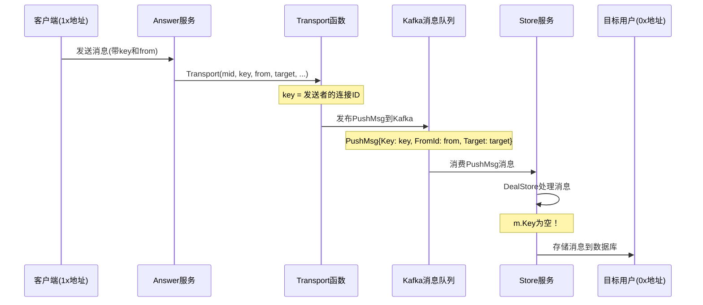

# Key字段为空问题分析

## 问题现象

### 正常情况（1x与1x通信）
```
{"level":"info","service":"store","appId":"dtalk","key":"6041512e-a648-4fa1-9c55-becef782d1ae","from":"15vzoUF78k4HUjRndNLebWfNsPUXfFAMoA","time":"2025-11-10T07:13:28Z","message":"do store"}
```
- ✅ `key` 字段有值（发送者的连接ID）
- ✅ `from` 字段有值（发送者地址）

### 异常情况（1x与0x通信）
```
{"level":"info","service":"store","appId":"dtalk","key":"","from":"19BKdzKcQbJ7N6q7Ys3KYaJHVSnCF3raAo","time":"2025-11-10T07:12:14Z","message":"do store"}
```
- ❌ `key` 字段为空字符串
- ✅ `from` 字段有值（发送者地址）

## 代码流程分析

### 消息流转路径



### 关键代码位置

#### 1. Transport函数构造PushMsg
```77:93:dtalk/service/record/answer/service/msg.go
func (e *Exec) Transport(ctx context.Context, mid int64, key, from, target string, ch imparse.Channel, frameType imparse.FrameType, data []byte) error {
	pushMsg := &record.PushMsg{
		AppId:     e.appId,
		FromId:    from,
		Mid:       mid,
		Key:       key,  // 这里key应该是发送者的连接ID
		Target:    target,
		Msg:       data,
		Type:      int32(ch),
		FrameType: string(frameType),
	}
	b, err := proto.Marshal(pushMsg)
	if err != nil {
		return err
	}
	return e.dao.PublishToSend(ctx, from, b)
}
```

#### 2. Store服务处理消息
```240:266:dtalk/service/record/store/service/service.go
func (s *Service) DealStore(ctx context.Context, m *record.PushMsg) error {
	s.log.Info().Str("appId", m.AppId).Str("key", m.Key).Str("from", m.FromId).Msg("do store")
	if m.AppId != s.cfg.AppId {
		return model.ErrAppId
	}

	frame, err := s.parser.NewFrame(m.GetKey(), m.GetFromId(), bytes.NewReader(m.GetMsg()), chat.WithMid(m.GetMid()), chat.WithTarget(m.GetTarget()), chat.WithTransmissionMethod(imparse.Channel(m.GetType())))
	if err != nil {
		s.log.Error().Stack().Err(err).Str("key", m.Key).Str("from", m.FromId).Msg("NewFrame error")
		return err
	}
	//TODO 暂时处理，之后device信息统一通过answer服务传递
	devType := xproto.Device_Android
	dev, err := s.deviceClient.GetDeviceByConnID(ctx, &device.GetDeviceByConnIdRequest{
		Uid:    m.GetFromId(),
		ConnID: m.GetKey(),  // 使用key查询设备信息
	})
	if dev != nil {
		devType = xproto.Device(dev.GetDeviceType())
	}
	if err := s.storage.SaveMsg(ctx, devType, frame); err != nil {
		s.log.Error().Stack().Err(err).Str("key", m.Key).Str("from", m.FromId).Msg("Store error")
		return err
	}
	s.log.Debug().Str("appId", m.AppId).Str("key", m.Key).Str("from", m.FromId).Msg("pass Store")
	return nil
}
```

## 问题根因分析

### 可能的原因

1. **消息路由时key丢失**
   - 当目标地址是0x格式时，消息路由逻辑可能无法正确获取发送者的连接key
   - `Transport` 函数被调用时，`key` 参数可能已经为空

2. **Frame构造时key传递问题**
   - `NewFrame` 函数使用 `m.GetKey()` 作为第一个参数
   - 如果key为空，可能导致frame构造失败或后续处理异常

3. **设备查询失败**
   - `GetDeviceByConnID` 使用空的key查询设备信息会失败
   - 但代码中有fallback机制（默认Android），所以不会直接报错

4. **消息存储失败**
   - 虽然key为空不会直接导致存储失败
   - 但可能影响消息的完整性或后续查询

## 需要进一步调查

1. **查看Answer服务的日志**
   - 检查 `Transport` 函数被调用时，`key` 参数是否有值
   - 检查消息发布到Kafka时，PushMsg中的Key字段是否正确

2. **查看消息路由逻辑**
   - 检查当目标地址是0x格式时，消息路由是否有特殊处理
   - 检查 `getServerByMids` 或 `getServerByKeys` 函数是否能正确处理0x地址

3. **检查Frame构造逻辑**
   - 查看 `NewFrame` 函数如何处理空的key参数
   - 检查是否有地址格式相关的验证逻辑

## 建议的调试步骤

1. **在Answer服务中添加日志**
   ```go
   func (e *Exec) Transport(ctx context.Context, mid int64, key, from, target string, ...) error {
       log.Info().Str("key", key).Str("from", from).Str("target", target).Msg("Transport called")
       // ... 现有代码
   }
   ```

2. **在Store服务中添加更详细的日志**
   ```go
   func (s *Service) DealStore(ctx context.Context, m *record.PushMsg) error {
       s.log.Info().
           Str("appId", m.AppId).
           Str("key", m.Key).
           Str("from", m.FromId).
           Str("target", m.Target).
           Int64("mid", m.Mid).
           Msg("DealStore received message")
       // ... 现有代码
   }
   ```

3. **检查Kafka消息内容**
   - 查看Kafka中存储的PushMsg消息，确认Key字段是否在序列化时丢失

4. **验证地址格式处理**
   - 检查系统是否有地址格式验证逻辑，可能0x地址在某些地方被过滤或处理异常

## 临时解决方案

如果key字段为空不影响核心功能，可以考虑：

1. **允许key为空的情况**
   - 在 `DealStore` 中，如果key为空，使用默认设备类型
   - 确保消息存储不受影响

2. **添加key验证和日志**
   - 当key为空时，记录警告日志
   - 但不阻止消息处理流程

## 根本解决方案

需要找到key字段丢失的根本原因：

1. **检查消息路由逻辑**：确保无论目标地址格式如何，都能正确传递发送者的key
2. **检查地址格式处理**：确保0x地址格式在所有环节都能被正确处理
3. **检查连接管理**：确保0x地址用户的连接信息能正确存储和查询

