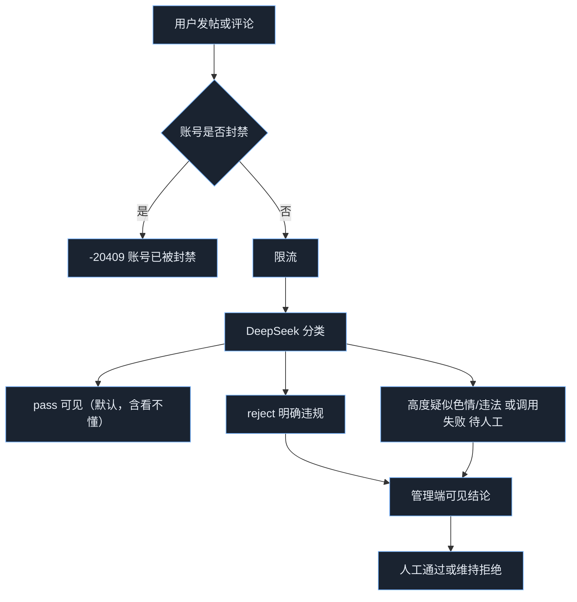

# 谈信广场 HTTP API

## 通用说明

- 协议：HTTPS（本地开发可用 HTTP）
- 基础 URL：直连 `http://127.0.0.1:18100`，或经反代后的站点根路径
- 路径前缀：C 端 `/square/app`，管理端 API `/square/admin`，运营台 `/square/console/`（旧地址 `/square/admin-ui/` 会 301 到运营台）
- 健康检查：`GET /square/healthz`

### C 端认证

- Header：`FZM-SIGNATURE`
- 算法与聊天一致：token 为 `{sig}#{ts}*{appId}#{hex_pubkey}`，签名原文 `{timestamp}*{appId}`，有效期 120 秒
- 身份只从验签得到，**不要把 address 放在 Body**
- `MOCK` / `MOCK2` 仅当 `SQUARE_ENV` 为 `local|dev|test` **且** `SQUARE_ALLOW_MOCK=true` 时有效
- 生产环境（`prod` / `production`）启动时强制关闭 MOCK；收到 MOCK 返回 `-1010`

### 管理端认证

- 登录：用户名 + 密码 + 图形验证码（每次必须带）
- 成功后 Header：`Authorization: Bearer <JWT>`
- JWT：HS256，默认 8 小时
- 只静默出错的 IP：同一 IP 连续 3 次账号登录失败（用户名或密码错误，不含验证码填错）后静默 1 小时，期间这个地址直接拒绝，提示「请一小时后再试」。账号本身不锁定，其他地址仍可登录。静默结束后该 IP 重新计数。登录成功只清掉当前这个 IP 的失败次数
- 同一 IP 每分钟最多 20 次登录请求
- 近 1 小时内，至少 2 个不同 IP、且每个 IP 登录失败不少于 2 次时，已登录的运营台每 15 秒轮询 `GET /square/admin/login-alert`。`alert=true` 时弹「登录安全预警」，列出地址和失败次数。同一组次数只弹一次，失败次数增加后再弹。单个地址反复失败不会因为这条规则弹框，该地址仍按上面的静默处理
- 登录成功会记下会话（账号、IP、过期时间，与 JWT 相同，默认 8 小时）。`POST /square/admin/logout` 只作废当前这次登录。同一账号同时有 2 个及以上不同 IP 的未过期会话时，`shareAlert=true`，运营台弹红色「账号同时在线」，提示确认密码是否泄漏、是否认识这些地址。同一组地址只弹一次，地址变化后再弹。同一 IP 再登录不会挤掉其他地址
- 同一个账号同时有 2 个及以上未过期、未退出的登录时，`multiAlert=true`，运营台弹黄色「同一账号多人登录」。同一个地址或不同地址都算。同一组登录只弹一次，再多一个登录会再弹。这不静默地址，也不锁定账号。不同地址时仍会先弹上面的红色提醒
- 首启超管：`SQUARE_BOOTSTRAP_ADMIN_USER` / `SQUARE_BOOTSTRAP_ADMIN_PASSWORD`（角色 `super`）。额外账号：`SQUARE_BOOTSTRAP_ADMINS`，格式 `用户名:密码:角色`，多条逗号分隔，角色 `super` 或 `reviewer`。启动时只补库里还没有的用户名，不覆盖已有密码
- 忘记根管理员密码：`SQUARE_ADMIN_PASSWORD_RESET=true`，并把 `SQUARE_BOOTSTRAP_ADMIN_PASSWORD` 写成新密码（至少 12 位），重启一次。只覆盖 `SQUARE_BOOTSTRAP_ADMIN_USER`。登录后把开关改回 `false`，否则每次启动都会覆盖页面上改过的密码
- 响应永不回传密码 hash 或验证码明文

### 注意事项

- 条件查询支持多值并行：`?status=a&status=b`
- 分页：`page`、`pageSize`（默认 20，上限 100），响应 `list` + `total`
- 图片只存 URL；C 端自行传 OSS，运营台走 `POST /square/admin/upload` 代理到 IM nginx `POST {SQUARE_OSS_URL}/oss/upload`（与 ChatPro 相同：multipart `file`/`appId`/`key`，Header `FZM-SIGNATURE`）。广场服务用固定 secp256k1 私钥（`SQUARE_OSS_PRIVKEY`）签发该 Header，**不是用户钱包、也不是官方号 `square-official`**。机审只看标题、简介和正文，不审图片。运营台官方帖不走 AI
- 帖子与公众号文章默认 45 天后软删（`SQUARE_POST_TTL_DAYS`，`0` 关闭，合法 30–62）。`SQUARE_OSS_DELETE` 默认 `false`，本期不删 OSS 图。热门窗口 `SQUARE_HOT_WINDOW_DAYS` 默认 7
- 文字审核：默认宁松勿严；运营可切「审核全部」，帖与评拿不准进人工队列
- 无 DeepSeek 密钥或调用失败时结论仍为 `review`（待人工），帖/评不对 C 端可见
- 限流在调用 DeepSeek **之前**计数（含随后被拒的请求）
- 本地未设置 `SQUARE_PG_HOST` 时自动拉取并创建 Docker 容器 `txchat-square-pg`（`127.0.0.1:15432`，用户/密码/库名默认均为 `square`，见 `.env.example`）；生产必须显式指定

---

## 错误处理

### C 端响应

```json
{ "result": 0, "message": "操作成功", "data": {} }
```

失败时 `result != 0`，`data` 为 `null`。

### 管理端响应

```json
{ "code": 200, "message": "success", "data": {} }
```

失败时 `code` 为 400/401/403/404/500，`data` 为 `null`。

### 常见错误码

| 码 | 端 | 说明 |
|----|----|------|
| 0 / 200 | 成功 | 操作成功 |
| -1010 | C | 无效签名（含生产环境 MOCK） |
| -1011 | C | 签名过期 |
| -1012 | C/管理 | 参数错误 |
| -1000 | C | 内部错误 |
| -20401 | C | 内容不合规，无法发布 |
| -20402 | C | 已提交，等待审核 |
| -20403 | C | 无权操作 |
| -20404 | C | 资源不存在 |
| -20405 | C | 公众号已封禁 |
| -20406 | C | 非公众号 |
| -20407 | C | 评论已关闭 |
| -20408 | C | 已有待审申请 |
| -20409 | C | 账号已被封禁 |
| -20410 | C | 已举报过该内容 |
| -20411 | C | 不能关注自己 |
| -20412 | 管理 | 最多置顶 3 条 |
| -20413 | C | 广场已完全关闭（`message` 为关闭说明） |
| -20414 | C | 半关闭，当前账号不能发帖 |
| -20415 | C | 个人/公众号帖超过 20 分钟编辑窗 |
| -20416 | C | 24 小时内与自己已发帖内容相似度达到 90% |
| -20417 | C/管理 | 公众号名称已被使用 |
| -20418 | C/管理 | 不能回复该评论 |
| -20429 | C/管理 | 操作过于频繁 |
| -30401 | 管理 | 该 IP 静默一小时，账号本身未锁定 |
| -30402 | 管理 | 用户名或密码错误 |
| -30403 | 管理 | 未登录 |
| -30404 | 管理 | 验证码错误 |

---

## C 端接口 `/square/app/*`

均需 `FZM-SIGNATURE`。

### POST /square/app/posts

发帖。限流后再 AI 审核，`pass` 才对广场可见。已认证公众号发帖一律 `authorKind=1`，展示名为公众号名称。同一地址 24 小时内新帖与自己已发帖（含已删除）的标题、简介、正文归一化后相似度达到 90%，返回 `-20416`，不占发帖次数。

**请求参数（JSON）**

| 字段 | 类型 | 必填 | 说明 |
|------|------|------|------|
| content | string | 是 | 正文，最长 5000 字 |
| title | string | 否 | 标题，最长 64 字；C 端可不传，空字符串 |
| intro | string | 否 | 简介，最长 200 字；C 端可不传，空字符串 |
| nickname | string | 否 | 聊天昵称快照；已是公众号时忽略 |
| mediaUrls | string[] | 否 | 图片 URL，最多 9 个 |
| commentsEnabled | bool | 否 | 仅公众号帖可关评论 |

**响应 data**：帖子对象（见下方字段表）。AI 拒绝 `result=-20401`；待审 `result=-20402`。

**示例请求**

```http
POST /square/app/posts
FZM-SIGNATURE: MOCK
Content-Type: application/json

{"content":"hello square","nickname":"alice","mediaUrls":[]}
```

**示例响应**

```json
{
  "result": 0,
  "message": "操作成功",
  "data": {
    "id": 1,
    "authorAddr": "1FKxgaEh5fuSm7a35BfUnKYAmradowpiTR",
    "authorName": "alice",
    "authorKind": 0,
    "authorAvatar": "",
    "title": "",
    "intro": "",
    "content": "hello square",
    "mediaUrls": [],
    "commentsEnabled": true,
    "status": 1,
    "commentCount": 0,
    "likeCount": 0,
    "viewCount": 0,
    "liked": false,
    "createdAt": "2026-09-09T14:00:00+08:00",
    "editUntil": "2026-09-09T14:20:00+08:00"
  }
}
```

### GET /square/app/status

当前广场开关。需签名，始终 `result=0`。`data.mode` 为 `open|closed|limited`；完全关闭时用 `message` 展示说明。详见 [App增量-广场开关与审核强度](App增量-广场开关与审核强度.md)。

### GET /square/app/posts

广场流，仅 `status=1`。完全关闭时 `-20413`。

**查询参数**：`page`、`pageSize`、`kind`（0 个人 / 1 公众号，可省略）、`authorAddr`（可多值）、`authorName`（可多值，昵称模糊匹配）、`tag`（官方帖标签，可多值：`公告`/`消息`/`活动`）、`feed`（`latest` 默认 / `hot` 近 N 天热门 / `following` 关注流）。地址与昵称同时传时为 AND。热度 = `likeCount*2 + commentCount*3`。

**响应 data**：`{ list, total, page, pageSize }`，元素含 `likeCount`、`viewCount`、`liked`、`pinned`、`pinnedAt`、`editUntil`、`tag`。第 1 页最前插入当前筛选下的置顶帖（全站最多 3 条可见置顶），`total` 含这些置顶。

### GET /square/app/posts/:id

详情。非作者且当日未读过则 `viewCount+1`。作者打开不加。

### PUT /square/app/posts/:id

作者二次编辑自己的帖。请求体与发帖相同。会重新审核；软删与草稿不能改。个人帖与公众号帖仅 `createdAt` 起 20 分钟内可改，超时 `-20415`；仅运营台官方账号帖不限时。编辑导致离开可见状态时会自动取消置顶。

### DELETE /square/app/posts/:id

删自己的帖（软删 `status=3`）。

### POST /square/app/posts/:id/like

点赞，幂等。

**响应 data**：`{ likeCount, liked }`

### DELETE /square/app/posts/:id/like

取消点赞，幂等。

### POST /square/app/posts/:id/comments

评论。帖子须可见且允许评论。限流后再 AI。官方回复走管理端 `POST /square/admin/posts/:id/comments`，C 端列表里 `isOfficial=true`。

**请求 JSON**：`content`（必填，最长 500）、`nickname`（可选）、`replyToId`（可选。不传或 0 为一级评论；大于 0 表示回复某条可见评论。回复「回复」仍挂在同一条一级评论下）。目标不可见、已删或不是本帖评论时 `-20418`。

审核通过后：一级评论给帖子作者写收件箱，回复给被回复的人写收件箱。自己评自己、接收人是 `square-official` 时不写。

### GET /square/app/posts/:id/comments

评论列表。默认返回该帖全部可见评论，`total` 与 `commentCount` 都是可见评论数。传 `thread=1` 时只返回楼（含占位楼）和每楼最早 2 条回复；此时 `total` 是楼数，`commentCount` 是含回复的可见评论数。

评论对象增加 `parentId`、`replyToId`、`replyToAddr`、`replyToName`、`replyCount`、`deleted`。`thread=1` 时楼对象另含 `replies`。

### GET /square/app/posts/:id/comments/:commentId/replies

某条一级评论下的可见回复，时间从早到晚。`commentId` 必须是该帖的一级评论。

### GET /square/app/replies

我的评论收件箱，新的在前。`read=0` 只看可展示未读，`read=1` 只看已读，不传为全部历史。`unreadCount` 只统计未读且 `available=true` 的条数。条目含 `postId`、`postTitle`、`postAvailable`、`rootId`、`commentId`、`replyToId`、`actorAddr`、`actorName`、`content`、`read`、`available`、`createdAt`。`replyToId=0` 表示有人评论了你的帖。帖子已删或评论不可见时 `available=false`，不计未读。

### POST /square/app/replies/read

`{ "ids": [1, 2] }` 或 `{ "all": true }`，只能改自己的。响应 `{ unreadCount }`。

### DELETE /square/app/comments/:id

删自己的评。

### PUT /square/app/posts/:id/comments-enabled

仅公众号作者。

```json
{ "enabled": false }
```

### GET /square/app/official/me

我的公众号状态。

**响应 data 示例**

```json
{
  "state": "pending",
  "address": "1FKxgaEh5fuSm7a35BfUnKYAmradowpiTR",
  "apply": { "id": 1, "status": "pending", "name": "谈信官方", "remark": "" }
}
```

`state`：`none` / `pending` / `approved` / `rejected` / `banned`。`approved` 只在仍有正常公众号时返回。运营取消公众号后，即使最近一次申请曾通过，`state` 也回到 `none`，可以重新申请。

### POST /square/app/official/apply

提交或拒绝后再次申请。同一地址同时只能一条 pending。每天最多 3 次。名称与现有公众号（含封禁）、待审或已通过申请相同时拒绝，`-20417`。已拒绝的申请不占名。取消入驻后，该次已通过申请里的名称仍然占用，需换名再申请。

```json
{ "name": "谈信官方", "avatar": "https://oss.example/a.png", "intro": "简介" }
```

### POST /square/app/follows

关注用户或公众号（按地址）。不能关注自己 `-20411`。幂等。Body：`{ "targetAddr": "..." }`

### DELETE /square/app/follows/:addr

取消关注，幂等。

### GET /square/app/follows

我关注的。分页。`list[]`：`address`、`name`、`avatar`、`targetKind`、`followedAt`。

### GET /square/app/followers

关注我的。字段同上。

### GET /square/app/me/posts

当前地址的帖（不含已删、不含草稿）及汇总 `totalPosts` / `totalViews` / `totalLikes` / `totalComments`。

### POST /square/app/posts/:id/report

举报可见帖。`reason`：`spam`/`porn`/`scam`/`abuse`/`other`；`detail` 可选。重复 `-20410`。不自动下架。

### PUT /square/app/official

已通过且未封禁的公众号改昵称和头像。`name` 必填（1–32 字），`avatar` 可选。改昵称后该地址历史公众号帖的 `authorName` 一并更新；改头像后历史公众号帖的 `authorAvatar` 立刻变为新值。

```json
{ "name": "谈信资讯", "avatar": "https://oss.example/b.png" }
```

### 帖子字段

| 字段 | 说明 |
|------|------|
| authorKind | 0 个人 / 1 公众号 |
| authorAvatar | 公众号帖为当前公众号头像 URL；个人帖为空字符串，客户端应回退链上头像 |
| authorIntro | 平台官方身份的简介。仅 `authorAddr=square-official` 且该展示名在身份列表中时有值，其余为空字符串。不落在帖子上，改简介后历史帖立刻变成新简介 |
| title | 标题，无则空字符串 |
| intro | 简介，无则空字符串 |
| contentFormat | `plain` / `markdown`；平台官方帖为 `markdown`，其余为 `plain` |
| tag | 官方帖标签：`公告`/`消息`/`活动`；空为未分类；个人帖为空 |
| status | 1 可见 / 2 隐藏 / 3 已删 / 4 AI 拒绝 / 5 待人工 / 6 草稿（仅运营台官方帖）；C 端列表仅 1，作者可见 4/5，草稿对 C 端等同不存在 |
| likeCount / viewCount / liked | 点赞数、阅读数、当前地址是否已赞 |

### 限流

| 动作 | 短窗 | 日窗 |
|------|------|------|
| 发帖 | 10 分钟 5 条 | 每天 20 条。已入驻公众号每天 10 条；金标公众号不限发帖次数 |
| 评论 | 10 分钟 20 条 | 每天 100 条 |
| 点赞 | 1 分钟 60 次 | — |
| 公众号申请 | — | 每天 3 次 |
| 关注 | 1 分钟 30 次 | — |
| 举报 | 10 分钟 10 次 | 每天 20 次 |

超限 `-20429`。

---

## 管理端接口 `/square/admin/*`

登录后 `Authorization: Bearer`。每次请求按库里的账号状态和权限校验，停用立即生效。`reviewer` 默认可审申请、藏帖评、覆盖 AI、封禁/解封发帖用户、处理举报。可分配权限：`official_ban` 封禁公众号、`gold` 金标、`settings` 广场开关与白名单。`staff` 只属于根管理员 `admin`，不能下发给其他账号。`developer` 初始拥有三项可分配权限，`operator`（审核员）初始没有。

### GET /square/admin/auth/captcha

无需登录。返回 `captchaId` + PNG（data URL），2 分钟过期，一次有效。

```json
{ "code": 200, "message": "success", "data": { "captchaId": "ab12", "image": "data:image/png;base64,..." } }
```

### POST /square/admin/auth/login

**请求 JSON**

| 字段 | 必填 | 说明 |
|------|------|------|
| username | 是 | 用户名 |
| password | 是 | 密码，长度 ≥ 12 |
| captchaId | 是 | 验证码 ID |
| captcha | 是 | 验证码文本 |

**示例请求**

```json
{ "username": "admin", "password": "change-me-please-12", "captchaId": "ab12", "captcha": "K7P2Q" }
```

**示例响应**

```json
{ "code": 200, "message": "success", "data": { "token": "eyJ...", "username": "admin", "role": "super", "permissions": ["official_ban", "gold", "settings", "staff"], "expire": 28800 } }
```

### GET /square/admin/me

当前管理员。`permissions` 为当前生效权限。根管理员含 `staff`。

### PUT /square/admin/password

当前登录账号修改自己的密码。需带原密码。新密码至少 12 位，且不能与当前密码相同。审计 `change_password`，不记录密码明文。

**请求参数**

| 字段 | 类型 | 必填 | 说明 |
|------|------|------|------|
| currentPassword | string | 是 | 当前密码 |
| newPassword | string | 是 | 新密码，至少 12 位 |

**示例请求**

```http
PUT /square/admin/password
Authorization: Bearer <JWT>
Content-Type: application/json

{ "currentPassword": "change-me-please-12", "newPassword": "new-password-please-12" }
```

**示例响应**

```json
{ "code": 200, "message": "success", "data": { "username": "admin" } }
```

当前密码错误返回 `-30402`。过短或与当前相同返回 `-1012`。

忘记密码无法登录时，不要调这个接口。在服务器设置 `SQUARE_ADMIN_PASSWORD_RESET=true` 和 `SQUARE_BOOTSTRAP_ADMIN_PASSWORD`，重启进程。只重置根管理员。

### GET /square/admin/staff

仅 `staff`。运营账号列表，含根管理员（`protected=true` 不可改）。

**响应 data**

| 字段 | 说明 |
|------|------|
| list | `id` `username` `role` `status`（1 启用 / 0 停用）`permissions` `protected` `createdAt` |
| catalog | 可分配权限：`code` `label` |

### POST /square/admin/staff/:id/status

仅 `staff`。启用或停用其他运营账号。不能改自己，也不能改持有 `staff` 的账号。

```json
{ "status": 0 }
```

写审计 `set_staff_status`。对方已签发的 JWT 下次请求即失效。

### PUT /square/admin/staff/:id/permissions

仅 `staff`。整体替换可分配权限。传空数组即全部收回。不能包含 `staff`。

```json
{ "permissions": ["gold", "settings"] }
```

写审计 `set_staff_permissions`。

### GET /square/admin/stats

工作台运营指标。需 JWT。时区固定 `Asia/Shanghai`。帖评累计与按日增量均不含已删除（`status=3`）和草稿（`status=6`）。浏览量来自 `square_post_view`：同一用户同一帖同一天只计 1 次。

**请求参数**

| 参数 | 类型 | 必填 | 说明 |
|------|------|------|------|
| days | int | 否 | 趋势天数，默认 14，范围 7–90。多值时取最后一个合法值：`?days=7&days=14` |
| authorAddr | string | 否 | 作者钱包地址，可多值：`?authorAddr=a&authorAddr=b`。传入后额外返回该地址近 N 日发帖量 |

**响应 data**

| 字段 | 说明 |
|------|------|
| timezone | `Asia/Shanghai` |
| days | 实际使用的天数 |
| today | 今日 `posts` / `comments` / `views` / `likes` |
| yesterday | 昨日同上，用于环比 |
| total | 累计帖子、评论、浏览、点赞 |
| series | 全站按日数组，缺日补 0：`date`、`posts`、`comments`、`views`、`likes` |
| authorAddrs | 实际用于查询的地址列表，未传则为空数组 |
| authorTotal | 这些地址在近 `days` 日内的发帖总数（不含已删除与草稿） |
| authorSeries | 这些地址按日发帖量；`posts` 有值，其余为 0。未传 `authorAddr` 时为空数组 |

**示例请求**

```http
GET /square/admin/stats?days=14
Authorization: Bearer <JWT>
```

**示例响应**

```json
{
  "code": 200,
  "message": "success",
  "data": {
    "timezone": "Asia/Shanghai",
    "days": 14,
    "today": { "posts": 3, "comments": 8, "views": 42, "likes": 5 },
    "yesterday": { "posts": 2, "comments": 6, "views": 30, "likes": 4 },
    "total": { "posts": 120, "comments": 340, "views": 1800, "likes": 90 },
    "series": [
      { "date": "2026-09-02", "posts": 1, "comments": 2, "views": 10, "likes": 1 }
    ]
  }
}
```

### GET /square/admin/applies

多状态：`?status=pending&status=approved`。分页。

### POST /square/admin/applies/:id/review

```json
{ "approve": true, "remark": "" }
```

通过后写入 `square_official_account`，该地址之后发帖全部为公众号帖。通过时若名称已被其他公众号或其他已通过申请占用，返回 400，`message` 为「公众号名称已被使用」，申请保持待审。

### GET /square/admin/officials

`?status=1&status=2`（1 正常 / 2 封禁）、`?gold=1`（可多值，仅金标 / 非金标）、`order`（`followers` 粉丝最多 / `posts` 发帖最多 / `reports` 投诉最多；不传或无法识别时按入驻时间倒序，响应里的 `order` 为 `created`）。含平台官方号 `square-official`（运营台发帖身份，不可封禁）。每条另含 `gold`、`goldAt`、`intro`、`createdAt`（入驻时间）、`postCount`（不含已删/草稿）、`followerCount`、`reportCount`。`reportCount` 是该地址所发帖子在 `square_report` 中的举报条数（含已处理，不限帖子状态；同一人举报同一帖只计一次）。金标需权限 `gold`，封禁公众号需 `official_ban`。封禁不自动摘标。

运营台点名称或地址打开该号详情：完整 `address`、入驻时间 `createdAt`、`intro`，以及发帖列表。帖子复用 `GET /square/admin/posts?authorAddr=`（可多值）；详情里不传 `status`，因此含草稿与已删除。

### GET /square/admin/accounts

任意账户发帖数与被关注数。`address`、`authorName` 可多值。未传条件时列出发过帖、有关注关系或已入驻的地址。

**响应 list[]**：`address`、`authorName`、`isOfficial`、`officialStatus`、`postCount`、`followerCount`、`followingCount`、`avatar`、`intro`、`gold`、`officialBanReason`、`reportCount`、`userBanned`、`userBanReason`、`joinedAt`。`avatar` / `intro` / `gold` / `officialBanReason` / `joinedAt` 来自公众号资料，普通用户为空，`joinedAt` 为 `null`。`reportCount` 是该地址所发帖子被举报的条数（含已处理，不限帖子状态）。`userBanned` 表示钱包是否被封禁。

运营台点名称或地址打开详情：完整地址、入驻时间（未入驻显示「未入驻」）、简介、粉丝、关注、投诉，以及发帖列表。帖子复用 `GET /square/admin/posts?authorAddr=`；详情里不传 `status`，因此含草稿与已删除。

### GET /square/admin/authors

发帖人排行。`order`（`likes` 点赞最多 / `views` 阅读最多，默认 `likes`）、`window`（`today` 当日 / `week` 最近一周含今日共 7 个自然日 / `month` 最近一个月含今日共 30 个自然日，默认 `week`，时区 `Asia/Shanghai`）、`authorAddr`（可多值）、`authorName`（可多值，昵称模糊）、分页。

统计该窗口内发过的帖（不含草稿与已删）的累计 `likeCount` / `viewCount`，再按作者汇总。地址与昵称同时传时为 AND。`authorAddr` 与 `address` 均可多值。

排行示例：`GET /square/admin/authors?order=likes&window=today`、`GET /square/admin/authors?order=views&window=week`。

**响应** 另含 `order`、`window`。**list[]**：`rank`、`address`、`authorName`、`authorKind`、`authorAvatar`、`isOfficial`、`postCount`、`likeCount`、`viewCount`、`commentCount`。

**示例请求**

```http
GET /square/admin/authors?order=likes&window=week&page=1&pageSize=20
Authorization: Bearer <JWT>
```

**示例响应**

```json
{
  "code": 200,
  "message": "success",
  "data": {
    "order": "likes",
    "window": "week",
    "page": 1,
    "pageSize": 20,
    "total": 2,
    "list": [
      {
        "rank": 1,
        "address": "1FKxga…",
        "authorName": "广场官方",
        "authorKind": 1,
        "authorAvatar": "https://cdn.example/a.png",
        "isOfficial": true,
        "postCount": 4,
        "likeCount": 128,
        "viewCount": 2400,
        "commentCount": 36
      }
    ]
  }
}
```

### GET /square/admin/reports

举报队列。`status`（0 待处理 / 1 已处理 / 2 已驳回）、`reason`、`reporterAddr`、`targetId` 均可多值。默认待处理在前。

**响应 list[]** 含举报人、原因、详情，以及被举报帖摘要（`title`/`intro`/`authorAddr`/`authorName`/`authorKind`/`postStatus`）。

### POST /square/admin/reports/:id/handle

`reviewer` 可处理。

```json
{ "action": "hide" }
```

`hide` 帖子改为隐藏；`delete` 软删；`dismiss` 仅驳回举报。写审计。

### GET /square/admin/settings

广场开关与审核强度。已登录可看，修改需权限 `settings`。

**响应 data**

| 字段 | 说明 |
|------|------|
| gateMode | `open` 开放 / `closed` 完全关闭 / `limited` 半关闭 |
| gateMessage | 完全关闭时返回给 C 端的说明 |
| allowOfficials | 半关闭时已入驻公众号是否默认可发 |
| moderationLevel | `default` 宁松勿严 / `strict` 审核全部（帖+评） |
| posters | 发帖白名单：`address` `remark` `operator` `createdAt` |

### PUT /square/admin/settings

需权限 `settings`。

```json
{
  "gateMode": "limited",
  "gateMessage": "广场功能已经关闭",
  "allowOfficials": true,
  "moderationLevel": "strict"
}
```

写审计 `update_square_settings`。立即对 C 端生效。

### POST /square/admin/settings/posters

需权限 `settings`。加入半关闭发帖白名单。支持单值 `address` 或多值 `addresses`，也可 `?address=a&address=b`。

```json
{ "addresses": ["1FKxgaEh5fuSm7a35BfUnKYAmradowpiTR"], "remark": "运营号" }
```

### DELETE /square/admin/settings/posters/:addr

需权限 `settings`。移出白名单。也可 `?address=a&address=b`。

### GET /square/admin/platform-official

读取平台官方号资料；若不存在则自动创建（名称默认「谈信广场」）。`names` 是可切换的官方展示名，每条有自己的 `avatar` 和 `intro`。名称表为空时，会把当前目录名和目录简介收进去。`draftCount` 是该名称下的草稿数，`postCount` 是可见和隐藏帖数，不含已删除。`reviewer` 与 `super` 均可。

**示例响应**

```json
{
  "code": 200,
  "message": "success",
  "data": {
    "address": "square-official",
    "name": "谈信广场",
    "avatar": "",
    "intro": "",
    "names": [
      { "id": 1, "name": "谈信广场", "avatar": "", "intro": "", "draftCount": 0, "postCount": 2 }
    ]
  }
}
```

### PUT /square/admin/platform-official

只更新平台官方头像。`name` 若传入会被忽略，不再改目录名，也不再改写历史帖的展示名。头像仍是所有官方名称共用的。`reviewer` 与 `super` 均可。

```json
{ "avatar": "https://oss.example/oa.png" }
```

### POST /square/admin/platform-official/names

添加一个发布身份。1–32 字，最多 30 个。不能与其他公众号、待审或已通过的申请重名。`avatar`、`intro` 可选。`reviewer` 与 `super` 均可。

**请求参数（JSON）**

| 字段 | 类型 | 必填 | 说明 |
|------|------|------|------|
| name | string | 是 | 官方展示名，1–32 字 |
| avatar | string | 否 | 该身份的头像 URL，最长 2048 字 |
| intro | string | 否 | 身份简介，最长 200 字。读帖时作为 `authorIntro` 带出 |

**示例请求**

```http
POST /square/admin/platform-official/names
Authorization: Bearer <JWT>
Content-Type: application/json

{ "name": "谈信活动" }
```

**示例响应**

```json
{
  "code": 200,
  "message": "success",
  "data": { "id": 2, "name": "谈信活动", "avatar": "", "intro": "", "draftCount": 0, "postCount": 0 }
}
```

名称已被占用时 `code` 为 `-20417`。

### PUT /square/admin/platform-official/names/:id

修改一个发布身份的名称、头像或简介。只传需要改的字段。改名称时，这个身份下未删除的帖子和草稿会跟着改名，其他身份不变。头像和简介按名称在读帖时带出，不写进每一行帖子。若改的是公众号目录当前使用的那个身份，目录上的名称、头像和简介一并更新。`reviewer` 与 `super` 均可。

**请求参数（JSON）**

| 字段 | 类型 | 必填 | 说明 |
|------|------|------|------|
| name | string | 否 | 新名称，1–32 字 |
| avatar | string | 否 | 新头像 URL。要清空头像就传空字符串 |
| intro | string | 否 | 新简介，最长 200 字。要清空就传空字符串。不传则保持原简介 |

**示例请求**

```http
PUT /square/admin/platform-official/names/2
Authorization: Bearer <JWT>
Content-Type: application/json

{ "name": "谈信活动", "avatar": "https://oss.example/oa.png", "intro": "活动与通知" }
```

### DELETE /square/admin/platform-official/names/:id

删除一个官方展示名。至少保留一个。该名称下还有未删除的帖子或草稿时拒绝，不会连带删帖。若删掉的名称正好是公众号目录里的名称，目录名改成剩下的第一个，已发出帖子的展示名不变。`reviewer` 与 `super` 均可。

**示例请求**

```http
DELETE /square/admin/platform-official/names/2
Authorization: Bearer <JWT>
```

**示例响应**

```json
{
  "code": 200,
  "message": "success",
  "data": { "id": 2 }
}
```

### POST /square/admin/upload

运营台图片上传代理。浏览器只带管理端 JWT，由广场服务转发到 OSS：`POST {SQUARE_OSS_URL}/oss/upload`，表单 `file`、`appId`（默认 `dtalk`）、`key`（`chatList/picture/…`），Header `FZM-SIGNATURE`。签名使用配置的固定 secp256k1 私钥 `SQUARE_OSS_PRIVKEY`，每次上传复用同一对密钥，不现场生成临时钱包。该地址与用户、平台官方号无关，也不写入广场业务。`reviewer` 与 `super` 均可。单张不超过 2MB，仅 jpg/png/gif/webp。运营台官方发帖对超过 2MB 的 jpg/png/webp 会先压缩再上传。

**请求参数（multipart/form-data）**

| 字段 | 类型 | 必填 | 说明 |
|------|------|------|------|
| file | file | 是 | 图片文件 |
| kind | string | 否 | `picture`（默认）或 `avatar`，仅影响 OSS 路径前缀 |

**示例请求**

```http
POST /square/admin/upload
Authorization: Bearer <JWT>
Content-Type: multipart/form-data

file=@notice.png
kind=picture
```

**示例响应**

```json
{
  "code": 200,
  "message": "success",
  "data": {
    "url": "https://oss.example/chatList/picture/20260917/a.png"
  }
}
```

发帖时把返回的 `url` 放进 `mediaUrls` 或 `avatar`。

### POST /square/admin/posts/official

运营台以平台官方身份发帖或保存草稿。无需钱包地址，不走 C 端验签、限流和 AI 审核。`draft=false`（默认）发布后 `status=1` 直接进广场；`draft=true` 保存为 `status=6`，C 端广场流与详情都看不到。`reviewer` 与 `super` 均可。图片请先走 `/upload`，不要在运营台手填 URL。

**请求参数（JSON）**

| 字段 | 类型 | 必填 | 说明 |
|------|------|------|------|
| title | string | 发布时是 | 标题，1–64 字；草稿可为空 |
| intro | string | 否 | 简介，最长 200 字 |
| content | string | 发布时是 | 正文，去空格后非空，最长 5000 字，支持 Markdown；草稿可为空 |
| name | string | 是 | 已添加的官方展示名。帖子记在这个名称下，不会改其他名称的帖。名称不存在时失败 |
| avatar | string | 否 | 保留字段。发帖不再用它改头像，头像走 `PUT /platform-official` |
| mediaUrls | string[] | 否 | 已上传 OSS 的图片 URL，最多 9 个 |
| commentsEnabled | bool | 否 | 是否允许评论，默认 true |
| draft | bool | 否 | `true` 存草稿（status=6）；默认 `false` 直接发布（status=1） |
| tag | string | 否 | 官方帖标签：`公告`/`消息`/`活动`；空为未分类 |
| publishAt | string | 否 | RFC3339。设置后先存为草稿，到点自动发布。必须晚于当前至少 1 分钟，且不超过 14 天。已发布帖不能再传 |
| expireAfterSec | number | 否 | 自动删除间隔，单位秒。`0` 或不传表示不自动删除。可选 12 小时 `43200`、1 天 `86400`、1 周 `604800`，自定义为 1–720 小时。定时帖从实际发布时起算；立即发布或已发布帖从保存时起算 |

**示例请求**

```http
POST /square/admin/posts/official
Authorization: Bearer <JWT>
Content-Type: application/json

{
  "title": "系统维护通知",
  "intro": "今晚 22:00–23:00 广场暂停发帖",
  "content": "广场公告：今日维护 22:00–23:00",
  "name": "谈信广场",
  "avatar": "https://oss.example/oa.png",
  "mediaUrls": [],
  "commentsEnabled": true,
  "draft": false,
  "tag": "公告"
}
```

**示例响应**

```json
{
  "code": 200,
  "message": "success",
  "data": {
    "id": 21,
    "authorAddr": "square-official",
    "authorName": "谈信广场",
    "authorKind": 1,
    "authorAvatar": "https://oss.example/oa.png",
    "title": "系统维护通知",
    "intro": "今晚 22:00–23:00 广场暂停发帖",
    "tag": "公告",
    "content": "广场公告：今日维护 22:00–23:00",
    "mediaUrls": [],
    "commentsEnabled": true,
    "status": 1,
    "commentCount": 0,
    "likeCount": 0,
    "viewCount": 0,
    "createdAt": "2026-09-17T15:20:00+08:00",
    "authorBanned": false
  }
}
```

C 端广场流看到的就是普通公众号帖：`authorKind=1`，优先用 `authorAvatar`。

### PUT /square/admin/posts/official/:id

继续编辑官方草稿或已发布帖。只能改 `authorAddr=square-official` 且状态为草稿（6）、可见（1）或隐藏（2）的帖。请求体与 `POST /posts/official` 相同。`draft=true` 仅草稿可用，覆盖后仍为 `status=6`；已发布帖传 `draft=true` 会失败。`draft=false` 且不带 `publishAt` 时发布或覆盖为 `status=1`。带 `publishAt` 时保持草稿，到点由服务每分钟发布，并把 `createdAt` 改成实际发布时间，使帖子出现在广场最新位置。`expireAfterSec>0` 时写入 `expireAt`；到点后软删，状态变为 3。列表字段增加 `publishAt`、`expireAt`、`expireAfterSec`。已发布列表：`GET /square/admin/posts?status=1&status=2&authorAddr=square-official`。草稿与定时帖：`GET /square/admin/posts?status=6&authorAddr=square-official`。

**示例请求**

```http
PUT /square/admin/posts/official/21
Authorization: Bearer <JWT>
Content-Type: application/json

{
  "title": "系统维护通知",
  "intro": "今晚 22:00–23:00 广场暂停发帖",
  "content": "广场公告：今日维护 22:00–23:00",
  "mediaUrls": [],
  "commentsEnabled": true,
  "draft": false
}
```

### POST /square/admin/officials/:addr/ban （official_ban）

```json
{ "reason": "违规", "hidePosts": true }
```

### POST /square/admin/officials/:addr/unban （official_ban）

### POST /square/admin/officials/:addr/revoke （official_ban）

取消公众号。删除入驻身份，该地址之后按普通用户发帖，已发公众号帖改为普通帖（去掉官方标签）。平台官方号不可取消。写审计 `revoke_official`。可再次提交入驻申请。

### POST /square/admin/officials/:addr/gold （gold）

给已入驻公众号授予金标。幂等。写审计 `gold_official`。该号帖子 JSON 带 `authorGold=true`，并进入 App `GET /square/app/officials`。

### POST /square/admin/officials/:addr/ungold （gold）

取消金标。幂等。写审计 `ungold_official`。封禁与取消金标独立。

### GET /square/admin/bans

已封禁钱包列表。`reviewer` 与 `super` 均可。

**请求参数**

| 参数 | 类型 | 必填 | 说明 |
|------|------|------|------|
| address | string | 否 | 钱包地址，可多值：`?address=a&address=b`。未传则返回**全部**已封禁用户。支持片段模糊匹配（ILIKE） |
| order | string | 否 | `desc` 最新封禁在前（默认）/ `asc` 最早封禁在前 |
| page / pageSize | int | 否 | 分页 |

**响应 data**：`list`（`address` `authorName` `reason` `operator` `createdAt` `updatedAt`）、`total`、`page`、`pageSize`。`authorName` 为该地址最近一次发帖或评论的展示名。

**示例请求（全部）**

```http
GET /square/admin/bans?page=1&pageSize=20
Authorization: Bearer <JWT>
```

### POST /square/admin/bans

按钱包地址手动封禁。地址放在 JSON 里，避免路径编码问题。`reviewer` 与 `super` 均可。

```json
{ "address": "1FKxgaEh5fuSm7a35BfUnKYAmradowpiTR", "reason": "评论区辱骂", "hidePosts": true, "hideComments": true }
```

兼容：`POST /square/admin/bans/:addr`，Body 可不带 `address`。

| 字段 | 必填 | 说明 |
|------|------|------|
| address | 路径未带 addr 时必填 | 钱包地址 |
| reason | 否 | 封禁原因，最长 500 字 |
| hidePosts | 否 | 将该地址全部可见帖改为隐藏 |
| hideComments | 否 | 将该地址全部可见评论改为隐藏，并扣减帖子 `comment_count` |

**示例响应**

```json
{ "code": 200, "message": "success", "data": { "address": "1FKxgaEh5fuSm7a35BfUnKYAmradowpiTR" } }
```

C 端此后返回 `-20409 账号已被封禁`。

### POST /square/admin/bans/:addr/unban

解封。已隐藏的帖评不会自动恢复。该地址未被封禁时 `-20404`。

### GET /square/admin/posts

查询：`status`（可多值，含 `6` 草稿）、`authorAddr`（可多值）、`authorName`（可多值，昵称模糊）、`kind`、`tag`（官方帖标签，可多值：`公告`/`消息`/`活动`）、`verdict`（可多值 pass/reject/review）、`gold=1`（仅金标公众号作者的帖）、`from`、`to`（RFC3339）、`order`（`desc` 最新在前 / `asc` 最早在前 / `hot` 最热 / `likes` 点赞最多 / `comments` 评论最多 / `followers` 作者当前粉丝最多 / `posts` 作者当前发帖最多）、`window`（排行窗口，仅 `hot|likes|comments` 生效：`today` 当日 / `week` 最近一周含今日共 7 个自然日 / `month` 最近一个月含今日共 30 个自然日，默认 `week`，时区 `Asia/Shanghai`）、`hotDays`（兼容旧参数：`1`→当日、`7`→一周、`30`→一个月）、分页。未传 `from` 时，排行排序会按 `window` 自动截时间。`followers` / `posts` 不套窗口。地址与昵称同时传时为 AND。平台官方草稿：`?status=6&authorAddr=square-official`。按某个官方名称精确查看时再加 `authorNameExact`（可多值，全等匹配，不是模糊）：`?status=6&status=1&authorAddr=square-official&authorNameExact=谈信广场`。

排行示例：`GET /square/admin/posts?status=1&order=likes&window=today`。最热仍为 `likeCount*2 + commentCount*3`。

列表含 `likeCount`、`viewCount`、`createdAt`、`updatedAt`、`pinned`、`pinnedAt`、`tag`、`authorGold`、`authorBanned`（作者钱包是否被封禁）与 `moderation`（类别、原因、模型名）。

### GET /square/admin/official-replies

平台官方号（`square-official`）已发布帖子下，用户可见回复的汇总。不含草稿和已删除帖，也不计官方自己发的评论。按最近一条用户回复时间倒序。运营台用这个列表看「某帖有多少回复」，并打开帖子详情。

**请求参数**

| 字段 | 类型 | 必填 | 说明 |
|------|------|------|------|
| page | number | 否 | 页码，默认 1 |
| pageSize | number | 否 | 每页条数，默认 20，最大 100 |

**响应参数**

| 字段 | 类型 | 说明 |
|------|------|------|
| list | array | 有用户回复的官方帖 |
| total | number | 有用户回复的帖子数 |
| list[].postId | number | 帖子 ID，对应 `GET /square/admin/posts/:id` |
| list[].postTitle | string | 标题；空则用简介，再空则用正文，最多 64 字 |
| list[].postStatus | number | 帖子状态，与帖子列表相同 |
| list[].replyCount | number | 该帖可见的用户评论数（含回复，不含官方自己的评论） |
| list[].latestCommentId | number | 最近一条用户评论 ID |
| list[].latestAuthorName | string | 最近一条的作者昵称 |
| list[].latestAuthorAddr | string | 最近一条的作者地址 |
| list[].latestContent | string | 最近一条正文 |
| list[].latestAt | string | 最近一条时间，RFC3339 |

**示例请求**

```http
GET /square/admin/official-replies?page=1&pageSize=20
Authorization: Bearer <JWT>
```

**示例响应**

```json
{
  "code": 200,
  "message": "success",
  "data": {
    "list": [
      {
        "postId": 12,
        "postTitle": "本周维护通知",
        "postStatus": 1,
        "replyCount": 3,
        "latestCommentId": 88,
        "latestAuthorName": "洪",
        "latestAuthorAddr": "1FKx...",
        "latestContent": "收到",
        "latestAt": "2026-11-06T08:00:00Z"
      }
    ],
    "total": 1,
    "page": 1,
    "pageSize": 20
  }
}
```

### GET /square/admin/posts/:id

管理端帖子详情，不受前台可见性限制。字段同列表单项。

### POST /square/admin/posts/:id/comments

以平台官方号 `square-official` 回复该帖。立刻可见，不走 AI、不占用 C 端评论限流。已删除或草稿不能回复；帖子关闭评论时仍可发，用户打开该帖仍能看到这条官方评。写审计 `official_reply`（`targetType=post`，`extra` 为新评论 ID）。

**请求参数**

| 字段 | 类型 | 必填 | 说明 |
|------|------|------|------|
| content | string | 是 | 正文，最长 500 字 |
| replyToId | number | 否 | 回复某条评论。不传则作为一级评论，通知帖子作者 |

**示例请求**

```http
POST /square/admin/posts/12/comments
Authorization: Bearer <JWT>
Content-Type: application/json

{ "content": "官方已关注，后续由运营核实处理。" }
```

**示例响应**

```json
{
  "code": 200,
  "message": "success",
  "data": {
    "id": 88,
    "postId": 12,
    "authorAddr": "square-official",
    "authorName": "谈信广场",
    "content": "官方已关注，后续由运营核实处理。",
    "status": 1,
    "floor": 0,
    "isOfficial": true,
    "authorBanned": false,
    "createdAt": "2026-09-21T22:10:00+08:00"
  }
}
```

### POST /square/admin/posts/:id/status

```json
{ "status": 2 }
```

1 可见 / 2 隐藏 / 3 删除。不能经此接口设为草稿（6）；草稿发布请走 `PUT /posts/official/:id`。离开可见状态时自动取消置顶。

### POST /square/admin/posts/:id/pin

将可见帖置顶。全站同时最多 3 条可见置顶，超出返回「最多置顶 3 条」。已置顶则幂等成功。

**示例响应**

```json
{ "code": 200, "message": "success", "data": { "id": 12, "pinned": true, "status": 1 } }
```

### POST /square/admin/posts/:id/unpin

取消置顶。未置顶则幂等成功。隐藏 / 删除 / 批量删除也会清掉置顶。

### POST /square/admin/posts/batch-delete

批量软删帖子（状态改为 3）。`reviewer` 与 `super` 均可。一次最多 100 条；已删除的会跳过。每条成功删除的帖子都会写入操作审计。

**请求 JSON**

| 字段 | 必填 | 说明 |
|------|------|------|
| ids | 是 | 帖子 ID 数组，也可改用 query：`?id=1&id=2` 或 `?ids=1&ids=2` |

**示例请求**

```json
{ "ids": [12, 13, 14] }
```

**示例响应**

```json
{ "code": 200, "message": "success", "data": { "deleted": 3, "ids": [12, 13, 14] } }
```

### POST /square/admin/posts/:id/ai

人工覆盖 AI：`{ "pass": true }` 改为可见；`false` 维持拒绝。

### GET /square/admin/comments

`status`、`postId`、`authorAddr`、`verdict` 均可多值/组合。`order=desc|asc` 按评论创建时间排序。

列表含 `floor`：一级评论只在 `parent_id=0` 里编号；回复按该楼下的序号（含已删除/隐藏，避免序号跳动）。含 `authorBanned`、`isOfficial`（`authorAddr=square-official`）、`parentId`、`replyToId`、`replyToAddr`、`replyToName`、`replyCount`。

### POST /square/admin/comments/:id/status

同帖子状态。人工改为可见时补 `comment_count+1`。

### POST /square/admin/comments/:id/ai

同帖子 AI 覆盖。

### GET /square/admin/login-alert

已登录即可。统计近 60 分钟 `login_fail`（含验证码错误和密码错误），不返回密码。

响应 `data`：

| 字段 | 说明 |
|---|---|
| alert | 达到预警条件时为 `true`：至少 2 个 IP，且每个 IP 失败不少于 `minFails`（当前为 2） |
| windowMin | 统计窗口，分钟 |
| minFails | 单个 IP 计入预警的最少失败次数 |
| ipCount | 达到 `minFails` 的 IP 数，最多返回 8 个 |
| failCount | 这些 IP 的失败次数合计 |
| ips | `{ ip, fails, lastAt }`，按失败次数从高到低 |

未达预警时 `alert` 为 `false`，`ips` 仍可能列出已经多次失败的单个地址。

同时在线（与失败次数无关）：

| 字段 | 说明 |
|---|---|
| shareAlert | 任一账号有至少 2 个不同 IP 的未过期、未退出会话时为 `true` |
| shares | `{ username, ipCount, ips }`。`ips` 为 `{ ip, current, lastSeen }`，`current` 表示是不是这次请求自己的地址。每个账号最多 8 个地址，最多 8 个账号 |

`current` 用来标出「当前地址」，其余是需要确认的其他地址。退出登录后该地址不再计入。

同一账号多次登录：

| 字段 | 说明 |
|---|---|
| multiAlert | 任一账号有至少 2 个未过期、未退出的登录会话时为 `true`。会话可以在同一个 IP，也可以在不同 IP |
| accounts | `{ username, sessionCount, sessions }`。`sessions` 为 `{ ip, current, lastSeen }`。`current` 表示是不是这次请求自己的那一次登录。每个账号最多 8 次登录，最多 8 个账号 |

### POST /square/admin/logout

已登录即可。作废当前 JWT 对应的会话，其他地址上的同账号会话保持到过期或各自退出。

**示例响应**

```json
{ "code": 200, "message": "success", "data": { "username": "admin" } }
```

### GET /square/admin/audits

操作日志只读。不包含密码与验证码明文。

查询参数（均可多值并行，如 `?action=a&action=b`）：

| 参数 | 说明 |
|---|---|
| action | 动作码：`login_ok`、`set_post_status`、`review_apply`、`ban_user` 等 |
| targetType | 对象类型：`post` / `comment` / `apply` / `official` / `user` |
| targetId | 对象 ID。查某帖全部操作：`?targetType=post&targetId=13` |
| page / pageSize | 分页 |

`action` 为内部码，管理台展示中文说明。`extra` 含义：帖评状态为 `1` 可见 / `2` 隐藏 / `3` 删除；审核类为 `true`/`false`。

---

## 发帖审核流程



---

## 本地 MOCK 联调

仅本地/开发：

```bash
export SQUARE_ENV=local
export SQUARE_ALLOW_MOCK=true
export SQUARE_BOOTSTRAP_ADMIN_USER=admin
export SQUARE_BOOTSTRAP_ADMIN_PASSWORD=change-me-please-12
export SQUARE_BOOTSTRAP_ADMINS=developer:change-me-please-12:super,operator:change-me-please-12:reviewer
```

C 端请求头 `FZM-SIGNATURE: MOCK`（地址 `1FKxgaEh5fuSm7a35BfUnKYAmradowpiTR`）或 `MOCK2`。

生产 compose **不得**设置 `SQUARE_ALLOW_MOCK=true`。
