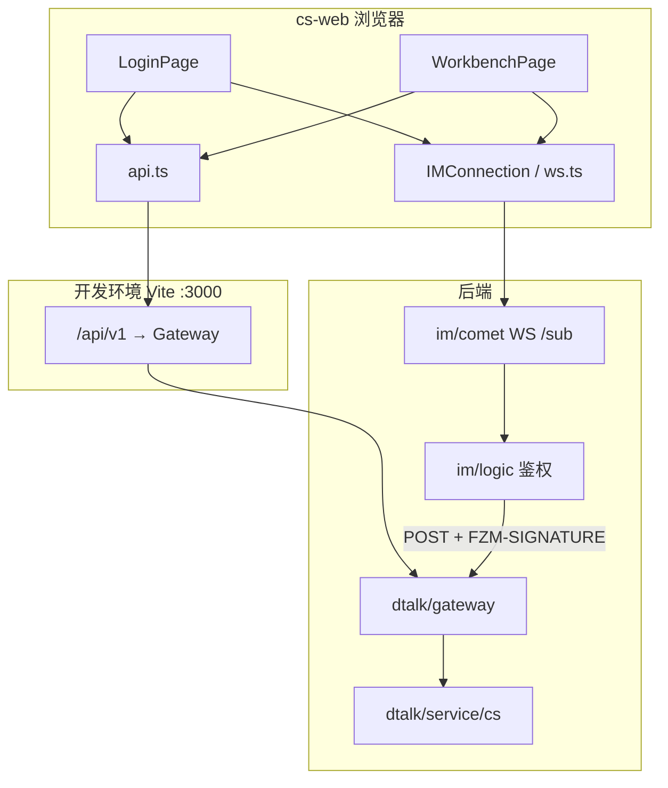
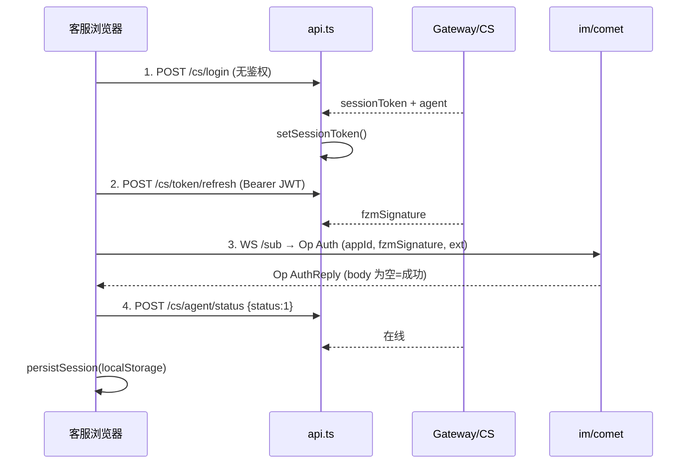
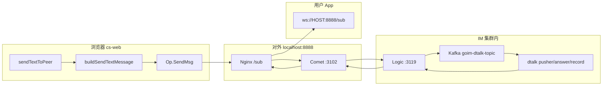

# cs-web 登录与鉴权说明

本文档说明客服 Web 工作台（`dtalk/service/web/cs-web`）如何连接服务端、完成登录，以及在运行期如何对 HTTP 与 WebSocket 请求进行鉴权。

---

## 1. 概述

cs-web 是 React + Vite 单页应用，客服通过**用户名 + 密码**登录。系统采用**双凭证**模型，职责分离：

| 凭证 | 用途 | 携带方式 | 签发方 |
|------|------|----------|--------|
| **Session Token（JWT）** | 调用 CS 业务 HTTP API（加解密、状态、链操作等） | `Authorization: Bearer <token>` | `dtalk/service/cs` |
| **FZM-SIGNATURE** | 连接 `im/comet` WebSocket、拉取需 FZM 的网关接口（如私聊历史） | Comet Auth 帧的 `token` 字段，或 HTTP 头 `FZM-SIGNATURE` | CS 服务用客服链上地址私钥代签 |

设计要点：

- 浏览器**不持有**客服私钥；FZM 由服务端根据 DB 中加密存储的私钥生成。
- CS 相关 HTTP 路由**不走**普通用户的 `AuthMiddleWare()`（FZM 中间件），而使用独立的 JWT Session 校验。
- 实时消息走 Comet WebSocket，与普通 App 用户相同，必须使用 FZM-SIGNATURE 通过 Logic 鉴权。

---

## 2. 架构与请求路径



### 2.1 开发环境 HTTP 代理

`vite.config.ts` 将浏览器请求 `/api/v1/*` 代理到网关（默认 `http://localhost:8888`），并去掉前缀 `/api/v1`：

```text
浏览器:  POST http://localhost:3000/api/v1/cs/login
代理后:  POST http://<gateway>/cs/login
```

本地调试示例：

```bash
# 经网关（完整 CS + store 等）
GATEWAY_PROXY_TARGET=http://127.0.0.1:8888 npm run dev

# 仅本机 CS 服务（仅 /cs/*，不含 /store 等）
GATEWAY_PROXY_TARGET=http://127.0.0.1:18030 npm run dev
```

生产部署时，需由 Nginx/网关将 `/api/v1` 同样转发到 Gateway 或 CS 服务。

---

## 3. 登录流程（四步）

入口：`src/pages/LoginPage.tsx` → `handleLogin()`。  
应用启动时：`src/App.tsx` 先调用 `getSessionRestoreOutcome()` 尝试从 `localStorage` 恢复会话，失败则展示登录页。



### Step 1：CS 登录（用户名 + 密码）

- **前端**：`login(username, password)` → `POST /api/v1/cs/login`，`noAuth: true`，不携带 `Authorization`。
- **后端**：Gateway `LoginHandler` → CS `Login()`：按用户名查 `cs_agent`，`bcrypt` 校验密码，签发 **HS256 JWT**（默认有效期 **24 小时**，`issuer: cs-service`，claims 含 `agentId`、`username`）。
- **前端处理**：`setSessionToken(resp.sessionToken)`，内存变量供后续 `request()` 使用；同时得到 `agent`（`agentId` 为链上地址）及 `cometReceiveAckDelayMillis`。

### Step 2：获取 FZM-SIGNATURE

- **前端**：`refreshFZMToken()` → `POST /api/v1/cs/token/refresh`，请求头 `Authorization: Bearer <sessionToken>`。
- **后端**：校验 JWT → 读取客服公钥/加密私钥 → 解密私钥 → `auth.ApiAuthenticator.Request(appId, pubKey, privKey)` 生成 FZM；生成后会做自验证，确保与 Gateway `AuthMiddleWare` 逻辑一致。
- **说明**：FZM 有效期较短（实现总结文档为约 **120 秒**），Comet 重连前会再次调用 `refreshFZMToken()`（见 `IMConnection.setRefreshTokenHandler`）。

### Step 3：连接 Comet WebSocket

- **URL**：`{cometUrl}` 将 `http` 替换为 `ws` 后拼接 `/sub`，例如 `ws://host:8888/sub`。
- **认证帧**：`Op.Auth`，body 为 protobuf 编码的 `AuthMsg`：
  - `appId`：登录页可配置，默认 `dtalk`
  - `token`：Step 2 的 `fzmSignature`（**不是** JWT）
  - `ext`：`encodeLoginExt(uuid, deviceName)`，对应 `imparse.auth.Login`（设备类型 Web=5、UUID、设备名等）
- **成功**：收到 `Op.AuthReply` 且 **body 为空**；body 非空表示失败（错误文本在 body 中）。
- **连接后**：30s 心跳（`Op.Heartbeat` / `HeartbeatReply`），断线指数退避重连，重连前刷新 FZM。

Comet 侧会调用 Logic，Logic 再以 `FZM-SIGNATURE` 等头请求 Gateway 完成与用户登录相同的验签流程（`im/logic/auth/dtalk/auth.go`）。

### Step 4：更新客服在线状态

- **前端**：`updateAgentStatus(1)` → `POST /api/v1/cs/agent/status`，body `{ "status": 1 }`。
- **作用**：DB 中客服状态为在线；若跳过或失败，服务端可能仍按「离线」走离线 AI 代答（恢复会话时也会重试 3 次）。

最后调用 `persistSession()` 写入 `localStorage`（key：`cs_web_session_v1`），**不保存密码**。

---

## 4. 会话恢复（刷新页面）

`src/lib/sessionPersistence.ts`：

1. `loadPersistedSession()` 读取本地 JSON，校验 `version`、`sessionToken`、`connectParams`、`agent` 等字段。
2. `restorePersistedCometSession()`：`setSessionToken` → `refreshFZMToken()` → 用**同一 deviceUUID** 重建 Comet 连接 → `updateAgentStatus(1)`（带重试）。
3. `App.tsx` 通过单例 Promise 避免 React Strict Mode 双次挂载产生两条 WebSocket。

恢复失败会 `clearPersistedSession()` 并回到登录页。

---

## 5. 鉴权机制详解

### 5.1 HTTP：统一封装 `api.ts`

```typescript
// 默认：Bearer sessionToken
headers['Authorization'] = `Bearer ${sessionToken}`;

// 登录接口：noAuth
request('/cs/login', body, { noAuth: true });

// 私聊历史等：使用 FZM 头（与 App 一致）
request('/store/app/pri-chat-record', body, { useFZM: fzmToken });
```

网关响应格式：

```json
{
  "result": 0,
  "message": "",
  "data": { }
}
```

`result !== 0` 时前端抛出 `message` 或默认错误。

### 5.2 HTTP：CS 路由鉴权（服务端）

Gateway `/cs/*` **不挂** `api.AuthMiddleWare()`，各 Handler 自行从 `Authorization` 取 Bearer，转发给 CS 微服务；CS 直连时由 `SessionAuthMiddleware` 解析 JWT 并注入 `agent_id`。

需 Session 的接口（节选）：

| 路径 | 说明 |
|------|------|
| `/cs/token/refresh` | 生成 FZM-SIGNATURE |
| `/cs/agent/info` | 当前客服信息 |
| `/cs/agent/status` | 更新在线/离线/忙碌 |
| `/cs/encrypt`、`/cs/decrypt` | 消息加解密 |
| `/cs/chain/ping`、`/cs/chain/bind-comet` | 链相关 |

公开接口：

| 路径 | 说明 |
|------|------|
| `/cs/login` | 登录 |
| `/cs/agents` | 客服列表（含状态） |

### 5.3 HTTP：FZM 鉴权（历史消息等）

`/store/app/pri-chat-record` 等路由使用 `AuthMiddleWare()`，请求头需：

- `FZM-SIGNATURE`：客服地址对应的签名 token  
- 可选：`FZM-UUID`、`FZM-DEVICE`、`FZM-DEVICE-NAME`（Comet 鉴权时由 ext 解析后转发）

cs-web 当前工作台主流程以 Comet 实时消息为主；若集成历史记录，需先 `refreshFZMToken()` 再带 `useFZM` 调用。

### 5.4 WebSocket：Comet 二进制协议

定义见 `src/lib/protocol.ts`：

- 帧头 20 字节 + body；`Op.Auth = 1`，`Op.AuthReply = 2`。
- 认证成功后发送业务消息：`Op.SendMsg = 7`，收消息 `Op.ReceiveMsg = 9`，应答 `Op.ReceiveMsgReply = 10`。
- `cometReceiveAckDelayMillis`：收到 `ReceiveMsg` 后延迟再 `sendAck`，减轻未读状态不同步（默认 280ms，以登录/配置为准）。

---

## 6. 下线（登出）

`WorkbenchPage.handleLogout()`：

1. `updateAgentStatus(0)` — 标记离线（失败仍继续清理）。
2. `clearPersistedSession()` — 删除 `localStorage` 会话。
3. `connectionStore.connection.disconnect()` — 关闭 WebSocket，停止自动重连。
4. 清空 `connectionStore`，回调 `onLogout()` 回到 `LoginPage`。

注意：下线**不会**调用服务端「注销 JWT」接口；JWT 在过期前仍可用于 API，但本地已清除 token，且 Comet 已断开。

---

## 7. 关键源码索引

| 模块 | 路径 | 职责 |
|------|------|------|
| 登录页 | `src/pages/LoginPage.tsx` | 四步登录、步骤 UI |
| HTTP 客户端 | `src/lib/api.ts` | Bearer / FZM / 网关 JSON 解析 |
| WebSocket | `src/lib/ws.ts` | 连接、Auth、心跳、重连、刷新 FZM |
| 会话持久化 | `src/lib/sessionPersistence.ts` | localStorage 读写与恢复 |
| 全局状态 | `src/store.ts` | `connectionStore`、`LoginResult` |
| 应用路由 | `src/App.tsx` | 恢复会话 vs 登录页 |
| 工作台 | `src/pages/WorkbenchPage.tsx` | 消息、下线、链工具 |
| 开发代理 | `vite.config.ts` | `/api` → Gateway |
| CS 登录实现 | `dtalk/service/cs/service/service.go` | `Login`、`ValidateSession`、`GenerateFZMSignature` |
| CS HTTP 路由 | `dtalk/service/cs/server/http/http.go` | 公开/需 Session 分组 |
| Gateway CS 路由 | `dtalk/gateway/.../handler/routes.go` | `/cs/*` 转发 CS 微服务 |

---

## 8. HTTP API 参考（客服认证相关）

### 8.1 通用说明

| 项 | 说明 |
|----|------|
| 协议 | HTTPS（生产）/ HTTP（本地开发） |
| 基础 URL | 浏览器侧统一为 `/api/v1`；经 Vite 代理后网关路径无 `/api/v1` 前缀 |
| 方法 | 均为 **POST** |
| Content-Type | `application/json` |
| CS 业务认证 | `Authorization: Bearer <sessionToken>`（JWT，24h） |
| IM/存储类认证 | `FZM-SIGNATURE: <token>`（短效，由 `/cs/token/refresh` 获取） |
| 响应封装 | `{ "result": number, "message": string, "data": object }`，`result === 0` 为成功 |

### 8.2 错误处理

| result / 场景 | 含义 | 前端表现 |
|---------------|------|----------|
| `result !== 0` | 业务错误 | `api.ts` 抛出 `Error(message)` |
| HTTP 非 JSON / 空体 | 代理或网关异常 | 解析失败并附带 URL、状态码 |
| 缺少 Session | Gateway/CS 返回签名类错误码 | 提示 missing session token |
| JWT 过期/无效 | `ValidateSession` 失败 | 需重新登录 |
| Comet AuthReply body 非空 | Logic/Gateway 拒绝 FZM 或设备冲突等 | 登录 Step 3 失败，body 文本为原因 |

常见 `xerror` 语义（与网关一致）：参数错误、签名无效、签名过期、内部错误等，具体以 `message` 字段为准。

---

### 8.3 POST `/cs/login`（公开）

**请求参数**

| 参数 | 类型 | 必填 | 说明 |
|------|------|------|------|
| username | string | 是 | 客服账号 |
| password | string | 是 | 密码 |

**响应参数（data）**

| 参数 | 类型 | 说明 |
|------|------|------|
| sessionToken | string | JWT Session Token |
| agent | object | `agentId`、`name`、`avatar`、`status` |
| cometReceiveAckDelayMillis | number | ReceiveMsg 后延迟 Ack（ms） |

**示例请求**

```http
POST /api/v1/cs/login
Content-Type: application/json

{
  "username": "cs01",
  "password": "your-password"
}
```

**示例响应**

```json
{
  "result": 0,
  "message": "",
  "data": {
    "sessionToken": "eyJhbGciOiJIUzI1NiIs...",
    "agent": {
      "agentId": "1FKxgaEh5fuSm7a35BfUnKYAmradowpiTR",
      "name": "客服小张",
      "avatar": "",
      "status": 0
    },
    "cometReceiveAckDelayMillis": 280
  }
}
```

---

### 8.4 POST `/cs/token/refresh`（需 Session）

**请求头**

```http
Authorization: Bearer <sessionToken>
```

**请求体**：无或 `{}`

**响应参数（data）**

| 参数 | 类型 | 说明 |
|------|------|------|
| fzmSignature | string | 用于 Comet Auth 与 FZM HTTP 头 |

**示例响应**

```json
{
  "result": 0,
  "data": {
    "fzmSignature": "Base64OrEncodedSignatureString..."
  }
}
```

---

### 8.5 POST `/cs/agent/status`（需 Session）

**请求参数**

| 参数 | 类型 | 必填 | 说明 |
|------|------|------|------|
| status | int | 是 | `0` 离线，`1` 在线，`2` 忙碌 |

**示例请求**

```json
{ "status": 1 }
```

**示例响应**

```json
{
  "result": 0,
  "data": { "status": 1 }
}
```

---

### 8.6 POST `/cs/agent/info`（需 Session）

用于恢复会话时补全 `cometReceiveAckDelayMillis` 等。

**响应 data**

| 参数 | 类型 | 说明 |
|------|------|------|
| agent | object | 当前客服公开信息 |
| cometReceiveAckDelayMillis | number | Ack 延迟配置 |

---

## 9. WebSocket 连接参数（登录页可配）

| 字段 | 默认值 | 说明 |
|------|--------|------|
| Comet 地址 | `ws://localhost:8888` | Comet 根地址（自动加 `/sub`） |
| AppId | `dtalk` | AuthMsg.appId |
| 区块链 RPC | 可本地存储 | 链绑定/探测，不参与 Comet 鉴权 |
| 用户名/密码 | — | 仅用于 Step 1 |

---

## 10. 安全与运维注意

1. **私钥仅在服务端**：CS DB `private_key_enc` 可 AES-GCM 加密；前端永不接触。
2. **JWT 仅存内存 + localStorage**：同源脚本可读取，生产应使用 HTTPS 并控制 XSS。
3. **FZM 短效**：Comet 重连必须刷新；`IMConnection` 已在重连回调中处理。
4. **agentId 即链上地址**：FZM 验签得到的 `uid` 必须与 `agentId` 一致，否则 Comet 上 mid 错误、消息路由异常（CS 服务生成时会自验证）。
5. **双通道一致性**：HTTP 用 JWT、实时用 FZM；任一步失败都会导致「能调 API 但收不到消息」或相反，登录页四步状态面板用于排查。

---

## 11. 相关文档

- 后端实现总结：`dtalk/service/cs/CS_IMPLEMENTATION_SUMMARY.md`
- 用户 App 登录与聊天（FZM + Comet）：`doc/USER_LOGIN_AND_CHAT_FLOW.md`（若仓库根目录存在）
- 部署拓扑与 Nginx 路由：`doc/部署文档.md`

---

## 12. 参与组件与端口（cs + cs-web + IM）

地址分两类：

- **对外（浏览器可访问）**：代码/配置默认示例，如 `localhost:8888`、`localhost:8901`
- **集群内（浏览器不直连）**：如 `gateway:19000`、`cs:18030`、`comet:3102`、`logic:3119`

| 组件 | 典型对外地址 | 集群内监听 | 协议 | 作用 |
|------|-------------|-----------|------|------|
| **cs-web** | `http://<本机>:3000`（Vite dev） | — | HTTP | 客服前端 |
| **Nginx** | `http://localhost:8888` | — | HTTP/WS | 统一入口 |
| **Gateway** | 经 Nginx `/` → `gateway:19000` | `0.0.0.0:19000` | HTTP | API、`/user/login` 验 FZM |
| **CS 客服服务** | 经 Gateway 转发 | `0.0.0.0:18030` | HTTP | `/cs/*`、JWT、代签 FZM、加解密 |
| **Comet** | `ws://localhost:8888/sub` | WS `:3102` | WebSocket | 长连接、收发 IM 帧 |
| **Logic** | 不对外 | gRPC `:3119` | gRPC | 连接映射、消息路由、回调 Gateway 鉴权 |
| **MySQL** | — | 见 `cs.toml`（如 `127.0.0.1:3306`） | TCP | `cs_agent` 等 |
| **链 RPC** | `http://localhost:8901`（登录页可改） | — | HTTP | 链绑定/探测（非 IM 必需） |

Nginx 路由（`doc/部署文档.md` → `dtalk/script/nginx/conf.d/dtalk.conf`）：

| 路径 | 上游 | 说明 |
|------|------|------|
| `/` | gateway:19000 | HTTP API（含 `/cs/*`） |
| `/sub`、`/sub/` | comet:3102 | WebSocket 长连接 |

Gateway 转发 CS：`gateway.toml` → `CSServiceURL = "http://127.0.0.1:18030"`（Gateway 所在机器访问 CS）。

Logic 验 FZM：`im/logic/conf/logic.toml` → `authUrl = "http://txchat-gateway-node1:19000/user/login"`（**集群内 HTTP**，非浏览器直连）。

### 12.1 Comet 地址与 `/sub`

登录页默认填 **`ws://localhost:8888`**（Comet **根地址**）。`IMConnection` 会自动拼接：

```text
实际连接 URL = cometUrl.replace(/^http/, 'ws') + '/sub'
             → ws://localhost:8888/sub
```

- **不要**在登录页再手写 `/sub`，否则会变成 `…/sub/sub`。
- Comet 握手要求 `RequestURI == "/sub"`（`im/comet/ws.go`），否则连接被拒绝。

---

## 13. 完整登录流程（逐步 URL）

### 13.1 阶段 A：打开页面 / 恢复会话

| 步 | 谁 → 谁 | URL / 连接 | 说明 |
|----|---------|------------|------|
| A0 | 浏览器加载前端 | `http://<运行 cs-web 的机器>:3000/` | Vite 默认 `port: 3000`；生产可为 Nginx 静态资源 |
| A1（可选） | 读本地 | `localStorage` → `cs_web_session_v1` | 有缓存则 `getSessionRestoreOutcome()`，见 [§13.6](#136-刷新页面恢复无密码) |

### 13.2 阶段 B：HTTP — CS 账号登录（JWT）

| 步 | 浏览器请求 URL（开发环境） | 代理/转发后 | 最终服务 |
|----|---------------------------|-------------|----------|
| **B1** | `POST http://127.0.0.1:3000/api/v1/cs/login` | Vite → `GATEWAY_PROXY_TARGET`（默认 `http://localhost:8888/cs/login`） | — |
| **B2** | — | `http://localhost:8888/cs/login` | Nginx `/` → **Gateway :19000** |
| **B3** | — | 集群内 `http://127.0.0.1:18030/cs/login` | **CS** 查 MySQL、`bcrypt`、签发 JWT |
| **B4** | 响应 `sessionToken` + `agent` + `cometReceiveAckDelayMillis` | — | 前端 `setSessionToken()` |

请求体：`{ "username", "password" }`，无 `Authorization`。

仅本机 CS、不经网关时：

```bash
GATEWAY_PROXY_TARGET=http://127.0.0.1:18030 npm run dev
# B1 仍走 localhost:3000/api/v1/cs/login → 127.0.0.1:18030/cs/login
```

### 13.3 阶段 C：HTTP — 换取 FZM-SIGNATURE

| 步 | 浏览器 URL | 转发链 | 说明 |
|----|------------|--------|------|
| **C1** | `POST http://127.0.0.1:3000/api/v1/cs/token/refresh` | → `http://localhost:8888/cs/token/refresh` → CS `:18030` | 头：`Authorization: Bearer <JWT>` |
| **C2** | CS 用 DB 私钥代签 | — | 返回 `fzmSignature`（约 120s 有效） |

### 13.4 阶段 D：WebSocket — 登录 IM（Comet 认证）

| 步 | URL / 连接 | 说明 |
|----|------------|------|
| **D1** | 浏览器 → **`ws://localhost:8888/sub`** | `Op.Auth`；`token`=fzmSignature，`appId`=dtalk，`ext`=设备 protobuf |
| **D2** | Nginx `/sub` → **comet:3102** | WebSocket 升级 |
| **D3** | Comet → **Logic gRPC :3119** `Connect` | 内网 |
| **D4** | Logic → **`POST http://<gateway>:19000/user/login`** | 头 `FZM-SIGNATURE`、 `FZM-UUID` 等（与 App 相同） |
| **D5** | Gateway `AuthMiddleWare()` 验签 | `uid` = 客服 `agentId` |
| **D6** | Logic 写 Redis 连接映射 | `mid` = agentId |
| **D7** | Comet → 浏览器 `Op.AuthReply`（body 空） | 状态 `connected` |

重连：先 C 步刷新 FZM，再 D1 连 `/sub`（`ws.ts` → `setRefreshTokenHandler`）。

### 13.5 阶段 E：标在线 + 持久化

| 步 | URL | 服务 |
|----|-----|------|
| **E1** | `POST …/api/v1/cs/agent/status` body `{ "status": 1 }` | Gateway → CS `:18030` |
| **E2** | `localStorage` `cs_web_session_v1` | 不含密码 |
| **E3** | 进入 `WorkbenchPage` | 再次 `status=1`；可选 `POST …/cs/register-pubkey` |

### 13.6 刷新页面恢复（无密码）

| 步 | URL / 连接 |
|----|------------|
| F1 | 读 `localStorage` |
| F2 | `POST …/api/v1/cs/token/refresh`（Bearer 旧 JWT） |
| F3 | `ws://localhost:8888/sub`（**同一 deviceUUID**） |
| F4 | `POST …/cs/agent/status` status=1（最多重试 3 次） |

### 13.7 登录时序（含 IP/端口）

```mermaid
sequenceDiagram
  participant B as 浏览器 cs-web
  participant V as Vite :3000
  participant N as Nginx localhost:8888
  participant G as Gateway :19000
  participant CS as CS :18030
  participant C as Comet :3102
  participant L as Logic :3119

  B->>V: POST /api/v1/cs/login
  V->>N: POST /cs/login
  N->>G: /cs/login
  G->>CS: HTTP 18030/cs/login
  CS-->>B: JWT + agent

  B->>V: POST /api/v1/cs/token/refresh Bearer JWT
  V->>N->>G->>CS: /cs/token/refresh
  CS-->>B: fzmSignature

  B->>N: WS ws://localhost:8888/sub Op.Auth
  N->>C: WS :3102/sub
  C->>L: gRPC Connect
  L->>G: POST :19000/user/login FZM-SIGNATURE
  G-->>L: address=agentId
  L-->>C: key,mid
  C-->>B: AuthReply OK

  B->>V: POST /api/v1/cs/agent/status status=1
  V->>N->>G->>CS: 标在线
```

---

## 14. 发送与接收消息流程（逐步 URL）

前提：Comet 已 `connected`；`agentId` = 客服链上地址；`activeUserId` = 用户链上地址。

### 14.1 用户如何出现在会话列表

- App 用户将**客服地址**加好友后发私聊；
- cs-web **不主动拉会话列表**；首条 `ReceiveMsg` 的 `from` 即新会话；
- 本地按 `agentId` 存 `localStorage`（`chatPersistence`）。

### 14.2 客服发送消息

| 步 | 位置 | URL / 连接 | 说明 |
|----|------|------------|------|
| **S1** | 浏览器 UI | — | `handleSend()` → `sendTextToPeer(peer, text)` |
| **S2** | 浏览器内存 | — | `buildSendTextMessage()`：`Common(ToUser)` + `TextMsg`（当前主路径**明文**，未调 `/cs/encrypt`） |
| **S3** | 浏览器 → Comet | **`ws://localhost:8888/sub`** | `Op.SendMsg`，body = 业务 protobuf |
| **S4** | Nginx → Comet | `:3102` | `Operate` → `Receive` |
| **S5** | Comet → Logic | gRPC `:3119` `Receive` | 上行进入 IM |
| **S6** | Logic → Kafka | `goim-dtalk-topic` | 与 App 上行一致 |
| **S7** | dtalk | pusher / answer / record 等 | 落库、路由 |
| **S8** | 用户设备 | 用户 `ws://<HOST>:8888/sub` | `Op.ReceiveMsg` 推到 App |
| **S9** | 客服本端 | 同上 WS | 乐观更新 UI；异步 `Op.SendMsgReply`（含 `mid`，多仅日志） |

AI 自动回复同样调用 `sendTextToPeer()`，内容来自 DeepSeek（`POST …/deepseek-proxy/…` → `api.deepseek.com`，与 IM 无关）。

### 14.3 客服接收用户消息

| 步 | URL / 连接 | 说明 |
|----|------------|------|
| **R1** | **`ws://localhost:8888/sub`** `Op.ReceiveMsg` | Comet 下行 |
| **R2** | 若密文 | `POST http://127.0.0.1:3000/api/v1/cs/decrypt` → `…8888/cs/decrypt` → CS `:18030`（Bearer JWT） |
| **R3** | 同上 WS | 延迟 `cometReceiveAckDelayMillis`（默认 280ms）后 `Op.ReceiveMsgReply` |
| **R4** | — | 更新未读；可选触发 AI `scheduleAiAutoReply` |

### 14.4 发送/接收总览



### 14.5 下线

| 步 | URL / 连接 |
|----|------------|
| L1 | `POST …/api/v1/cs/agent/status` `{ "status": 0 }` |
| L2 | 清除 `localStorage`，`disconnect()` WebSocket |

---

## 15. 双通道对照（HTTP vs 实时 IM）

| 能力 | 凭证 | 浏览器侧 URL 示例 | 后端 |
|------|------|-------------------|------|
| CS 登录、上下线、加解密、链 | **JWT** | `http://127.0.0.1:3000/api/v1/cs/*` → `http://localhost:8888/cs/*` | CS `:18030` |
| 实时聊天 | **FZM-SIGNATURE** | **`ws://localhost:8888/sub`** | Comet → Logic → Gateway `/user/login`（内网验签） |
| 私聊历史（若调用） | **FZM** | `POST …/api/v1/store/app/pri-chat-record` + 头 `FZM-SIGNATURE` | Gateway + store |
| AI 自动回复（可选） | DeepSeek API Key | `POST …/deepseek-proxy/v1/…` | Vite → `api.deepseek.com` |

只完成 HTTP 登录、未连上 Comet：**能调 `/cs/*`，但无法收发聊天消息**。

---

## 16. 端到端 URL 矩阵（默认配置）

开发环境：Vite `localhost:3000`，代理目标 `localhost:8888`。本地调试时将 IP 换为 `127.0.0.1` 即可。

| 序号 | 动作 | 方法 | 浏览器/客户端 URL | 落点服务 |
|------|------|------|-------------------|----------|
| 1 | 打开工作台 | GET | `http://127.0.0.1:3000/` | cs-web |
| 2 | CS 登录 | POST | `http://127.0.0.1:3000/api/v1/cs/login` → `http://localhost:8888/cs/login` | CS `:18030` |
| 3 | 换 FZM | POST | `…/api/v1/cs/token/refresh` → `…/cs/token/refresh` | CS `:18030` |
| 4 | 登录 IM | **WS** | **`ws://localhost:8888/sub`** | Comet `:3102`；鉴权 Logic→Gateway `:19000` |
| 5 | 标在线 | POST | `…/api/v1/cs/agent/status` → `…/cs/agent/status` | CS `:18030` |
| 6 | 用户发私聊 | WS | 用户 `ws://localhost:8888/sub` | 同上 IM 链路 |
| 7 | 客服收消息 | WS | 客服 `ws://localhost:8888/sub` `ReceiveMsg` | Comet → 浏览器 |
| 8 | 解密（如需） | POST | `…/api/v1/cs/decrypt` | CS `:18030` |
| 9 | 客服发消息 | WS | `ws://localhost:8888/sub` `SendMsg` | Comet→Logic→Kafka→…→用户 |
| 10 | 链探测（可选） | POST | `…/api/v1/cs/chain/ping` | CS → 用户配置的 RPC（默认 `localhost:8901`） |
| 11 | 下线 | POST + WS | `…/cs/agent/status` status=0 + 断开 WS | CS + Comet |

---

*文档基于 cs-web、dtalk/service/cs、gateway、im/comet、im/logic 源码及 `doc/部署文档.md` 整理，如有接口变更请以代码为准。*
